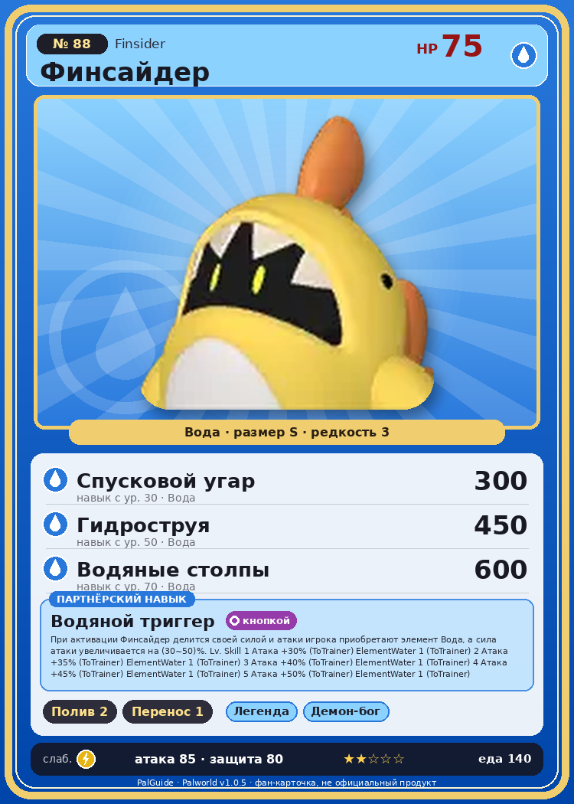

# #88 Финсайдер (Finsider)

{ width=360 }

| Поле | Значение |
|---|---|
| Стихия | Вода |
| Слабость (кто бьёт сильнее) | Молния |
| Редкость | 3 |
| Размер | S |
| HP / Атака / Защита (база вида) | 75 / 85 / 80 |
| Сколько ест | 140 |
| Цена продажи | 677 |
| Множитель поимки | ×1 |
| Скорость рывка верхом | 400 |

## Работа на базе
- Полив — ур. 2
- Транспортировка — ур. 1

## Партнёрский навык: Водяной триггер
При активации Финсайдер делится своей силой и атаки игрока приобретают элемент Вода , а сила атаки увеличивается на (30~50)% . Lv. Skill 1 Атака +30% (ToTrainer) ElementWater 1 (ToTrainer) 2 Атака +35% (ToTrainer) ElementWater 1 (ToTrainer) 3 Атака +40% (ToTrainer) ElementWater 1 (ToTrainer) 4 Атака +45% (ToTrainer) ElementWater 1 (ToTrainer) 5 Атака +50% (ToTrainer) ElementWater 1 (ToTrainer)

## Атаки по уровням
- ур. 1: Водяной выстрел (Вода, сила 50)
- ур. 7: Пузырьковый выстрел (Вода, сила 80)
- ур. 15: Силовая бомба (Нейтральный, сила 120)
- ур. 22: Гидроатака под давлением (Вода, сила 250)
- ур. 30: Спусковой угар (Вода, сила 300)
- ур. 40: Водяная стена (Вода, сила 300)
- ур. 50: Гидроструя (Вода, сила 450)
- ур. 70: Водяные столпы (Вода, сила 600)

## Где водится
- В дикой природе: да; точек появления днём: 671, ночью: 671
- Яйцо: Яйцо воды

## Дроп
- Кожа — 1 шт., 100%
- Маленькая душа Пала — 1 шт., 1%
- Жидкость водного Пала — 1–2 шт., 100%

**Дроп альфы:**
- Деталь древней цивилизации — 2–3 шт., 100%
- Ценные внутренности — 2–3 шт., 100%

## Разведение
- Ранг разведения (CombiRank): 2450
- Участвует в особых парах: Гобфин Игнис → Финсайдер Игнис

## Лучшие пассивки по роли
- боец: Легенда, Демон-бог, Хладнокровный, Бессмертие, Владыка морей (вместо Бессмертия, если нет мутации)
- ездовой: Божественная скорость, Легенда, Вечный двигатель, Небесное скольжение

## Чем хорош / чем плох
- ✅ можно оседлать
- ❌ явных минусов нет

> Выглядит так, будто из кигуруми кто-то выглядывает. Но если сунуть руку внутрь — там пусто. Причём руку можно засовывать бесконечно глубоко. Иногда кажется, что внутри — целая вселенная.

См. также: [Стихии](../../2_mehaniki/stihii.md) · [Разведение](../../2_mehaniki/razvedenie.md) · [Все палы](README.md)
_Источник: paldb.cc v1.0.5_
