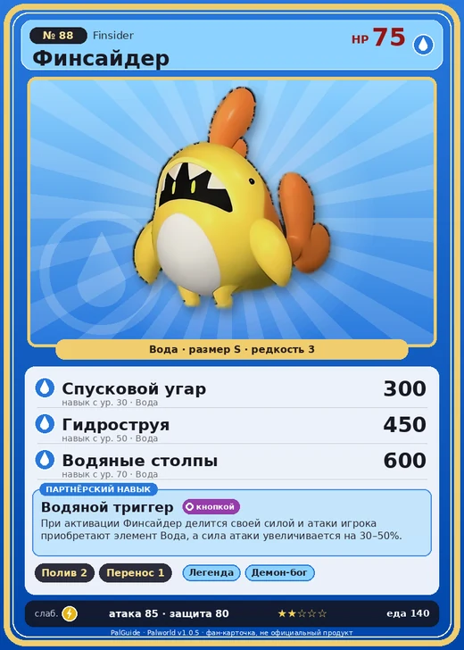

# Финсайдер

<canvas id="fx"></canvas>

№ 88

Вода

Слабость: Молния <b class="mx">×1,5</b> <button class="hlp" data-tip="Множители перемножаются по обеим стихиям: ×1,5 за стихию, которую атака бьёт, ×0,65 за ту, что её держит.">?</button>

Устойчив: Огонь <b class="mx">×0,65</b>

💧 Полив <b>2</b>📦 Транспортировка <b>1</b>

<b>Водяной триггер</b> 🔘 Включается кнопкой

❤️ 75 · ⚔️ 85 · 🛡 80

Основное

💎Редкость <button class="hlp" data-tip="Чем выше число, тем реже встречается пал. 1–4 — обычные, 5–7 — редкие, 8+ — легендарные.">?</button><b>3</b>

📏Размер<b>S</b>

💰Цена продажи <button class="hlp" data-tip="Сколько золота даст торговец за пала.">?</button><b>677</b>

Бой

🎯Множитель поимки <button class="hlp" data-tip="Насколько легче или труднее поймать: ×1 — обычно, меньше — сложнее.">?</button><b>×1</b>

🐎Скорость рывка верхом <button class="hlp" data-tip="Скорость, если сесть на пала и бежать рывком.">?</button><b>400</b>

Ферма и еда

🍖Сколько ест <button class="hlp" data-tip="Сколько сытости пал тратит — чем больше, тем больше еды нужно на базе.">?</button><b>140</b>

Разведение

🧬Сила разведения <button class="hlp" data-tip="Скрытое число игры: у детёныша оно примерно среднее от родителей. Чем меньше — тем «сильнее» пал.">?</button><b>2450</b>

=== "Обзор"

    #### Работа на базе

    
<a class="wbar" href="../../../2_mehaniki/rabota/?w=watering&lv=2">💧 Полив<i style="--v:20%"></i><b>2</b></a><a class="wbar" href="../../../2_mehaniki/rabota/?w=transporting&lv=1">📦 Транспортировка<i style="--v:10%"></i><b>1</b></a><a class="wb-more" href="../../../2_mehaniki/rabota/">Что значат уровни работы →</a>

    #### Партнёрский навык: Водяной триггер
    При активации Финсайдер делится своей силой и атаки игрока приобретают элемент Вода, а сила атаки увеличивается на 30–50%.

    #### Чем хорош / чем плох
    - ✅ хорошая атака (85)
    - ❌ явных минусов нет

    > Выглядит так, будто из кигуруми кто-то выглядывает. Но если сунуть руку внутрь — там пусто. Причём руку можно засовывать бесконечно глубоко. Иногда кажется, что внутри — целая вселенная.

    См. также: [Стихии](../../guide/06_stihii.md) · [Разведение](../../guide/07_razvedenie.md) · [Все палы](README.md)

=== "Атаки"

    #### Атаки по уровням
    - ур. 1: Водяной выстрел (Вода, сила 50)
    - ур. 7: Пузырьковый выстрел (Вода, сила 80)
    - ур. 15: Силовая бомба (Нейтральный, сила 120)
    - ур. 22: Гидроатака под давлением (Вода, сила 250)
    - ур. 30: Спусковой угар (Вода, сила 300)
    - ур. 40: Водяная стена (Вода, сила 300)
    - ур. 50: Гидроструя (Вода, сила 450)
    - ур. 70: Водяные столпы (Вода, сила 600)

=== "Где живёт"

    #### Где водится

    

<button data-k="d" class="on">☀️ День</button><button data-k="n">🌙 Ночь</button>

ур. 1–32<a class="btn hm-full" href="../../../map/?pal=StuffedShark">Показать на большой карте</a>

Иссохшие дюныШрамы войныОстров Огненных жилОстров вечного лета

🥚 Яйцо<b>Яйцо воды</b>

=== "Дроп"

    #### Дроп
    - Кожа — 1 шт., 100%
    - Маленькая душа Пала — 1 шт., 1%
    - Жидкость водного Пала — 1–2 шт., 100%

    **Дроп альфы:**

    - Деталь древней цивилизации — 2–3 шт., 100%
    - Ценные внутренности — 2–3 шт., 100%

=== "Разведение"

    #### Разведение
    - Ранг разведения: 2450
    - Участвует в особых парах: [Гобфин Игнис](gobfin_ignis.md) → [Финсайдер Игнис](finsider_ignis.md)

=== "Пассивки"

    #### Лучшие пассивки по роли

    

⚔️ Боец

максимум урона и живучести в бою

<a class="psv r-4" data-psv="Легенда" href="../../../passivki/legend/">Легенда</a><a class="psv r-4" data-psv="Демон-бог" href="../../../passivki/demon_god/">Демон-бог</a><a class="psv r-3" data-psv="Владыка морей" href="../../../passivki/lord_of_the_sea/">Владыка морей</a><a class="psv r-3" data-psv="Хладнокровный" href="../../../passivki/serenity/">Хладнокровный</a>

    <small>Нажми на пассивку, чтобы узнать, что она даёт и где её взять.</small>

<a class="card-link" href="../mammorest_cryst/">← Мамморест Крист</a><a class="card-link" href="../finsider_ignis/">Финсайдер Игнис →</a>

