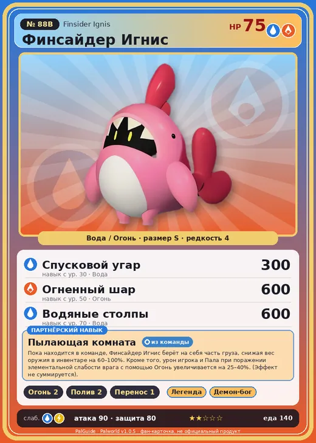

# #88B Финсайдер Игнис (Finsider Ignis)

№ 88B

ВодаОгонь

Слабость: ВодаМолния

🔥 Разжигание огня <b>2</b>💧 Полив <b>2</b>📦 Транспортировка <b>1</b>

<b>Пылающая комната</b> 🎒 из команды

❤️ 75 · ⚔️ 90 · 🛡 80

| Поле | Значение |
|---|---|
| Стихия | Вода, Огонь |
| Слабость (кто бьёт сильнее) | Вода, Молния |
| Редкость | 4 |
| Размер | S |
| HP / Атака / Защита (база вида) | 75 / 90 / 80 |
| Сколько ест | 140 |
| Цена продажи | 749 |
| Множитель поимки | ×1 |
| Скорость рывка верхом | 400 |

=== "Обзор"

    #### Работа на базе
    - Разжигание огня — ур. 2
    - Полив — ур. 2
    - Транспортировка — ур. 1

    #### Партнёрский навык: Пылающая комната
    Пока находится в команде, Финсайдер Игнис берёт на себя часть груза, снижая вес оружия в инвентаре на (60~100)% . Кроме того, урон игрока и Пала при поражении элементальной слабости врага с помощью Огонь увеличивается на (25~40)% . (Эффект не суммируется)

    #### Чем хорош / чем плох
    - ✅ можно оседлать
    - ❌ разводится только особой парой

    > Руку можно засовывать ему в пасть сколько угодно глубоко — внутри пусто. Один исследователь решил, что это, возможно, карманное измерение, и попытался целиком в него залезть, как в спальный мешок. Но Пала начало тошнить — видимо, это всё-таки его внутренности.

    См. также: [Стихии](../../guide/06_stihii.md) · [Разведение](../../guide/07_razvedenie.md) · [Все палы](README.md)

=== "Атаки"

    #### Атаки по уровням
    - ур. 1: Огненный выстрел (Огонь, сила 40)
    - ур. 7: Расщеплённый огонь (Огонь, сила 80)
    - ур. 15: Огненное дыхание (Огонь, сила 160)
    - ур. 22: Полоса брызг (Вода, сила 160)
    - ур. 30: Спусковой угар (Вода, сила 300)
    - ур. 40: Огненная воронка (Огонь, сила 300)
    - ур. 50: Огненный шар (Огонь, сила 600)
    - ур. 70: Водяные столпы (Вода, сила 600)

=== "Где живёт"

    #### Где водится
    - В дикой природе: да; точек появления днём: 414, ночью: 414
    - Яйцо: Яйцо воды

=== "Дроп"

    #### Дроп
    - Кожа — 1 шт., 100%
    - Маленькая душа Пала — 1 шт., 1%
    - Огненный орган — 1–3 шт., 100%

    **Дроп альфы:**
    - Деталь древней цивилизации — 3–4 шт., 100%
    - Ценные внутренности — 2–3 шт., 100%

=== "Разведение"

    #### Разведение
    - Ранг разведения (CombiRank): 2240
    - **Особая пара:** [Финсайдер](../../4_spravochniki/paly/finsider.md) + [Гобфин Игнис](../../4_spravochniki/paly/gobfin_ignis.md)

=== "Пассивки"

    #### Лучшие пассивки по роли
    - боец: Легенда, Демон-бог, Хладнокровный, Бессмертие, Владыка морей (вместо Бессмертия, если нет мутации)
    - ездовой: Божественная скорость, Легенда, Вечный двигатель, Небесное скольжение

<a class="card-link" href="../finsider/">← Финсайдер</a><a class="card-link" href="../petallia/">Петаллия →</a>

