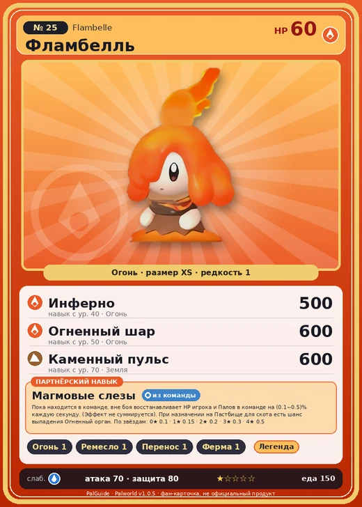

# Фламбелль

<canvas id="fx"></canvas>

№ 25 · Flambelle

Огонь

Слабость: Вода

🔥 Разжигание огня <b>1</b>🖐️ Ручная работа <b>1</b>📦 Транспортировка <b>1</b>🐑 Фермерство <b>1</b>

<b>Магмовые слезы</b> 🎒 из команды 🏠 на базе

❤️ 60 · ⚔️ 70 · 🛡 80

Основное

💎Редкость <button class="hlp" data-tip="Чем выше число, тем реже встречается пал. 1–4 — обычные, 5–7 — редкие, 8+ — легендарные.">?</button><b>1</b>

📏Размер<b>XS</b>

💰Цена продажи <button class="hlp" data-tip="Сколько золота даст торговец за пала.">?</button><b>436</b>

Бой

🎯Множитель поимки <button class="hlp" data-tip="Насколько легче или труднее поймать: ×1 — обычно, меньше — сложнее.">?</button><b>×1.1</b>

🐎Скорость рывка верхом <button class="hlp" data-tip="Скорость, если сесть на пала и бежать рывком.">?</button><b>375</b>

Ферма и еда

🍖Сколько ест <button class="hlp" data-tip="Сколько сытости пал тратит — чем больше, тем больше еды нужно на базе.">?</button><b>150</b>

Разведение

🧬Сила разведения <button class="hlp" data-tip="Скрытое число игры: у детёныша оно примерно среднее от родителей. Чем меньше — тем «сильнее» пал.">?</button><b>2700</b>

=== "Обзор"

    #### Работа на базе
    - Разжигание огня — ур. 1
    - Ручная работа — ур. 1
    - Транспортировка — ур. 1
    - Фермерство — ур. 1

    #### Партнёрский навык: Магмовые слезы
    Пока находится в команде, вне боя восстанавливает HP игрока и Палов в команде на (0.1~0.5)% каждую секунду. (Эффект не суммируется). При назначении на Пастбище для скота есть шанс выпадения Огненный орган. По звёздам: 0★ 0.1 · 1★ 0.15 · 2★ 0.2 · 3★ 0.3 · 4★ 0.5

    #### Чем хорош / чем плох
    - ✅
    - ❌ слабая атака (70); мало здоровья (60)

    > Когда этот Пал плачет, вместо слёз из его глаз течёт магма. Она снова впитывается в его тело — и становится всё горячее. Чем больше он плачет, тем сильнее становится.

    См. также: [Стихии](../../guide/06_stihii.md) · [Разведение](../../guide/07_razvedenie.md) · [Все палы](README.md)

=== "Атаки"

    #### Атаки по уровням
    - ур. 1: Огненный выстрел (Огонь, сила 40)
    - ур. 7: Расщеплённый огонь (Огонь, сила 80)
    - ур. 15: Огненная стрела (Огонь, сила 120)
    - ур. 22: Духовное пламя (Тьма, сила 200)
    - ур. 30: Огненный шторм (Огонь, сила 200)
    - ур. 40: Инферно (Огонь, сила 500)
    - ур. 50: Огненный шар (Огонь, сила 600)
    - ур. 70: Каменный пульс (Земля, сила 600)

=== "Где живёт"

    #### Где водится
    - В дикой природе: да; точек появления днём: 234, ночью: 234; уровни в первых точках: 4–6
    - Подземелья: Пещера Вулкана
    - Может продаваться у торговца/рекрутера
    - Яйцо: Раскалённое яйцо

=== "Дроп"

    #### Дроп
    - Огненный орган — 2–3 шт., 100%
    - Качественное масло Пала — 1 шт., 100%

    **Дроп альфы:**
    - Деталь древней цивилизации — 1–3 шт., 100%
    - Ценные внутренности — 1–3 шт., 100%

=== "Разведение"

    #### Разведение
    - Ранг разведения (CombiRank): 2700
    - Участвует в особых парах: Камоноске → Камоноске Игнис; Танзи → Танзи Игнис; Лизпанк → Лизпанк Игнис

=== "Пассивки"

    #### Лучшие пассивки по роли

    

⚔️ Боец

максимум урона и живучести в бою

<a class="psv r-4" data-psv="Легенда" href="../../../passivki/legend/">Легенда</a><a class="psv r-4" data-psv="Демон-бог" href="../../../passivki/demon_god/">Демон-бог</a><a class="psv r-3" data-psv="Император огня" href="../../../passivki/flame_emperor/">Император огня</a><a class="psv r-3" data-psv="Хладнокровный" href="../../../passivki/serenity/">Хладнокровный</a>

    <small>Нажми на пассивку, чтобы узнать, что она даёт и где её взять.</small>

<a class="card-link" href="../nox/">← Нокс</a><a class="card-link" href="../rooby/">Руби →</a>

