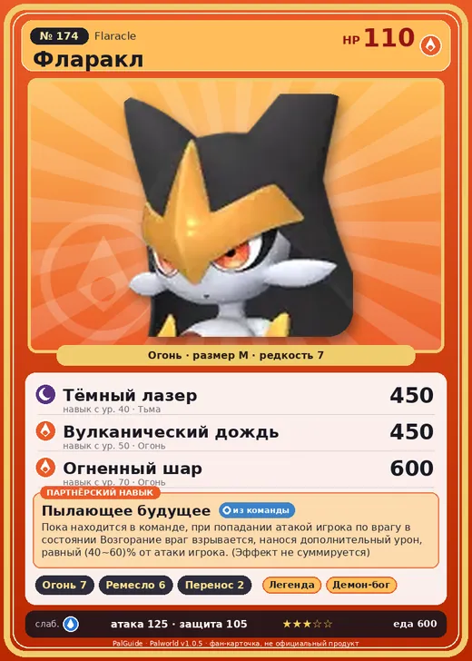

# #174 Фларакл (Flaracle)

№ 174

Огонь

Слабость: Вода

🔥 Разжигание огня <b>7</b>🖐️ Ручная работа <b>6</b>📦 Транспортировка <b>2</b>

<b>Пылающее будущее</b> 🎒 из команды

❤️ 110 · ⚔️ 125 · 🛡 105

| Поле | Значение |
|---|---|
| Стихия | Огонь |
| Слабость (кто бьёт сильнее) | Вода |
| Редкость | 7 |
| Размер | M |
| HP / Атака / Защита (база вида) | 110 / 125 / 105 |
| Сколько ест | 600 |
| Цена продажи | 3217 |
| Множитель поимки | ×1 |
| Скорость рывка верхом | 600 |

=== "Обзор"

    #### Работа на базе
    - Разжигание огня — ур. 7
    - Ручная работа — ур. 6
    - Транспортировка — ур. 2

    #### Партнёрский навык: Пылающее будущее
    Пока находится в команде, при попадании атакой игрока по врагу в состоянии Возгорание враг взрывается , нанося дополнительный урон, равный (40~60)% от атаки игрока. (Эффект не суммируется) level value 1 FoxExorcist_PlayerInflictEffect_PartnerSkill 40 2 FoxExorcist_PlayerInflictEffect_PartnerSkill 44 3 FoxExorcist_PlayerInflictEffect_PartnerSkill 48 4 FoxExorcist_PlayerInflictEffect_PartnerSkill 52 5 FoxExorcist_PlayerInflictEffect_PartnerSkill 60

    #### Чем хорош / чем плох
    - ✅ очень высокая атака (125); отличный рабочий (пригодность 7); можно оседлать
    - ❌ много ест (600)

    > Сосредотачивается и выискивает будущее в пламени. Если будущее не устраивает, повторяет, пока не выпадет лучшее. Поэтому будущее Фларакл всегда сияет!

    См. также: [Стихии](../../guide/06_stihii.md) · [Разведение](../../guide/07_razvedenie.md) · [Все палы](README.md)

=== "Атаки"

    #### Атаки по уровням
    - ур. 1: Огненный выстрел (Огонь, сила 40)
    - ур. 7: Огненная стрела (Огонь, сила 120)
    - ур. 15: Огненное дыхание (Огонь, сила 160)
    - ур. 22: Огненная стена (Огонь, сила 250)
    - ур. 30: Огненная воронка (Огонь, сила 300)
    - ур. 40: Тёмный лазер (Тьма, сила 450)
    - ур. 50: Вулканический дождь (Огонь, сила 450)
    - ур. 70: Огненный шар (Огонь, сила 600)

=== "Где живёт"

    #### Где водится
    - В дикой природе: да; точек появления днём: 1, ночью: 1
    - Яйцо: Большое раскалённое яйцо

=== "Дроп"

    #### Дроп
    - Кожа — 3–4 шт., 100%
    - Огненный орган — 3–4 шт., 100%

    **Дроп альфы:**
    - Деталь древней цивилизации — 7–9 шт., 100%
    - Ценный мех — 2–3 шт., 100%

=== "Разведение"

    #### Разведение
    - Ранг разведения (CombiRank): 390

=== "Пассивки"

    #### Лучшие пассивки по роли
    - боец: Легенда, Демон-бог, Хладнокровный, Бессмертие, Император огня (вместо Бессмертия, если нет мутации)
    - рабочий: Дьявольские руки, Виртуоз, Мастеровитый, Небожитель/Трудоголик
    - ездовой: Божественная скорость, Легенда, Вечный двигатель, Небесное скольжение

<a class="card-link" href="../tropicaw/">← Тропикау</a><a class="card-link" href="../ophydia/">Офидия →</a>

