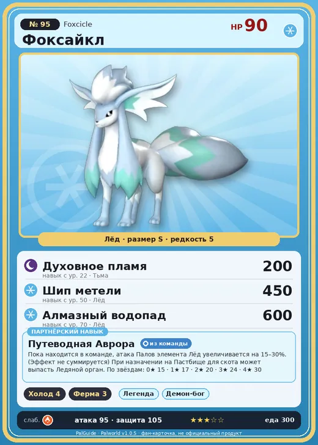

# #95 Фоксайкл (Foxcicle)

#95 · Foxcicle

Лёд

Слабость: Огонь

❄️ Охлаждение <b>4</b>🐑 Фермерство <b>3</b>

<b>Путеводная Аврора</b> 🎒 из команды 🏠 на базе

❤️ 90 · ⚔️ 95 · 🛡 105

| Поле | Значение |
|---|---|
| Стихия | Лёд |
| Слабость (кто бьёт сильнее) | Огонь |
| Редкость | 5 |
| Размер | S |
| HP / Атака / Защита (база вида) | 90 / 95 / 105 |
| Сколько ест | 300 |
| Цена продажи | 1543 |
| Множитель поимки | ×1 |
| Скорость рывка верхом | 750 |

## Работа на базе
- Охлаждение — ур. 4
- Фермерство — ур. 3

## Партнёрский навык: Путеводная Аврора
Пока находится в команде, атака Палов элемента Лёд увеличивается на (15~30)% . (Эффект не суммируется) При назначении на Пастбище для скота может выпасть Ледяной орган . level value 1 AttackUp_Ice_PartnerSkill 15 2 AttackUp_Ice_PartnerSkill 17 3 AttackUp_Ice_PartnerSkill 20 4 AttackUp_Ice_PartnerSkill 24 5 AttackUp_Ice_PartnerSkill 30

## Атаки по уровням
- ур. 1: Воздушная пушка (Нейтральный, сила 40)
- ур. 7: Ледяная ракета (Лёд, сила 40)
- ур. 15: Ледяной резак (Лёд, сила 80)
- ур. 22: Духовное пламя (Тьма, сила 200)
- ур. 30: Айсберг (Лёд, сила 120)
- ур. 40: Ледяное дыхание (Лёд, сила 160)
- ур. 50: Шип метели (Лёд, сила 450)
- ур. 70: Алмазный водопад (Лёд, сила 600)

## Где водится
- В дикой природе: да; точек появления днём: 188, ночью: 188; уровни в первых точках: 30–34
- Может продаваться у торговца/рекрутера
- Яйцо: Большое яйцо льда

## Дроп
- Кожа — 1 шт., 100%
- Ледяной орган — 2–3 шт., 100%

**Дроп альфы:**
- Деталь древней цивилизации — 6–8 шт., 100%
- Ценный мех — 6–8 шт., 100%

## Разведение
- Ранг разведения (CombiRank): 1970
- Участвует в особых парах: Фокспаркс → Фокспаркс Крист; Ванвирм → Ванвирм Крист; Райхаунд → Райхаунд Крист; Рептиро → Рептиро Крист

## Лучшие пассивки по роли
- по обзору: Легенда
- боец: Легенда, Демон-бог, Хладнокровный, Бессмертие, Император льда (вместо Бессмертия, если нет мутации)
- рабочий: Дьявольские руки, Виртуоз, Мастеровитый, Небожитель/Трудоголик
- ездовой: Божественная скорость, Легенда, Вечный двигатель, Небесное скольжение

## Чем хорош / чем плох
- ✅ +атака ледяных; ледяной орган; можно оседлать
- ❌ явных минусов нет

> В ночи, когда в небе мерцает северное сияние, они поднимают глаза к небу и поют красивым голосом. Увы, именно это пение привлекает к ним врагов.

См. также: [Стихии](../../guide/06_stihii.md) · [Разведение](../../guide/07_razvedenie.md) · [Все палы](README.md)
