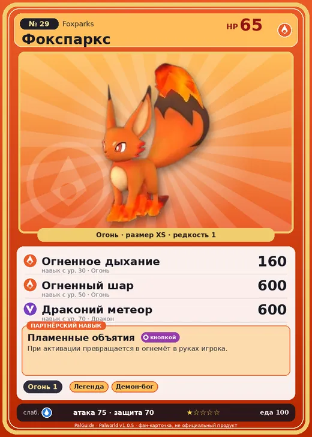

# Фокспаркс

<canvas id="fx"></canvas>

№ 29 · Foxparks

Огонь

Слабость: Вода

🔥 Разжигание огня <b>1</b>

<b>Пламенные объятия</b> 🔘 кнопкой

❤️ 65 · ⚔️ 75 · 🛡 70

Основное

💎Редкость <button class="hlp" data-tip="Чем выше число, тем реже встречается пал. 1–4 — обычные, 5–7 — редкие, 8+ — легендарные.">?</button><b>1</b>

📏Размер<b>XS</b>

💰Цена продажи <button class="hlp" data-tip="Сколько золота даст торговец за пала.">?</button><b>394</b>

Бой

🎯Множитель поимки <button class="hlp" data-tip="Насколько легче или труднее поймать: ×1 — обычно, меньше — сложнее.">?</button><b>×1.1</b>

🐎Скорость рывка верхом <button class="hlp" data-tip="Скорость, если сесть на пала и бежать рывком.">?</button><b>550</b>

Ферма и еда

🍖Сколько ест <button class="hlp" data-tip="Сколько сытости пал тратит — чем больше, тем больше еды нужно на базе.">?</button><b>100</b>

Разведение

🧬Сила разведения <button class="hlp" data-tip="Скрытое число игры: у детёныша оно примерно среднее от родителей. Чем меньше — тем «сильнее» пал.">?</button><b>2990</b>

=== "Обзор"

    #### Работа на базе
    - Разжигание огня — ур. 1

    #### Партнёрский навык: Пламенные объятия
    При активации превращается в огнемёт в руках игрока. Технологии 6.

    #### Чем хорош / чем плох
    - ✅
    - ❌ слабая атака (75); мало здоровья (65)

    > Недавно родившиеся Палы ещё не умеют обращаться с огнём. Они извергают пламя по малейшему поводу и начинают закашливаться. Их чихание нередко становится причиной лесных пожаров.

    См. также: [Стихии](../../guide/06_stihii.md) · [Разведение](../../guide/07_razvedenie.md) · [Все палы](README.md)

=== "Атаки"

    #### Атаки по уровням
    - ур. 1: Огненный выстрел (Огонь, сила 40)
    - ур. 7: Грязевой выстрел (Земля, сила 40)
    - ур. 15: Расщеплённый огонь (Огонь, сила 80)
    - ур. 22: Огненная стрела (Огонь, сила 120)
    - ур. 30: Огненное дыхание (Огонь, сила 160)
    - ур. 40: Духовное пламя (Тьма, сила 200)
    - ур. 50: Огненный шар (Огонь, сила 600)
    - ур. 70: Драконий метеор (Дракон, сила 600)

=== "Где живёт"

    #### Где водится
    - В дикой природе: да; точек появления днём: 94, ночью: 94; уровни в первых точках: 5–7
    - Подземелья: Пещера Отдалённого Острова, Пещера Холмов
    - Может продаваться у торговца/рекрутера
    - Яйцо: Раскалённое яйцо

=== "Дроп"

    #### Дроп
    - Кожа — 1 шт., 100%
    - Огненный орган — 1–2 шт., 100%

    **Дроп альфы:**
    - Деталь древней цивилизации — 1–2 шт., 100%
    - Ценный мех — 1–2 шт., 100%

=== "Разведение"

    #### Разведение
    - Ранг разведения (CombiRank): 2990
    - Участвует в особых парах: Фоксайкл → Фокспаркс Крист

=== "Пассивки"

    #### Лучшие пассивки по роли

    

⚔️ Боец

максимум урона и живучести в бою

<a class="psv r-4" data-psv="Легенда" href="../../../passivki/legend/">Легенда</a><a class="psv r-4" data-psv="Демон-бог" href="../../../passivki/demon_god/">Демон-бог</a><a class="psv r-3" data-psv="Император огня" href="../../../passivki/flame_emperor/">Император огня</a><a class="psv r-3" data-psv="Хладнокровный" href="../../../passivki/serenity/">Хладнокровный</a>

    <small>Нажми на пассивку, чтобы узнать, что она даёт и где её взять.</small>

<a class="card-link" href="../rushoar/">← Рашоа</a><a class="card-link" href="../foxparks_cryst/">Фокспаркс Крист →</a>

