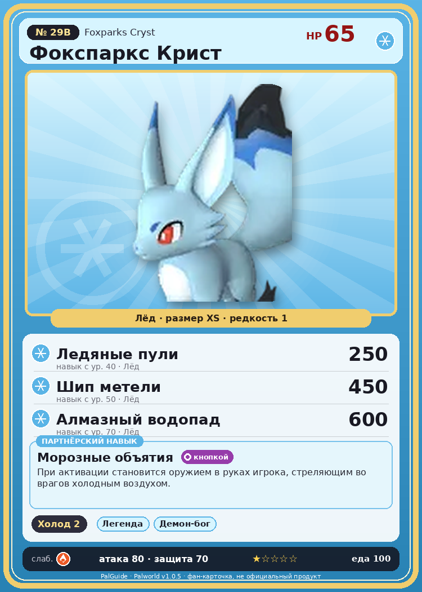

# #29B Фокспаркс Крист (Foxparks Cryst)

{ width=360 }

| Поле | Значение |
|---|---|
| Стихия | Лёд |
| Слабость (кто бьёт сильнее) | Огонь |
| Редкость | 1 |
| Размер | XS |
| HP / Атака / Защита (база вида) | 65 / 80 / 70 |
| Сколько ест | 100 |
| Цена продажи | 472 |
| Множитель поимки | ×1.1 |
| Скорость рывка верхом | 550 |

## Работа на базе
- Охлаждение — ур. 2

## Партнёрский навык: Морозные объятия
При активации становится оружием в руках игрока, стреляющим во врагов холодным воздухом. Технологии 24 level value 1 MainValue 15 Пробуждение : 2 MainValue 16 Пробуждение : (Увеличение урона: Небольшое ) 3 MainValue 18 Пробуждение : (Увеличение урона: Среднее ) 4 MainValue 21 Пробуждение : (Увеличение урона: Большое ) 5 MainValue 25 Пробуждение : (Увеличение урона: Очень большое )

## Атаки по уровням
- ур. 1: Ледяная ракета (Лёд, сила 40)
- ур. 7: Акваджет (Вода, сила 40)
- ур. 15: Ледяной резак (Лёд, сила 80)
- ур. 22: Айсберг (Лёд, сила 120)
- ур. 30: Ледяное дыхание (Лёд, сила 160)
- ур. 40: Ледяные пули (Лёд, сила 250)
- ур. 50: Шип метели (Лёд, сила 450)
- ур. 70: Алмазный водопад (Лёд, сила 600)

## Где водится
- В дикой природе: да; точек появления днём: 45, ночью: 45; уровни в первых точках: 30–34
- Подземелья: Пещера Тэнраку
- Яйцо: Яйцо льда

## Дроп
- Кожа — 1–2 шт., 100%
- Ледяной орган — 1–3 шт., 100%

**Дроп альфы:**
- Деталь древней цивилизации — 3–4 шт., 100%
- Ценный мех — 2–3 шт., 100%

## Разведение
- Ранг разведения (CombiRank): 2500
- **Особая пара:** [Фокспаркс](../../4_spravochniki/paly/foxparks.md) + [Фоксайкл](../../4_spravochniki/paly/foxcicle.md)

## Лучшие пассивки по роли
- боец: Легенда, Демон-бог, Хладнокровный, Бессмертие, Император льда (вместо Бессмертия, если нет мутации)
- ездовой: Божественная скорость, Легенда, Вечный двигатель, Небесное скольжение

## Чем хорош / чем плох
- ✅ можно оседлать
- ❌ мало здоровья (65); разводится только особой парой

> Недавно родившиеся Палы ещё не умеют обращаться с холодом. Они извергают ледяное дыхание по малейшему поводу и закашливаются. Если такой Пал простудится, его замёрзшие сопли мешают ему дышать и вызывают панику.

См. также: [Стихии](../../2_mehaniki/stihii.md) · [Разведение](../../2_mehaniki/razvedenie.md) · [Все палы](README.md)
_Источник: paldb.cc v1.0.5_
