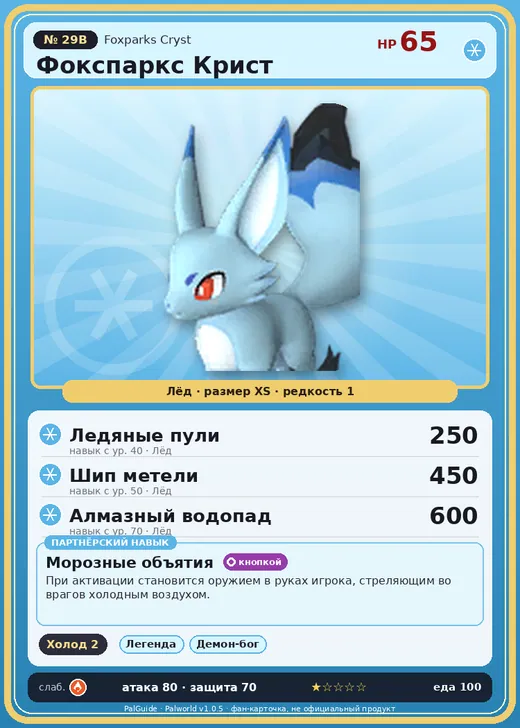

# #29B Фокспаркс Крист (Foxparks Cryst)

№ 29B

Лёд

Слабость: Огонь

❄️ Охлаждение <b>2</b>

<b>Морозные объятия</b> 🔘 кнопкой

❤️ 65 · ⚔️ 80 · 🛡 70

| Поле | Значение |
|---|---|
| Стихия | Лёд |
| Слабость (кто бьёт сильнее) | Огонь |
| Редкость | 1 |
| Размер | XS |
| HP / Атака / Защита (база вида) | 65 / 80 / 70 |
| Сколько ест | 100 |
| Цена продажи | 472 |
| Множитель поимки | ×1.1 |
| Скорость рывка верхом | 550 |

=== "Обзор"

    #### Работа на базе
    - Охлаждение — ур. 2

    #### Партнёрский навык: Морозные объятия
    При активации становится оружием в руках игрока, стреляющим во врагов холодным воздухом. Технологии 24.

    #### Чем хорош / чем плох
    - ✅
    - ❌ мало здоровья (65); разводится только особой парой

    > Недавно родившиеся Палы ещё не умеют обращаться с холодом. Они извергают ледяное дыхание по малейшему поводу и закашливаются. Если такой Пал простудится, его замёрзшие сопли мешают ему дышать и вызывают панику.

    См. также: [Стихии](../../guide/06_stihii.md) · [Разведение](../../guide/07_razvedenie.md) · [Все палы](README.md)

=== "Атаки"

    #### Атаки по уровням
    - ур. 1: Ледяная ракета (Лёд, сила 40)
    - ур. 7: Акваджет (Вода, сила 40)
    - ур. 15: Ледяной резак (Лёд, сила 80)
    - ур. 22: Айсберг (Лёд, сила 120)
    - ур. 30: Ледяное дыхание (Лёд, сила 160)
    - ур. 40: Ледяные пули (Лёд, сила 250)
    - ур. 50: Шип метели (Лёд, сила 450)
    - ур. 70: Алмазный водопад (Лёд, сила 600)

=== "Где живёт"

    #### Где водится
    - В дикой природе: да; точек появления днём: 45, ночью: 45; уровни в первых точках: 30–34
    - Подземелья: Пещера Тэнраку
    - Яйцо: Яйцо льда

=== "Дроп"

    #### Дроп
    - Кожа — 1–2 шт., 100%
    - Ледяной орган — 1–3 шт., 100%

    **Дроп альфы:**
    - Деталь древней цивилизации — 3–4 шт., 100%
    - Ценный мех — 2–3 шт., 100%

=== "Разведение"

    #### Разведение
    - Ранг разведения (CombiRank): 2500
    - **Особая пара:** [Фокспаркс](../../4_spravochniki/paly/foxparks.md) + [Фоксайкл](../../4_spravochniki/paly/foxcicle.md)

=== "Пассивки"

    #### Лучшие пассивки по роли

    

⚔️ Боец

максимум урона и живучести в бою

<a class="psv r-4" data-psv="Легенда" href="../../../passivki/legend/">Легенда</a><a class="psv r-4" data-psv="Демон-бог" href="../../../passivki/demon_god/">Демон-бог</a><a class="psv r-3" data-psv="Император льда" href="../../../passivki/ice_emperor/">Император льда</a><a class="psv r-3" data-psv="Хладнокровный" href="../../../passivki/serenity/">Хладнокровный</a>

    <small>Нажми на пассивку, чтобы узнать, что она даёт и где её взять.</small>

<a class="card-link" href="../foxparks/">← Фокспаркс</a><a class="card-link" href="../killamari/">Килламари →</a>

