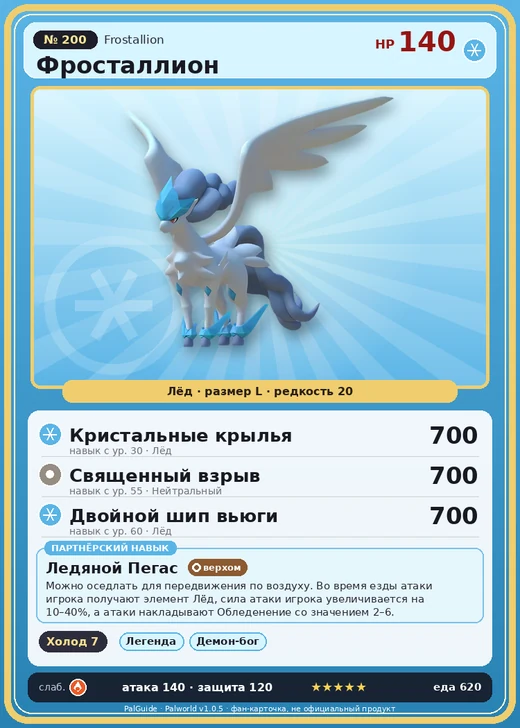

# Фросталлион

<canvas id="fx"></canvas>

№ 200 · Frostallion

Лёд

Слабость: Огонь

❄️ Охлаждение <b>7</b>

<b>Ледяной Пегас</b> 🐎 верхом

❤️ 140 · ⚔️ 140 · 🛡 120

| Поле | Значение |
|---|---|
| Стихия | Лёд |
| Слабость (кто бьёт сильнее) | Огонь |
| Редкость | 20 |
| Размер | L |
| HP / Атака / Защита (база вида) | 140 / 140 / 120 |
| Сколько ест | 620 |
| Цена продажи | 4695 |
| Множитель поимки | ×1 |
| Скорость рывка верхом | 1800 |

=== "Обзор"

    #### Работа на базе
    - Охлаждение — ур. 7

    #### Партнёрский навык: Ледяной Пегас
    Можно оседлать для передвижения по воздуху. Во время езды атаки игрока получают элемент Лёд, сила атаки игрока увеличивается на 10–40%, а атаки накладывают Обледенение со значением 2–6. Технологии 62.

    #### Чем хорош / чем плох
    - ✅ Мощный ледяной урон, летает; лучший против драконов; очень высокая атака (140); много здоровья (140); крепкая защита (120); отличный рабочий (пригодность 7); можно оседлать; летает (ездовой)
    - ❌ Слаб к огню; много ест; много ест (620); разводится только особой парой

    > Призывающий зиму — хранитель острова Палпагос. В былые времена, когда бедствие охватило эти земли, он взмыл в небеса, вознёс вечную зиму и тем самым запечатал зло.

    См. также: [Стихии](../../guide/06_stihii.md) · [Разведение](../../guide/07_razvedenie.md) · [Все палы](README.md)

=== "Атаки"

    #### Атаки по уровням
    - ур. 1: Воздушная пушка (Нейтральный, сила 40)
    - ур. 7: Ледяная ракета (Лёд, сила 40)
    - ур. 15: Ледяной резак (Лёд, сила 80)
    - ур. 22: Айсберг (Лёд, сила 120)
    - ур. 30: Кристальные крылья (Лёд, сила 700)
    - ур. 40: Ледяное дыхание (Лёд, сила 160)
    - ур. 50: Шип метели (Лёд, сила 450)
    - ур. 55: Священный взрыв (Нейтральный, сила 700)
    - ур. 60: Двойной шип вьюги (Лёд, сила 700)
    - ур. 70: Морозный всплеск (Лёд, сила 700)

=== "Где живёт"

    #### Где водится
    - В дикой природе: да; точек появления днём: 1, ночью: 1
    - Яйцо: Огромное яйцо льда

=== "Дроп"

    #### Дроп
    - Ледяной орган — 10 шт., 100%
    - Алмаз — 1 шт., 100%

    **Дроп альфы:**
    - Деталь древней цивилизации — 6–8 шт., 100%
    - Ценные внутренности — 6–8 шт., 100%

=== "Разведение"

    #### Разведение
    - Ранг разведения (CombiRank): 150
    - **Особая пара:** [Фросталлион](../../4_spravochniki/paly/frostallion.md) + [Фросталлион](../../4_spravochniki/paly/frostallion.md)
    - Участвует в особых парах: Фросталлион → Фросталлион; Фросталлион → Фросталлион; Хэлзефир → Фросталлион Нокт

=== "Пассивки"

    #### Лучшие пассивки по роли

    

⚔️ Боец

максимум урона и живучести в бою

<a class="psv r-4" data-psv="Легенда" href="../../../passivki/legend/">Легенда</a><a class="psv r-4" data-psv="Демон-бог" href="../../../passivki/demon_god/">Демон-бог</a><a class="psv r-3" data-psv="Император льда" href="../../../passivki/ice_emperor/">Император льда</a><a class="psv r-3" data-psv="Хладнокровный" href="../../../passivki/serenity/">Хладнокровный</a>

🛠 Рабочий

работает быстрее и меньше устаёт на базе

<a class="psv r-5" data-psv="Дьявольские руки" href="../../../passivki/demons_hand/">Дьявольские руки</a><a class="psv r-4" data-psv="Виртуоз" href="../../../passivki/remarkable_craftsmanship/">Виртуоз</a><a class="psv r-3" data-psv="Мастеровитый" href="../../../passivki/artisan/">Мастеровитый</a><a class="psv r-3" data-psv="Трудоголик" href="../../../passivki/workaholic/">Трудоголик</a>

🐎 Ездовой

быстрее бегает или летает с тобой верхом

<a class="psv r-4" data-psv="Божественная скорость" href="../../../passivki/swift/">Божественная скорость</a><a class="psv r-4" data-psv="Легенда" href="../../../passivki/legend/">Легенда</a><a class="psv r-4" data-psv="Вечный двигатель" href="../../../passivki/eternal_engine/">Вечный двигатель</a><a class="psv r-3" data-psv="Умелый бегун" href="../../../passivki/runner/">Умелый бегун</a>

    <small>Нажми на пассивку, чтобы узнать, что она даёт и где её взять.</small>

<a class="card-link" href="../necromus/">← Некромус</a><a class="card-link" href="../frostallion_noct/">Фросталлион Нокт →</a>

