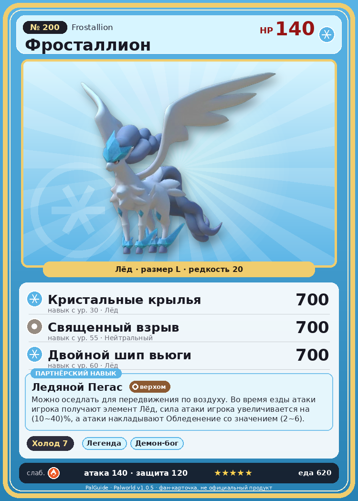

# #200 Фросталлион (Frostallion)

{ width=360 }

| Поле | Значение |
|---|---|
| Стихия | Лёд |
| Слабость (кто бьёт сильнее) | Огонь |
| Редкость | 20 |
| Размер | L |
| HP / Атака / Защита (база вида) | 140 / 140 / 120 |
| Сколько ест | 620 |
| Цена продажи | 4695 |
| Множитель поимки | ×1 |
| Скорость рывка верхом | 1800 |

## Работа на базе
- Охлаждение — ур. 7

## Партнёрский навык: Ледяной Пегас
Можно оседлать для передвижения по воздуху. Во время езды атаки игрока получают элемент Лёд , сила атаки игрока увеличивается на (10~40)% , а атаки накладывают Обледенение со значением (2~6) . Технологии 62 level value 1 GiveAIce_Ride 1 GiveElement_TrainerATK_UP_PartnerSkill_Ride_Legend 10 AdditionalEffect_Freeze_Ride 2 2 GiveAIce_Ride 1 GiveElement_TrainerATK_UP_PartnerSkill_Ride_Legend 14 AdditionalEffect_Freeze_Ride 3 3 GiveAIce_Ride 1 GiveElement_TrainerATK_UP_PartnerSkill_Ride_Legend 20 AdditionalEffect_Freeze_Ride 4 4 GiveAIce_Ride 1 GiveElement_TrainerATK_UP_PartnerSkill_Ride_Legend 28 AdditionalEffect_Freeze_Ride 5 5 GiveAIce_Ride 1 GiveElement_TrainerATK_UP_PartnerSkill_Ride_Legend 40 AdditionalEffect_Freeze_Ride 6

## Атаки по уровням
- ур. 1: Воздушная пушка (Нейтральный, сила 40)
- ур. 7: Ледяная ракета (Лёд, сила 40)
- ур. 15: Ледяной резак (Лёд, сила 80)
- ур. 22: Айсберг (Лёд, сила 120)
- ур. 30: Кристальные крылья (Лёд, сила 700)
- ур. 40: Ледяное дыхание (Лёд, сила 160)
- ур. 50: Шип метели (Лёд, сила 450)
- ур. 55: Священный взрыв (Нейтральный, сила 700)
- ур. 60: Двойной шип вьюги (Лёд, сила 700)
- ур. 70: Морозный всплеск (Лёд, сила 700)

## Где водится
- В дикой природе: да; точек появления днём: 1, ночью: 1
- Яйцо: Огромное яйцо льда

## Дроп
- Ледяной орган — 10 шт., 100%
- Алмаз — 1 шт., 100%

**Дроп альфы:**
- Деталь древней цивилизации — 6–8 шт., 100%
- Ценные внутренности — 6–8 шт., 100%

## Разведение
- Ранг разведения (CombiRank): 150
- **Особая пара:** [Фросталлион](../../4_spravochniki/paly/frostallion.md) + [Фросталлион](../../4_spravochniki/paly/frostallion.md)
- Участвует в особых парах: Фросталлион → Фросталлион; Фросталлион → Фросталлион; Хэлзефир → Фросталлион Нокт

## Лучшие пассивки по роли
- по обзору: Легенда, Демон-бог, Хладнокровный, Император льда
- боец: Легенда, Демон-бог, Хладнокровный, Бессмертие, Император льда (вместо Бессмертия, если нет мутации)
- рабочий: Дьявольские руки, Виртуоз, Мастеровитый, Небожитель/Трудоголик
- ездовой: Божественная скорость, Легенда, Вечный двигатель, Небесное скольжение

## Чем хорош / чем плох
- ✅ Мощный ледяной урон, летает; лучший против драконов; очень высокая атака (140); много здоровья (140); крепкая защита (120); отличный рабочий (пригодность 7); можно оседлать; летает (ездовой)
- ❌ Слаб к огню; много ест; много ест (620); разводится только особой парой

> Призывающий зиму — хранитель острова Палпагос. В былые времена, когда бедствие охватило эти земли, он взмыл в небеса, вознёс вечную зиму и тем самым запечатал зло.

См. также: [Стихии](../../2_mehaniki/stihii.md) · [Разведение](../../2_mehaniki/razvedenie.md) · [Все палы](README.md)
_Источник: paldb.cc v1.0.5_
