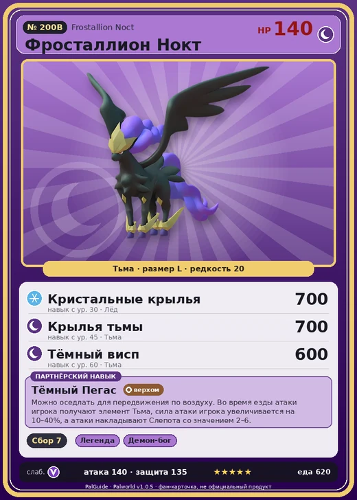

# #200B Фросталлион Нокт (Frostallion Noct)

№ 200B

Тьма

Слабость: Дракон

🌾 Сбор <b>7</b>

<b>Тёмный Пегас</b> 🐎 верхом

❤️ 140 · ⚔️ 140 · 🛡 135

| Поле | Значение |
|---|---|
| Стихия | Тьма |
| Слабость (кто бьёт сильнее) | Дракон |
| Редкость | 20 |
| Размер | L |
| HP / Атака / Защита (база вида) | 140 / 140 / 135 |
| Сколько ест | 620 |
| Цена продажи | 5000 |
| Множитель поимки | ×1 |
| Скорость рывка верхом | 1800 |

## Работа на базе
- Сбор — ур. 7

## Партнёрский навык: Тёмный Пегас
Можно оседлать для передвижения по воздуху. Во время езды атаки игрока получают элемент Тьма , сила атаки игрока увеличивается на (10~40)% , а атаки накладывают Слепота со значением (2~6) . Технологии 62 level value 1 GiveADark_Ride 1 GiveElement_TrainerATK_UP_PartnerSkill_Ride_Legend 10 AdditionalEffect_Darkness_Ride 2 2 GiveADark_Ride 1 GiveElement_TrainerATK_UP_PartnerSkill_Ride_Legend 14 AdditionalEffect_Darkness_Ride 3 3 GiveADark_Ride 1 GiveElement_TrainerATK_UP_PartnerSkill_Ride_Legend 20 AdditionalEffect_Darkness_Ride 4 4 GiveADark_Ride 1 GiveElement_TrainerATK_UP_PartnerSkill_Ride_Legend 28 AdditionalEffect_Darkness_Ride 5 5 GiveADark_Ride 1 GiveElement_TrainerATK_UP_PartnerSkill_Ride_Legend 40 AdditionalEffect_Darkness_Ride 6

## Атаки по уровням
- ур. 1: Воздушная пушка (Нейтральный, сила 40)
- ур. 7: Тёмный шар (Тьма, сила 50)
- ур. 15: Теневой взрыв (Тьма, сила 80)
- ур. 22: Духовное пламя (Тьма, сила 200)
- ур. 30: Кристальные крылья (Лёд, сила 700)
- ур. 40: Кошмарная сфера (Тьма, сила 300)
- ур. 45: Крылья тьмы (Тьма, сила 700)
- ур. 50: Тёмный лазер (Тьма, сила 450)
- ур. 55: Двойной шип вьюги (Лёд, сила 700)
- ур. 60: Тёмный висп (Тьма, сила 600)
- ур. 70: Морозный всплеск (Лёд, сила 700)

## Где водится
- В дикой природе: да; точек появления днём: 1, ночью: 1
- Яйцо: Огромное яйцо тьмы

## Дроп
- Алмаз — 1 шт., 100%
- Большая душа Пала — 1–2 шт., 100%

**Дроп альфы:**
- Деталь древней цивилизации — 6–8 шт., 100%
- Ценные внутренности — 6–8 шт., 100%

## Разведение
- Ранг разведения (CombiRank): 110
- **Особая пара:** [Фросталлион](../../4_spravochniki/paly/frostallion.md) + [Хэлзефир](../../4_spravochniki/paly/helzephyr.md)

## Лучшие пассивки по роли
- по обзору: Легенда, Демон-бог, Хладнокровный, Король тьмы
- боец: Легенда, Демон-бог, Хладнокровный, Бессмертие, Король тьмы (вместо Бессмертия, если нет мутации)
- рабочий: Дьявольские руки, Виртуоз, Мастеровитый, Небожитель/Трудоголик
- ездовой: Божественная скорость, Легенда, Вечный двигатель, Небесное скольжение

## Чем хорош / чем плох
- ✅ Тёмный урон, летает; хорош против нейтральных (Харталис); очень высокая атака (140); много здоровья (140); крепкая защита (135); отличный рабочий (пригодность 7); можно оседлать; летает (ездовой)
- ❌ Слаб к драконам; много ест (620); разводится только особой парой

> Призывающий ночь — хранитель острова Палпагос. В былые времена, когда бедствие охватило эти земли, он взмыл в небеса, вознёс бесконечную ночь и тем самым запечатал зло.

См. также: [Стихии](../../guide/06_stihii.md) · [Разведение](../../guide/07_razvedenie.md) · [Все палы](README.md)
