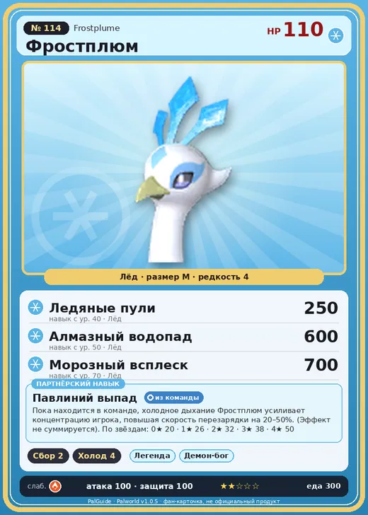

# #114 Фростплюм (Frostplume)

№ 114

Лёд

Слабость: Огонь

🌾 Сбор <b>2</b>❄️ Охлаждение <b>4</b>

<b>Павлиний выпад</b> 🎒 из команды

❤️ 110 · ⚔️ 100 · 🛡 100

| Поле | Значение |
|---|---|
| Стихия | Лёд |
| Слабость (кто бьёт сильнее) | Огонь |
| Редкость | 4 |
| Размер | M |
| HP / Атака / Защита (база вида) | 110 / 100 / 100 |
| Сколько ест | 300 |
| Цена продажи | 2382 |
| Множитель поимки | ×1 |
| Скорость рывка верхом | 750 |

=== "Обзор"

    #### Работа на базе
    - Сбор — ур. 2
    - Охлаждение — ур. 4

    #### Партнёрский навык: Павлиний выпад
    Пока находится в команде, холодное дыхание Фростплюм усиливает концентрацию игрока, повышая скорость перезарядки на (20~50)% . (Эффект не суммируется) level value 1 SnowPeafowl_PartnerSkill 20 2 SnowPeafowl_PartnerSkill 26 3 SnowPeafowl_PartnerSkill 32 4 SnowPeafowl_PartnerSkill 38 5 SnowPeafowl_PartnerSkill 50

    #### Чем хорош / чем плох
    - ✅ хорошая атака (100); можно оседлать
    - ❌ явных минусов нет

    > Чувствителен ко времени и каждое утро обязательно просыпается в одно и то же время. Говорят, что на острове Палпагос день разделили на 24 части потому, что, если посмотреть прямо на Фростплюм с расправленными крыльями, можно увидеть 24 замкнутых промежутка.

    См. также: [Стихии](../../guide/06_stihii.md) · [Разведение](../../guide/07_razvedenie.md) · [Все палы](README.md)

=== "Атаки"

    #### Атаки по уровням
    - ур. 1: Ледяная ракета (Лёд, сила 40)
    - ур. 7: Ледяной резак (Лёд, сила 80)
    - ур. 15: Айсберг (Лёд, сила 120)
    - ур. 22: Ледяное дыхание (Лёд, сила 160)
    - ур. 30: Ледяная стена (Лёд, сила 200)
    - ур. 40: Ледяные пули (Лёд, сила 250)
    - ур. 50: Алмазный водопад (Лёд, сила 600)
    - ур. 70: Морозный всплеск (Лёд, сила 700)

=== "Где живёт"

    #### Где водится
    - В дикой природе: да; точек появления днём: 100, ночью: 100; уровни в первых точках: 65–66
    - Подземелья: Пещера Священной Горы
    - Яйцо: Яйцо льда

=== "Дроп"

    #### Дроп
    - Ледяной орган — 1–2 шт., 100%

    **Дроп альфы:**
    - Деталь древней цивилизации — 2–3 шт., 100%
    - Ценное перо — 2–3 шт., 100%

=== "Разведение"

    #### Разведение
    - Ранг разведения (CombiRank): 860
    - Участвует в особых парах: Азуроб → Азуроб Крист; Юнивольт → Юнивольт Крист; Райберд → Райберд Крист

=== "Пассивки"

    #### Лучшие пассивки по роли
    - боец: Легенда, Демон-бог, Хладнокровный, Бессмертие, Император льда (вместо Бессмертия, если нет мутации)
    - рабочий: Дьявольские руки, Виртуоз, Мастеровитый, Небожитель/Трудоголик
    - ездовой: Божественная скорость, Легенда, Вечный двигатель, Небесное скольжение

<a class="card-link" href="../warsect_terra/">← Ворсект Терра</a><a class="card-link" href="../majex/">Маджекс →</a>

