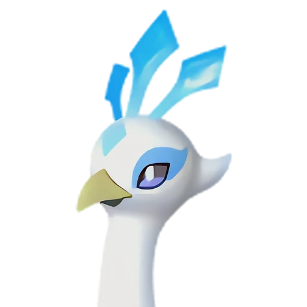

# Фростплюм

<canvas id="fx"></canvas>

№ 114 · Frostplume

Лёд

Слабость: Огонь <b class="mx">×1,5</b> <button class="hlp" data-tip="Множители перемножаются по обеим стихиям пала: ×1,5 за каждую стихию, которую атака бьёт, ×0,65 за каждую, которая её держит. Если одна стихия слаба, а другая устойчива (×1,5 × 0,65 ≈ ×0,98), слабости нет.">?</button>

Устойчив: Дракон <b class="mx">×0,65</b>

🌾 Сбор <b>2</b>❄️ Охлаждение <b>4</b>

<b>Павлиний выпад</b> 🎒 из команды

❤️ 110 · ⚔️ 100 · 🛡 100

Основное

💎Редкость <button class="hlp" data-tip="Чем выше число, тем реже встречается пал. 1–4 — обычные, 5–7 — редкие, 8+ — легендарные.">?</button><b>4</b>

📏Размер<b>M</b>

💰Цена продажи <button class="hlp" data-tip="Сколько золота даст торговец за пала.">?</button><b>2382</b>

Бой

🎯Множитель поимки <button class="hlp" data-tip="Насколько легче или труднее поймать: ×1 — обычно, меньше — сложнее.">?</button><b>×1</b>

🐎Скорость рывка верхом <button class="hlp" data-tip="Скорость, если сесть на пала и бежать рывком.">?</button><b>750</b>

Ферма и еда

🍖Сколько ест <button class="hlp" data-tip="Сколько сытости пал тратит — чем больше, тем больше еды нужно на базе.">?</button><b>300</b>

Разведение

🧬Сила разведения <button class="hlp" data-tip="Скрытое число игры: у детёныша оно примерно среднее от родителей. Чем меньше — тем «сильнее» пал.">?</button><b>860</b>

=== "Обзор"

    #### Работа на базе
    - Сбор — ур. 2
    - Охлаждение — ур. 4

    #### Партнёрский навык: Павлиний выпад
    Пока находится в команде, холодное дыхание Фростплюм усиливает концентрацию игрока, повышая скорость перезарядки на 20–50%. (Эффект не суммируется). По звёздам: 0★ 20 · 1★ 26 · 2★ 32 · 3★ 38 · 4★ 50

    #### Чем хорош / чем плох
    - ✅ хорошая атака (100)
    - ❌ явных минусов нет

    > Чувствителен ко времени и каждое утро обязательно просыпается в одно и то же время. Говорят, что на острове Палпагос день разделили на 24 части потому, что, если посмотреть прямо на Фростплюм с расправленными крыльями, можно увидеть 24 замкнутых промежутка.

    См. также: [Стихии](../../guide/06_stihii.md) · [Разведение](../../guide/07_razvedenie.md) · [Все палы](README.md)

=== "Атаки"

    #### Атаки по уровням
    - ур. 1: Ледяная ракета (Лёд, сила 40)
    - ур. 7: Ледяной резак (Лёд, сила 80)
    - ур. 15: Айсберг (Лёд, сила 120)
    - ур. 22: Ледяное дыхание (Лёд, сила 160)
    - ур. 30: Ледяная стена (Лёд, сила 200)
    - ур. 40: Ледяные пули (Лёд, сила 250)
    - ур. 50: Алмазный водопад (Лёд, сила 600)
    - ур. 70: Морозный всплеск (Лёд, сила 700)

=== "Где живёт"

    #### Где водится

    

<button data-k="d" class="on">☀️ День</button><button data-k="n">🌙 Ночь</button>

ур. 65–65<a class="btn hm-full" href="../../../map/?pal=SnowPeafowl">Показать на большой карте</a>

Солнечный предел

🕳 Подземелье<b>Пещера Священной Горы</b>

🥚 Яйцо<b>Яйцо льда</b>

=== "Дроп"

    #### Дроп
    - Ледяной орган — 1–2 шт., 100%

    **Дроп альфы:**
    - Деталь древней цивилизации — 2–3 шт., 100%
    - Ценное перо — 2–3 шт., 100%

=== "Разведение"

    #### Разведение
    - Ранг разведения (CombiRank): 860
    - Участвует в особых парах: Азуроб → Азуроб Крист; Юнивольт → Юнивольт Крист; Райберд → Райберд Крист

=== "Пассивки"

    #### Лучшие пассивки по роли

    

⚔️ Боец

максимум урона и живучести в бою

<a class="psv r-4" data-psv="Легенда" href="../../../passivki/legend/">Легенда</a><a class="psv r-4" data-psv="Демон-бог" href="../../../passivki/demon_god/">Демон-бог</a><a class="psv r-3" data-psv="Император льда" href="../../../passivki/ice_emperor/">Император льда</a><a class="psv r-3" data-psv="Хладнокровный" href="../../../passivki/serenity/">Хладнокровный</a>

🛠 Рабочий

работает быстрее и меньше устаёт на базе

<a class="psv r-5" data-psv="Дьявольские руки" href="../../../passivki/demons_hand/">Дьявольские руки</a><a class="psv r-4" data-psv="Виртуоз" href="../../../passivki/remarkable_craftsmanship/">Виртуоз</a><a class="psv r-3" data-psv="Мастеровитый" href="../../../passivki/artisan/">Мастеровитый</a><a class="psv r-3" data-psv="Трудоголик" href="../../../passivki/workaholic/">Трудоголик</a>

    <small>Нажми на пассивку, чтобы узнать, что она даёт и где её взять.</small>

<a class="card-link" href="../warsect_terra/">← Ворсект Терра</a><a class="card-link" href="../majex/">Маджекс →</a>

