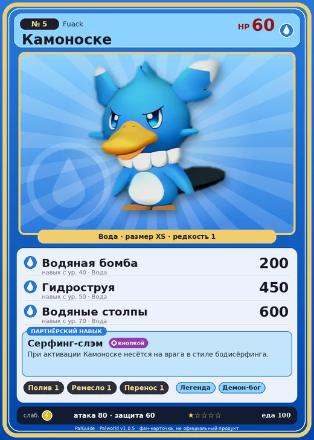

# #5 Камоноске (Fuack)

#5 · Fuack

Вода

Слабость: Молния

💧 Полив <b>1</b>🖐️ Ручная работа <b>1</b>📦 Транспортировка <b>1</b>

<b>Серфинг-слэм</b> 🔘 кнопкой

❤️ 60 · ⚔️ 80 · 🛡 60

| Поле | Значение |
|---|---|
| Стихия | Вода |
| Слабость (кто бьёт сильнее) | Молния |
| Редкость | 1 |
| Размер | XS |
| HP / Атака / Защита (база вида) | 60 / 80 / 60 |
| Сколько ест | 100 |
| Цена продажи | 376 |
| Множитель поимки | ×1.1 |
| Скорость рывка верхом | 400 |

## Работа на базе
- Полив — ур. 1
- Ручная работа — ур. 1
- Транспортировка — ур. 1

## Партнёрский навык: Серфинг-слэм
При активации Камоноске несётся на врага в стиле бодисёрфинга. level value 1 MainValue 1.5 Пробуждение : 2 MainValue 1.6 Пробуждение : (Увеличение урона: Небольшое ) 3 MainValue 1.8 Пробуждение : (Увеличение урона: Среднее ) 4 MainValue 2.1 Пробуждение : (Увеличение урона: Большое ) 5 MainValue 2.5 Пробуждение : (Увеличение урона: Очень большое )

## Атаки по уровням
- ур. 1: Водяной выстрел (Вода, сила 50)
- ур. 7: Силовой выстрел (Нейтральный, сила 80)
- ур. 15: Акваджет (Вода, сила 40)
- ур. 22: Ледяная ракета (Лёд, сила 40)
- ур. 30: Пузырьковый выстрел (Вода, сила 80)
- ур. 40: Водяная бомба (Вода, сила 200)
- ур. 50: Гидроструя (Вода, сила 450)
- ур. 70: Водяные столпы (Вода, сила 600)

## Где водится
- В дикой природе: да; точек появления днём: 571, ночью: 571; уровни в первых точках: 1–10
- Подземелья: Пещера Отдалённого Острова, Пещера Холмов
- Яйцо: Яйцо воды

## Дроп
- Кожа — 1 шт., 100%
- Жидкость водного Пала — 1 шт., 100%

**Дроп альфы:**
- Деталь древней цивилизации — 1–2 шт., 100%
- Ценный мех — 1–2 шт., 100%

## Разведение
- Ранг разведения (CombiRank): 2980
- Участвует в особых парах: Фламбелль → Камоноске Игнис; Брончерри → Брончерри Аква

## Лучшие пассивки по роли
- боец: Легенда, Демон-бог, Хладнокровный, Бессмертие, Владыка морей (вместо Бессмертия, если нет мутации)
- ездовой: Божественная скорость, Легенда, Вечный двигатель, Небесное скольжение

## Чем хорош / чем плох
- ✅ можно оседлать
- ❌ мало здоровья (60)

> Этот Пал может производить воду и создавать волну в любом месте. Когда спешит, он передвигается на боди-сёрфинге. На пике энтузиазма он часто врезается в стены и погибает.

См. также: [Стихии](../../2_mehaniki/stihii.md) · [Разведение](../../2_mehaniki/razvedenie.md) · [Все палы](README.md)
_Источник: paldb.cc v1.0.5_
