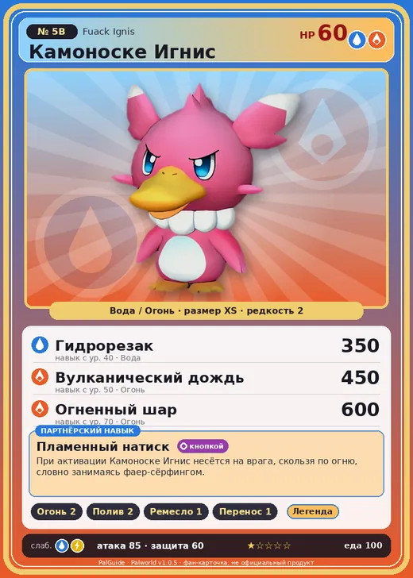

# #5B Камоноске Игнис (Fuack Ignis)

№ 5B

ВодаОгонь

Слабость: ВодаМолния

🔥 Разжигание огня <b>2</b>💧 Полив <b>2</b>🖐️ Ручная работа <b>1</b>📦 Транспортировка <b>1</b>

<b>Пламенный натиск</b> 🔘 кнопкой

❤️ 60 · ⚔️ 85 · 🛡 60

| Поле | Значение |
|---|---|
| Стихия | Вода, Огонь |
| Слабость (кто бьёт сильнее) | Вода, Молния |
| Редкость | 2 |
| Размер | XS |
| HP / Атака / Защита (база вида) | 60 / 85 / 60 |
| Сколько ест | 100 |
| Цена продажи | 463 |
| Множитель поимки | ×1.1 |
| Скорость рывка верхом | 400 |

=== "Обзор"

    #### Работа на базе
    - Разжигание огня — ур. 2
    - Полив — ур. 2
    - Ручная работа — ур. 1
    - Транспортировка — ур. 1

    #### Партнёрский навык: Пламенный натиск
    При активации Камоноске Игнис несётся на врага, скользя по огню, словно занимаясь фаер-сёрфингом. level value 1 MainValue 1 Пробуждение : 2 MainValue 1.1 Пробуждение : (Увеличение урона: Небольшое ) 3 MainValue 1.3 Пробуждение : (Увеличение урона: Среднее ) 4 MainValue 1.6 Пробуждение : (Увеличение урона: Большое ) 5 MainValue 2 Пробуждение : (Увеличение урона: Очень большое )

    #### Чем хорош / чем плох
    - ✅ можно оседлать
    - ❌ мало здоровья (60); разводится только особой парой

    > Его живот обладает высоким трением, и при боди-сёрфинге он воспламеняется. Часто превращается в огненный факел, если разгонится слишком сильно.

    См. также: [Стихии](../../guide/06_stihii.md) · [Разведение](../../guide/07_razvedenie.md) · [Все палы](README.md)

=== "Атаки"

    #### Атаки по уровням
    - ур. 1: Огненный выстрел (Огонь, сила 40)
    - ур. 7: Расщеплённый огонь (Огонь, сила 80)
    - ур. 15: Пузырьковый выстрел (Вода, сила 80)
    - ур. 22: Огненное дыхание (Огонь, сила 160)
    - ур. 30: Огненная стена (Огонь, сила 250)
    - ур. 40: Гидрорезак (Вода, сила 350)
    - ур. 50: Вулканический дождь (Огонь, сила 450)
    - ур. 70: Огненный шар (Огонь, сила 600)

=== "Где живёт"

    #### Где водится
    - В дикой природе: да; точек появления днём: 120, ночью: 120; уровни в первых точках: 27–30
    - Может продаваться у торговца/рекрутера
    - Яйцо: Яйцо воды

=== "Дроп"

    #### Дроп
    - Кожа — 1 шт., 100%
    - Жидкость водного Пала — 1 шт., 100%
    - Огненный орган — 1–2 шт., 50%

    **Дроп альфы:**
    - Деталь древней цивилизации — 2–3 шт., 100%
    - Ценный мех — 2–3 шт., 100%

=== "Разведение"

    #### Разведение
    - Ранг разведения (CombiRank): 2300
    - **Особая пара:** [Камоноске](../../4_spravochniki/paly/fuack.md) + [Фламбелль](../../4_spravochniki/paly/flambelle.md)

=== "Пассивки"

    #### Лучшие пассивки по роли
    - боец: Легенда, Демон-бог, Хладнокровный, Бессмертие, Владыка морей (вместо Бессмертия, если нет мутации)
    - ездовой: Божественная скорость, Легенда, Вечный двигатель, Небесное скольжение

<a class="card-link" href="../fuack/">← Камоноске</a><a class="card-link" href="../vixy/">Викси →</a>

