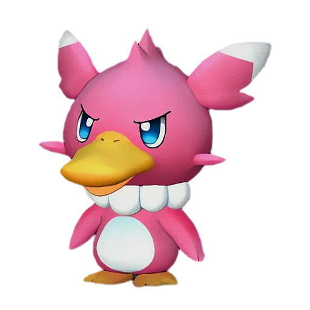

# Камоноске Игнис

<canvas id="fx"></canvas>

№ 5B · Fuack Ignis

ВодаОгонь

Слабость: Вода <b class="mx">×1,5</b>Молния <b class="mx">×1,5</b> <button class="hlp" data-tip="Множители перемножаются по обеим стихиям пала: ×1,5 за каждую стихию, которую атака бьёт, ×0,65 за каждую, которая её держит. Если одна стихия слаба, а другая устойчива (×1,5 × 0,65 ≈ ×0,98), слабости нет.">?</button>

Устойчив: Огонь <b class="mx">×0,65</b>Трава <b class="mx">×0,65</b>Лёд <b class="mx">×0,65</b>

🔥 Разжигание огня <b>2</b>💧 Полив <b>2</b>🖐️ Ручная работа <b>1</b>📦 Транспортировка <b>1</b>

<b>Пламенный натиск</b> 🔘 кнопкой

❤️ 60 · ⚔️ 85 · 🛡 60

Основное

💎Редкость <button class="hlp" data-tip="Чем выше число, тем реже встречается пал. 1–4 — обычные, 5–7 — редкие, 8+ — легендарные.">?</button><b>2</b>

📏Размер<b>XS</b>

💰Цена продажи <button class="hlp" data-tip="Сколько золота даст торговец за пала.">?</button><b>463</b>

Бой

🎯Множитель поимки <button class="hlp" data-tip="Насколько легче или труднее поймать: ×1 — обычно, меньше — сложнее.">?</button><b>×1.1</b>

🐎Скорость рывка верхом <button class="hlp" data-tip="Скорость, если сесть на пала и бежать рывком.">?</button><b>400</b>

Ферма и еда

🍖Сколько ест <button class="hlp" data-tip="Сколько сытости пал тратит — чем больше, тем больше еды нужно на базе.">?</button><b>100</b>

Разведение

🧬Сила разведения <button class="hlp" data-tip="Скрытое число игры: у детёныша оно примерно среднее от родителей. Чем меньше — тем «сильнее» пал.">?</button><b>2300</b>

💞Особая пара <button class="hlp" data-tip="Этого пала можно вывести только от этой пары.">?</button><b>Камоноске + Фламбелль</b>

=== "Обзор"

    #### Работа на базе
    - Разжигание огня — ур. 2
    - Полив — ур. 2
    - Ручная работа — ур. 1
    - Транспортировка — ур. 1

    #### Партнёрский навык: Пламенный натиск
    При активации Камоноске Игнис несётся на врага, скользя по огню, словно занимаясь фаер-сёрфингом.

    #### Чем хорош / чем плох
    - ✅
    - ❌ мало здоровья (60); разводится только особой парой

    > Его живот обладает высоким трением, и при боди-сёрфинге он воспламеняется. Часто превращается в огненный факел, если разгонится слишком сильно.

    См. также: [Стихии](../../guide/06_stihii.md) · [Разведение](../../guide/07_razvedenie.md) · [Все палы](README.md)

=== "Атаки"

    #### Атаки по уровням
    - ур. 1: Огненный выстрел (Огонь, сила 40)
    - ур. 7: Расщеплённый огонь (Огонь, сила 80)
    - ур. 15: Пузырьковый выстрел (Вода, сила 80)
    - ур. 22: Огненное дыхание (Огонь, сила 160)
    - ур. 30: Огненная стена (Огонь, сила 250)
    - ур. 40: Гидрорезак (Вода, сила 350)
    - ур. 50: Вулканический дождь (Огонь, сила 450)
    - ур. 70: Огненный шар (Огонь, сила 600)

=== "Где живёт"

    #### Где водится

    

<button data-k="d" class="on">☀️ День</button><button data-k="n">🌙 Ночь</button>

ур. 32–32<a class="btn hm-full" href="../../../map/?pal=">Показать на большой карте</a>

Обсидиановый вулканИссушенное побережьеДвурогий островРазрушенный город-крепость

🥚 Яйцо<b>Яйцо воды</b>

🛒 Торговец<b>Продаётся у торговца палами</b>

=== "Дроп"

    #### Дроп
    - Кожа — 1 шт., 100%
    - Жидкость водного Пала — 1 шт., 100%
    - Огненный орган — 1–2 шт., 50%

    **Дроп альфы:**
    - Деталь древней цивилизации — 2–3 шт., 100%
    - Ценный мех — 2–3 шт., 100%

=== "Разведение"

    #### Разведение
    - Ранг разведения (CombiRank): 2300
    - **Особая пара:** [Камоноске](../../4_spravochniki/paly/fuack.md) + [Фламбелль](../../4_spravochniki/paly/flambelle.md)

=== "Пассивки"

    #### Лучшие пассивки по роли

    

⚔️ Боец

максимум урона и живучести в бою

<a class="psv r-4" data-psv="Легенда" href="../../../passivki/legend/">Легенда</a><a class="psv r-4" data-psv="Демон-бог" href="../../../passivki/demon_god/">Демон-бог</a><a class="psv r-3" data-psv="Владыка морей" href="../../../passivki/lord_of_the_sea/">Владыка морей</a><a class="psv r-3" data-psv="Хладнокровный" href="../../../passivki/serenity/">Хладнокровный</a>

    <small>Нажми на пассивку, чтобы узнать, что она даёт и где её взять.</small>

<a class="card-link" href="../fuack/">← Камоноске</a><a class="card-link" href="../vixy/">Викси →</a>

