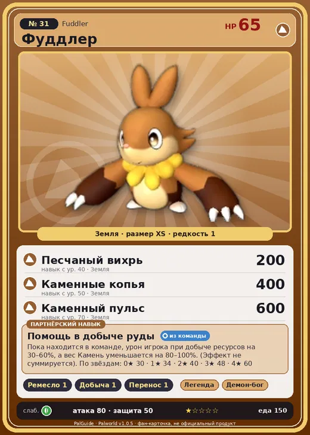

# Фуддлер

<canvas id="fx"></canvas>

№ 31 · Fuddler

Земля

Слабость: Трава

🖐️ Ручная работа <b>1</b>⛏️ Добыча <b>1</b>📦 Транспортировка <b>1</b>

<b>Помощь в добыче руды</b> 🎒 из команды

❤️ 65 · ⚔️ 80 · 🛡 50

| Поле | Значение |
|---|---|
| Стихия | Земля |
| Слабость (кто бьёт сильнее) | Трава |
| Редкость | 1 |
| Размер | XS |
| HP / Атака / Защита (база вида) | 65 / 80 / 50 |
| Сколько ест | 150 |
| Цена продажи | 358 |
| Множитель поимки | ×1 |
| Скорость рывка верхом | 550 |

=== "Обзор"

    #### Работа на базе
    - Ручная работа — ур. 1
    - Добыча — ур. 1
    - Транспортировка — ур. 1

    #### Партнёрский навык: Помощь в добыче руды
    Пока находится в команде, урон игрока при добыче ресурсов на 30–60%, а вес Камень уменьшается на 80–100%. (Эффект не суммируется). По звёздам: 0★ 30 · 1★ 34 · 2★ 40 · 3★ 48 · 4★ 60

    #### Чем хорош / чем плох
    - ✅
    - ❌ мало здоровья (65)

    > Большие когти этого Пала прочны, как алмаз, но на их заточку он тратит почти всю свою энергию. Иногда это всё, что он успевает сделать за день.

    См. также: [Стихии](../../guide/06_stihii.md) · [Разведение](../../guide/07_razvedenie.md) · [Все палы](README.md)

=== "Атаки"

    #### Атаки по уровням
    - ур. 1: Грязевой выстрел (Земля, сила 40)
    - ур. 5: Подныривание (Земля, сила 60)
    - ур. 7: Силовой выстрел (Нейтральный, сила 80)
    - ур. 15: Каменный залп (Земля, сила 80)
    - ур. 22: Камнемёт (Земля, сила 120)
    - ур. 30: Силовая бомба (Нейтральный, сила 120)
    - ур. 40: Песчаный вихрь (Земля, сила 200)
    - ур. 50: Каменные копья (Земля, сила 400)
    - ур. 70: Каменный пульс (Земля, сила 600)

=== "Где живёт"

    #### Где водится
    - В дикой природе: да; точек появления днём: 343, ночью: 343; уровни в первых точках: 28–31
    - Подземелья: Пещера Отдалённого Острова, Пещера Песчаных Дюн, Пещера Ущелья, Пещера Холмов
    - Яйцо: Яйцо земли

=== "Дроп"

    #### Дроп
    - Кожа — 1–2 шт., 100%

    **Дроп альфы:**
    - Деталь древней цивилизации — 1–2 шт., 100%
    - Ценный коготь — 1–2 шт., 100%

=== "Разведение"

    #### Разведение
    - Ранг разведения (CombiRank): 2790
    - Участвует в особых парах: Робинквилл → Робинквилл Терра

=== "Пассивки"

    #### Лучшие пассивки по роли

    

⚔️ Боец

максимум урона и живучести в бою

<a class="psv r-4" data-psv="Легенда" href="../../../passivki/legend/">Легенда</a><a class="psv r-4" data-psv="Демон-бог" href="../../../passivki/demon_god/">Демон-бог</a><a class="psv r-3" data-psv="Император земли" href="../../../passivki/earth_emperor/">Император земли</a><a class="psv r-3" data-psv="Хладнокровный" href="../../../passivki/serenity/">Хладнокровный</a>

    <small>Нажми на пассивку, чтобы узнать, что она даёт и где её взять.</small>

<a class="card-link" href="../killamari_primo/">← Килламари Примо</a><a class="card-link" href="../eikthyrdeer/">Иктирдир →</a>

