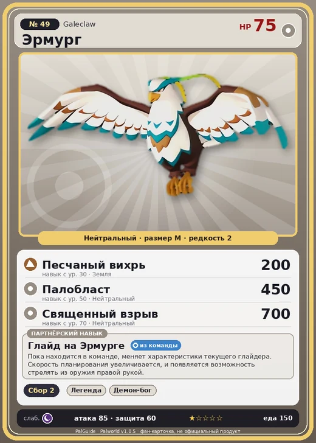

# Эрмург

<canvas id="fx"></canvas>

№ 49 · Galeclaw

Нейтральный

Слабость: Тьма

🌾 Сбор <b>2</b>

<b>Глайд на Эрмурге</b> 🎒 из команды

❤️ 75 · ⚔️ 85 · 🛡 60

| Поле | Значение |
|---|---|
| Стихия | Нейтральный |
| Слабость (кто бьёт сильнее) | Тьма |
| Редкость | 2 |
| Размер | M |
| HP / Атака / Защита (база вида) | 75 / 85 / 60 |
| Сколько ест | 150 |
| Цена продажи | 502 |
| Множитель поимки | ×1 |
| Скорость рывка верхом | 700 |

=== "Обзор"

    #### Работа на базе
    - Сбор — ур. 2

    #### Партнёрский навык: Глайд на Эрмурге
    Пока находится в команде, меняет характеристики текущего глайдера. Скорость планирования увеличивается, и появляется возможность стрелять из оружия правой рукой.

    #### Чем хорош / чем плох
    - ✅
    - ❌ явных минусов нет

    > Легко взлетает, даже схватив человека. Но стоит ему устать — он без жалости разжимает лапы, и случаи падений со смертельным исходом не прекращаются.

    См. также: [Стихии](../../guide/06_stihii.md) · [Разведение](../../guide/07_razvedenie.md) · [Все палы](README.md)

=== "Атаки"

    #### Атаки по уровням
    - ур. 1: Парящие когти (Нейтральный, сила 80)
    - ур. 7: Воздушная пушка (Нейтральный, сила 40)
    - ур. 15: Грязевой выстрел (Земля, сила 40)
    - ур. 22: Ветряной клинок (Трава, сила 40)
    - ур. 30: Песчаный вихрь (Земля, сила 200)
    - ур. 40: Травяной торнадо (Трава, сила 200)
    - ур. 50: Палобласт (Нейтральный, сила 450)
    - ур. 70: Священный взрыв (Нейтральный, сила 700)

=== "Где живёт"

    #### Где водится
    - В дикой природе: да; точек появления днём: 420, ночью: 420; уровни в первых точках: 11–15
    - Подземелья: Пещера Горного Потока, Пещера Ущелья
    - Яйцо: Обычное яйцо

=== "Дроп"

    #### Дроп
    - Мясо Эрмурга — 1 шт., 100%
    - Кожа — 1 шт., 100%

    **Дроп альфы:**
    - Деталь древней цивилизации — 2–4 шт., 100%
    - Ценное перо — 2–4 шт., 100%

=== "Разведение"

    #### Разведение
    - Ранг разведения (CombiRank): 2570

=== "Пассивки"

    #### Лучшие пассивки по роли

    

⚔️ Боец

максимум урона и живучести в бою

<a class="psv r-4" data-psv="Легенда" href="../../../passivki/legend/">Легенда</a><a class="psv r-4" data-psv="Демон-бог" href="../../../passivki/demon_god/">Демон-бог</a><a class="psv r-3" data-psv="Святое небо" href="../../../passivki/celestial_emperor/">Святое небо</a><a class="psv r-3" data-psv="Хладнокровный" href="../../../passivki/serenity/">Хладнокровный</a>

    <small>Нажми на пассивку, чтобы узнать, что она даёт и где её взять.</small>

<a class="card-link" href="../gloopie_primo/">← Глуппи Примо</a><a class="card-link" href="../wispaw/">Виспау →</a>

