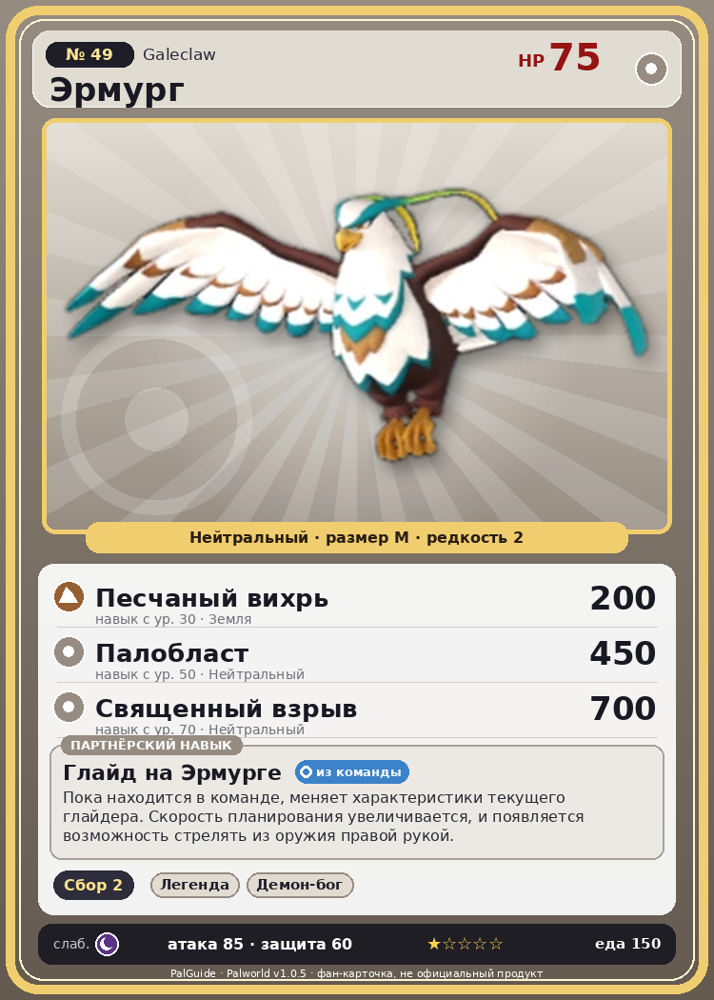

# #49 Эрмург (Galeclaw)

{ width=360 }

| Поле | Значение |
|---|---|
| Стихия | Нейтральный |
| Слабость (кто бьёт сильнее) | Тьма |
| Редкость | 2 |
| Размер | M |
| HP / Атака / Защита (база вида) | 75 / 85 / 60 |
| Сколько ест | 150 |
| Цена продажи | 502 |
| Множитель поимки | ×1 |
| Скорость рывка верхом | 700 |

## Работа на базе
- Сбор — ур. 2

## Партнёрский навык: Глайд на Эрмурге
Пока находится в команде, меняет характеристики текущего глайдера. Скорость планирования увеличивается, и появляется возможность стрелять из оружия правой рукой. level value 1 Пробуждение : 2 Пробуждение : (Улучшение характеристик глайдера: Небольшое ) 3 Пробуждение : (Улучшение характеристик глайдера: Среднее ) 4 Пробуждение : (Улучшение характеристик глайдера: Большое ) 5 Пробуждение : (Улучшение характеристик глайдера: Очень большое ) Lv. GliderMaxSpeed GliderGravityScale GliderSP 1 1000 0.03 2 1150 0.0275 9 3 1300 0.025 8 4 1500 0.0225 7 5 1700 0.02 6

## Атаки по уровням
- ур. 1: Парящие когти (Нейтральный, сила 80)
- ур. 7: Воздушная пушка (Нейтральный, сила 40)
- ур. 15: Грязевой выстрел (Земля, сила 40)
- ур. 22: Ветряной клинок (Трава, сила 40)
- ур. 30: Песчаный вихрь (Земля, сила 200)
- ур. 40: Травяной торнадо (Трава, сила 200)
- ур. 50: Палобласт (Нейтральный, сила 450)
- ур. 70: Священный взрыв (Нейтральный, сила 700)

## Где водится
- В дикой природе: да; точек появления днём: 420, ночью: 420; уровни в первых точках: 11–15
- Подземелья: Пещера Горного Потока, Пещера Ущелья
- Яйцо: Обычное яйцо

## Дроп
- Мясо Эрмурга — 1 шт., 100%
- Кожа — 1 шт., 100%

**Дроп альфы:**
- Деталь древней цивилизации — 2–4 шт., 100%
- Ценное перо — 2–4 шт., 100%

## Разведение
- Ранг разведения (CombiRank): 2570

## Лучшие пассивки по роли
- боец: Легенда, Демон-бог, Хладнокровный, Бессмертие, Святое небо (вместо Бессмертия, если нет мутации)
- ездовой: Божественная скорость, Легенда, Вечный двигатель, Небесное скольжение

## Чем хорош / чем плох
- ✅ можно оседлать
- ❌ явных минусов нет

> Легко взлетает, даже схватив человека. Но стоит ему устать — он без жалости разжимает лапы, и случаи падений со смертельным исходом не прекращаются.

См. также: [Стихии](../../2_mehaniki/stihii.md) · [Разведение](../../2_mehaniki/razvedenie.md) · [Все палы](README.md)
_Источник: paldb.cc v1.0.5_
