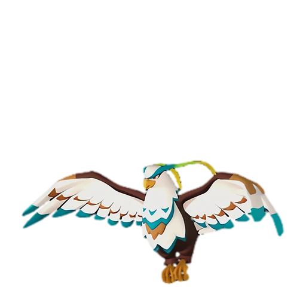

# Эрмург

<canvas id="fx"></canvas>

№ 49 · Galeclaw

Нейтральный

Слабость: Тьма <b class="mx">×1,5</b> <button class="hlp" data-tip="Множители перемножаются по обеим стихиям пала: ×1,5 за каждую стихию, которую атака бьёт, ×0,65 за каждую, которая её держит. Если одна стихия слаба, а другая устойчива (×1,5 × 0,65 ≈ ×0,98), слабости нет.">?</button>

🌾 Сбор <b>2</b>

<b>Глайд на Эрмурге</b> 🎒 из команды

❤️ 75 · ⚔️ 85 · 🛡 60

Основное

💎Редкость <button class="hlp" data-tip="Чем выше число, тем реже встречается пал. 1–4 — обычные, 5–7 — редкие, 8+ — легендарные.">?</button><b>2</b>

📏Размер<b>M</b>

💰Цена продажи <button class="hlp" data-tip="Сколько золота даст торговец за пала.">?</button><b>502</b>

Бой

🎯Множитель поимки <button class="hlp" data-tip="Насколько легче или труднее поймать: ×1 — обычно, меньше — сложнее.">?</button><b>×1</b>

🐎Скорость рывка верхом <button class="hlp" data-tip="Скорость, если сесть на пала и бежать рывком.">?</button><b>700</b>

Ферма и еда

🍖Сколько ест <button class="hlp" data-tip="Сколько сытости пал тратит — чем больше, тем больше еды нужно на базе.">?</button><b>150</b>

Разведение

🧬Сила разведения <button class="hlp" data-tip="Скрытое число игры: у детёныша оно примерно среднее от родителей. Чем меньше — тем «сильнее» пал.">?</button><b>2570</b>

=== "Обзор"

    #### Работа на базе
    - Сбор — ур. 2

    #### Партнёрский навык: Глайд на Эрмурге
    Пока находится в команде, меняет характеристики текущего глайдера. Скорость планирования увеличивается, и появляется возможность стрелять из оружия правой рукой.

    #### Чем хорош / чем плох
    - ✅
    - ❌ явных минусов нет

    > Легко взлетает, даже схватив человека. Но стоит ему устать — он без жалости разжимает лапы, и случаи падений со смертельным исходом не прекращаются.

    См. также: [Стихии](../../guide/06_stihii.md) · [Разведение](../../guide/07_razvedenie.md) · [Все палы](README.md)

=== "Атаки"

    #### Атаки по уровням
    - ур. 1: Парящие когти (Нейтральный, сила 80)
    - ур. 7: Воздушная пушка (Нейтральный, сила 40)
    - ур. 15: Грязевой выстрел (Земля, сила 40)
    - ур. 22: Ветряной клинок (Трава, сила 40)
    - ур. 30: Песчаный вихрь (Земля, сила 200)
    - ур. 40: Травяной торнадо (Трава, сила 200)
    - ур. 50: Палобласт (Нейтральный, сила 450)
    - ур. 70: Священный взрыв (Нейтральный, сила 700)

=== "Где живёт"

    #### Где водится

    

<button data-k="d" class="on">☀️ День</button><button data-k="n">🌙 Ночь</button>

ур. 11–38<a class="btn hm-full" href="../../../map/?pal=Eagle">Показать на большой карте</a>

Берег ПолумесяцаГлубины бамбуковой рощиОстров восходящих ветровЗелёный ручей

🕳 Подземелье<b>Пещера Горного Потока</b>

🕳 Подземелье<b>Пещера Ущелья</b>

🥚 Яйцо<b>Обычное яйцо</b>

=== "Дроп"

    #### Дроп
    - Мясо Эрмурга — 1 шт., 100%
    - Кожа — 1 шт., 100%

    **Дроп альфы:**
    - Деталь древней цивилизации — 2–4 шт., 100%
    - Ценное перо — 2–4 шт., 100%

=== "Разведение"

    #### Разведение
    - Ранг разведения (CombiRank): 2570

=== "Пассивки"

    #### Лучшие пассивки по роли

    

⚔️ Боец

максимум урона и живучести в бою

<a class="psv r-4" data-psv="Легенда" href="../../../passivki/legend/">Легенда</a><a class="psv r-4" data-psv="Демон-бог" href="../../../passivki/demon_god/">Демон-бог</a><a class="psv r-3" data-psv="Святое небо" href="../../../passivki/celestial_emperor/">Святое небо</a><a class="psv r-3" data-psv="Хладнокровный" href="../../../passivki/serenity/">Хладнокровный</a>

    <small>Нажми на пассивку, чтобы узнать, что она даёт и где её взять.</small>

<a class="card-link" href="../gloopie_primo/">← Глуппи Примо</a><a class="card-link" href="../wispaw/">Виспау →</a>

