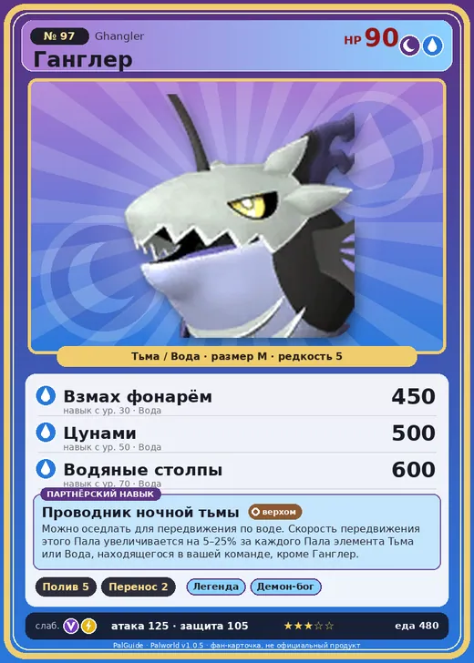

# #97 Ганглер (Ghangler)

#97 · Ghangler

ТьмаВода

Слабость: ДраконМолния

💧 Полив <b>5</b>📦 Транспортировка <b>2</b>

<b>Проводник ночной тьмы</b> 🐎 верхом 🐾 выпущен

❤️ 90 · ⚔️ 125 · 🛡 105

| Поле | Значение |
|---|---|
| Стихия | Тьма, Вода |
| Слабость (кто бьёт сильнее) | Дракон, Молния |
| Редкость | 5 |
| Размер | M |
| HP / Атака / Защита (база вида) | 90 / 125 / 105 |
| Сколько ест | 480 |
| Цена продажи | 2263 |
| Множитель поимки | ×1 |
| Скорость рывка верхом | 800 |

## Работа на базе
- Полив — ур. 5
- Транспортировка — ур. 2

## Партнёрский навык: Проводник ночной тьмы
Можно оседлать для передвижения по воде. Скорость передвижения этого Пала увеличивается на (5~25)% за каждого Пала элемента Тьма или Вода , находящегося в вашей команде, кроме Ганглер . Технологии 31 level value 1 MoveSpeed_PartnerSkill_SpecificElement 5 2 MoveSpeed_PartnerSkill_SpecificElement 9 3 MoveSpeed_PartnerSkill_SpecificElement 13 4 MoveSpeed_PartnerSkill_SpecificElement 18 5 MoveSpeed_PartnerSkill_SpecificElement 25

## Атаки по уровням
- ур. 1: Водяной выстрел (Вода, сила 50)
- ур. 7: Тёмный шар (Тьма, сила 50)
- ур. 15: Стрелы тьмы (Тьма, сила 120)
- ур. 22: Духовное пламя (Тьма, сила 200)
- ур. 30: Взмах фонарём (Вода, сила 450)
- ур. 40: Тёмный лазер (Тьма, сила 450)
- ур. 50: Цунами (Вода, сила 500)
- ур. 70: Водяные столпы (Вода, сила 600)

## Где водится
- В дикой природе: да; точек появления днём: 82, ночью: 316; уровни в первых точках: 30–40
- Подземелья: Пещера Вулкана, Пещера Цветущей Сакуры
- Яйцо: Большое яйцо тьмы

## Дроп
- Кость — 2–3 шт., 100%
- Ядовитая железа — 2–4 шт., 100%

**Дроп альфы:**
- Деталь древней цивилизации — 2–3 шт., 100%
- Ценный коготь — 2–3 шт., 100%

## Разведение
- Ранг разведения (CombiRank): 880
- Участвует в особых парах: Гостлайт → Ганглер Игнис

## Лучшие пассивки по роли
- боец: Легенда, Демон-бог, Хладнокровный, Бессмертие, Король тьмы (вместо Бессмертия, если нет мутации)
- рабочий: Дьявольские руки, Виртуоз, Мастеровитый, Небожитель/Трудоголик
- ездовой: Божественная скорость, Легенда, Вечный двигатель, Небесное скольжение

## Чем хорош / чем плох
- ✅ очень высокая атака (125); отличный рабочий (пригодность 5); можно оседлать
- ❌ явных минусов нет

> Сияющей приманкой он озаряет темноту. Заблудшие Палы, привлечённые светом, если попадутся Ганглер , уже не смогут сбежать. Он будет преследовать их, пока не убедится, что они благополучно добрались домой.

См. также: [Стихии](../../guide/06_stihii.md) · [Разведение](../../guide/07_razvedenie.md) · [Все палы](README.md)
