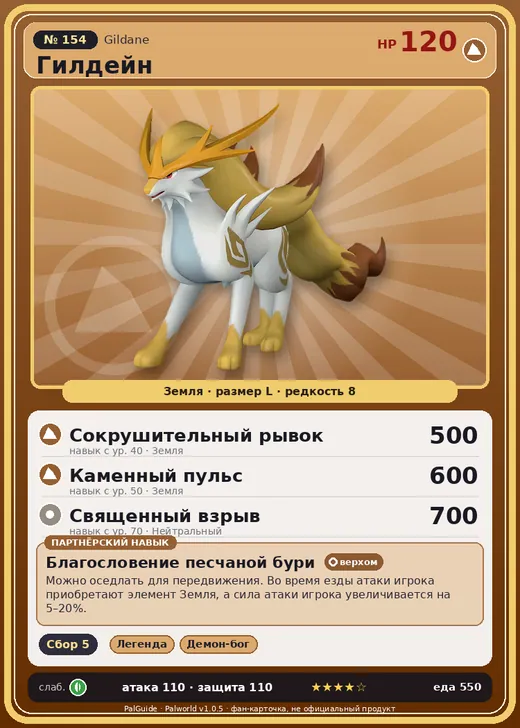

# #154 Гилдейн (Gildane)

№ 154

Земля

Слабость: Трава

🌾 Сбор <b>5</b>

<b>Благословение песчаной бури</b> 🐎 верхом

❤️ 120 · ⚔️ 110 · 🛡 110

| Поле | Значение |
|---|---|
| Стихия | Земля |
| Слабость (кто бьёт сильнее) | Трава |
| Редкость | 8 |
| Размер | L |
| HP / Атака / Защита (база вида) | 120 / 110 / 110 |
| Сколько ест | 550 |
| Цена продажи | 2622 |
| Множитель поимки | ×1 |
| Скорость рывка верхом | 1260 |

## Работа на базе
- Сбор — ур. 5

## Партнёрский навык: Благословение песчаной бури
Можно оседлать для передвижения. Во время езды атаки игрока приобретают элемент Земля , а сила атаки игрока увеличивается на (5~20)% . Технологии 54 level value 1 GiveAEarth_Ride 1 GiveElement_TrainerATK_UP_PartnerSkill_Ride 5 2 GiveAEarth_Ride 1 GiveElement_TrainerATK_UP_PartnerSkill_Ride 7 3 GiveAEarth_Ride 1 GiveElement_TrainerATK_UP_PartnerSkill_Ride 10 4 GiveAEarth_Ride 1 GiveElement_TrainerATK_UP_PartnerSkill_Ride 14 5 GiveAEarth_Ride 1 GiveElement_TrainerATK_UP_PartnerSkill_Ride 20

## Атаки по уровням
- ур. 1: Двойные клыки (земля) (Земля, сила 40)
- ур. 2: Дикие клыки (земля) (Земля, сила 50)
- ур. 3: Силовой выстрел (Нейтральный, сила 80)
- ур. 7: Грязевой выстрел (Земля, сила 40)
- ур. 15: Каменный залп (Земля, сила 80)
- ур. 22: Силовая бомба (Нейтральный, сила 120)
- ур. 30: Камнепад (Земля, сила 300)
- ур. 40: Сокрушительный рывок (Земля, сила 500)
- ур. 50: Каменный пульс (Земля, сила 600)
- ур. 70: Священный взрыв (Нейтральный, сила 700)

## Где водится
- В дикой природе: да; точек появления днём: 356, ночью: 356; уровни в первых точках: 53–56
- Подземелья: Пещера Тэнраку
- Яйцо: Огромное яйцо земли

## Дроп
- Кожа — 2–3 шт., 100%

**Дроп альфы:**
- Деталь древней цивилизации — 6–8 шт., 100%
- Ценный мех — 2–3 шт., 100%

## Разведение
- Ранг разведения (CombiRank): 730
- Участвует в особых парах: Иктирдир Тэрра → Селесдир

## Лучшие пассивки по роли
- боец: Легенда, Демон-бог, Хладнокровный, Бессмертие, Император земли (вместо Бессмертия, если нет мутации)
- рабочий: Дьявольские руки, Виртуоз, Мастеровитый, Небожитель/Трудоголик
- ездовой: Божественная скорость, Легенда, Вечный двигатель, Небесное скольжение

## Чем хорош / чем плох
- ✅ хорошая атака (110); много здоровья (120); отличный рабочий (пригодность 5); можно оседлать
- ❌ много ест (550)

> Во времена, когда на острове процветала алхимия, золотистый мех этих Палов ценился как катализатор для получения золота. Спустя какое-то время было сделано замечательное открытие: если важен лишь золотой цвет, достаточно просто обработать гриву.

См. также: [Стихии](../../guide/06_stihii.md) · [Разведение](../../guide/07_razvedenie.md) · [Все палы](README.md)
