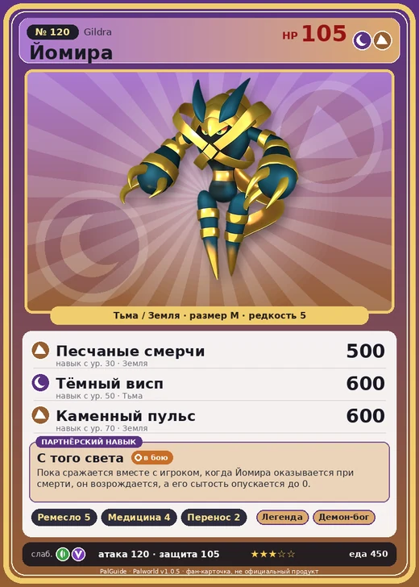

# Йомира

<canvas id="fx"></canvas>

№ 120

ТьмаЗемля

Слабость: Трава <b class="mx">×1,5</b>Дракон <b class="mx">×1,5</b> <button class="hlp" data-tip="Множители перемножаются по обеим стихиям: ×1,5 за стихию, которую атака бьёт, ×0,65 за ту, что её держит. Трава: 1 × 1,5 = ×1,5; Дракон: 1,5 × 1 = ×1,5.">?</button>

Устойчив: Нейтральный <b class="mx">×0,65</b>Молния <b class="mx">×0,65</b>

🖐️ Ручная работа <b>5</b>💊 Фармацевтика <b>4</b>📦 Транспортировка <b>2</b>

<b>С того света</b> 🐾 Когда пал выпущен

❤️ 105 · ⚔️ 120 · 🛡 105

Основное

💎Редкость <button class="hlp" data-tip="Чем выше число, тем реже встречается пал. 1–4 — обычные, 5–7 — редкие, 8+ — легендарные.">?</button><b>5</b>

📏Размер<b>M</b>

💰Цена продажи <button class="hlp" data-tip="Сколько золота даст торговец за пала.">?</button><b>2529</b>

Бой

🎯Множитель поимки <button class="hlp" data-tip="Насколько легче или труднее поймать: ×1 — обычно, меньше — сложнее.">?</button><b>×1</b>

🐎Скорость рывка верхом <button class="hlp" data-tip="Скорость, если сесть на пала и бежать рывком.">?</button><b>720</b>

Ферма и еда

🍖Сколько ест <button class="hlp" data-tip="Сколько сытости пал тратит — чем больше, тем больше еды нужно на базе.">?</button><b>450</b>

Разведение

🧬Сила разведения <button class="hlp" data-tip="Скрытое число игры: у детёныша оно примерно среднее от родителей. Чем меньше — тем «сильнее» пал.">?</button><b>1170</b>

=== "Обзор"

    #### Работа на базе

    
<a class="wbar" href="../../../2_mehaniki/rabota/?w=handiwork&lv=5">✋ Ручная работа<i style="--v:50%"></i><b>5</b></a><a class="wbar" href="../../../2_mehaniki/rabota/?w=medicine&lv=4">💊 Фармацевтика<i style="--v:40%"></i><b>4</b></a><a class="wbar" href="../../../2_mehaniki/rabota/?w=transporting&lv=2">📦 Транспортировка<i style="--v:20%"></i><b>2</b></a><a class="wb-more" href="../../../2_mehaniki/rabota/">Что значат уровни работы →</a>

    #### Партнёрский навык: С того света
    Пока сражается вместе с игроком, когда Йомира оказывается при смерти, он возрождается, а его сытость опускается до 0.

    #### Чем хорош / чем плох
    - ✅ очень высокая атака (120); отличный рабочий (пригодность 5)
    - ❌ явных минусов нет

    > Золотистый, похожий на бинт орган свободно растягивается и сжимается. Если он слишком пересохнет, может надорваться, поэтому ежедневная проверка увлажнённости абсолютно необходима.

    См. также: [Стихии](../../guide/06_stihii.md) · [Разведение](../../guide/07_razvedenie.md) · [Все палы](README.md)

=== "Атаки"

    #### Атаки по уровням
    - ур. 1: Тёмный шар (Тьма, сила 50)
    - ур. 7: Духовное пламя (Тьма, сила 200)
    - ур. 15: Песчаный вихрь (Земля, сила 200)
    - ур. 22: Кошмарная сфера (Тьма, сила 300)
    - ур. 30: Песчаные смерчи (Земля, сила 500)
    - ур. 40: Мумийный натиск (Тьма, сила 500)
    - ур. 50: Тёмный висп (Тьма, сила 600)
    - ур. 70: Каменный пульс (Земля, сила 600)

=== "Где живёт"

    #### Где водится

    

<button data-k="d" class="on">☀️ День</button><button data-k="n">🌙 Ночь</button>

<button data-w=p class=on>Палпагос</button><button data-w=t>Мировое древо</button>

ур. 39–80<a class="btn hm-full" href="../../../map/?pal=MummyPal">Показать на большой карте</a>

Иссохшие дюныШрамы войны

🥚 Яйцо<b>Большое яйцо тьмы</b>

🛒 Торговец<b>Продаётся у торговца палами</b>

=== "Дроп"

    #### Дроп
    - Ткань — 2–3 шт., 100%
    - Кожа — 2–3 шт., 100%

    **Дроп альфы:**

    - Деталь древней цивилизации — 3–5 шт., 100%
    - Ценный коготь — 2–3 шт., 100%

=== "Разведение"

    #### Разведение
    - Ранг разведения: 1170

=== "Пассивки"

    #### Лучшие пассивки по роли

    

⚔️ Боец

максимум урона и живучести в бою

<a class="psv r-4" data-psv="Легенда" href="../../../passivki/legend/">Легенда</a><a class="psv r-4" data-psv="Демон-бог" href="../../../passivki/demon_god/">Демон-бог</a><a class="psv r-3" data-psv="Король тьмы" href="../../../passivki/lord_of_the_underworld/">Король тьмы</a><a class="psv r-3" data-psv="Хладнокровный" href="../../../passivki/serenity/">Хладнокровный</a>

🛠 Рабочий

работает быстрее и меньше устаёт на базе

<a class="psv r-5" data-psv="Дьявольские руки" href="../../../passivki/demons_hand/">Дьявольские руки</a><a class="psv r-4" data-psv="Виртуоз" href="../../../passivki/remarkable_craftsmanship/">Виртуоз</a><a class="psv r-3" data-psv="Мастеровитый" href="../../../passivki/artisan/">Мастеровитый</a><a class="psv r-3" data-psv="Трудоголик" href="../../../passivki/workaholic/">Трудоголик</a>

    <small>Нажми на пассивку, чтобы узнать, что она даёт и где её взять.</small>

<a class="card-link" href="../icelyn/">← Айселин</a><a class="card-link" href="../jormuntide/">Йормунтайд →</a>

