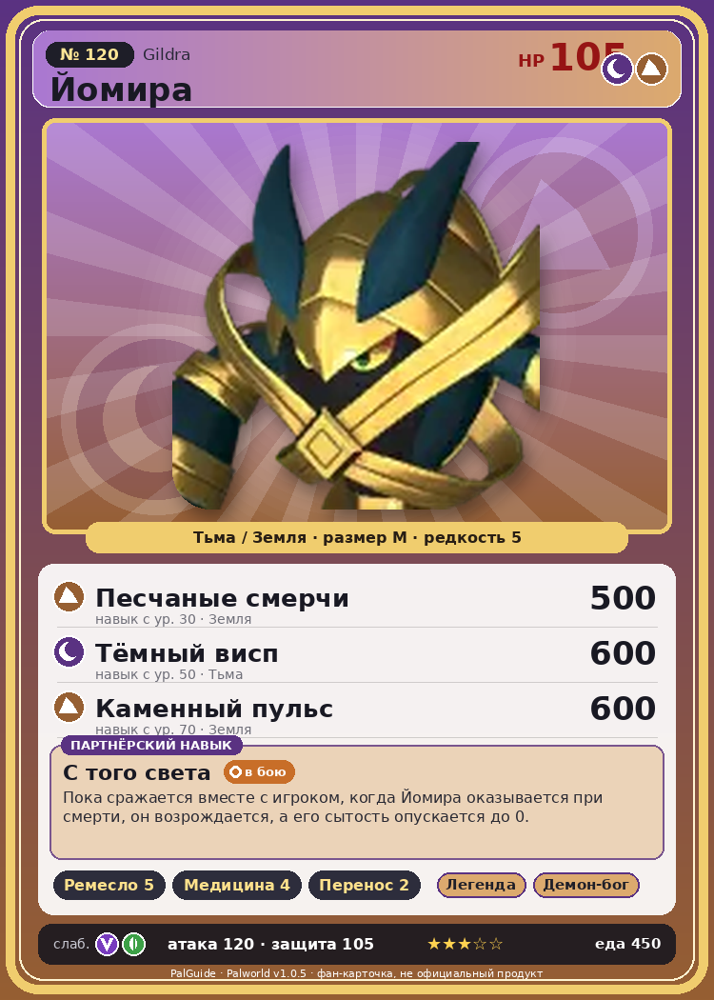

# #120 Йомира (Gildra)

{ width=360 }

| Поле | Значение |
|---|---|
| Стихия | Тьма, Земля |
| Слабость (кто бьёт сильнее) | Дракон, Трава |
| Редкость | 5 |
| Размер | M |
| HP / Атака / Защита (база вида) | 105 / 120 / 105 |
| Сколько ест | 450 |
| Цена продажи | 2529 |
| Множитель поимки | ×1 |
| Скорость рывка верхом | 720 |

## Работа на базе
- Ручная работа — ур. 5
- Фармацевтика — ур. 4
- Транспортировка — ур. 2

## Партнёрский навык: С того света
Пока сражается вместе с игроком, когда Йомира оказывается при смерти, он возрождается , а его сытость опускается до 0. level value 1 OverWriteCoolTime 600 Пробуждение : 2 OverWriteCoolTime 550 Пробуждение : (Сокращение перезарядки: Небольшое ) 3 OverWriteCoolTime 480 Пробуждение : (Сокращение перезарядки: Среднее ) 4 OverWriteCoolTime 390 Пробуждение : (Сокращение перезарядки: Большое ) 5 OverWriteCoolTime 280 Пробуждение : (Сокращение перезарядки: Очень большое )

## Атаки по уровням
- ур. 1: Тёмный шар (Тьма, сила 50)
- ур. 7: Духовное пламя (Тьма, сила 200)
- ур. 15: Песчаный вихрь (Земля, сила 200)
- ур. 22: Кошмарная сфера (Тьма, сила 300)
- ур. 30: Песчаные смерчи (Земля, сила 500)
- ур. 40: Мумийный натиск (Тьма, сила 500)
- ур. 50: Тёмный висп (Тьма, сила 600)
- ур. 70: Каменный пульс (Земля, сила 600)

## Где водится
- В дикой природе: да; точек появления днём: 325, ночью: 325; уровни в первых точках: 39–44
- Может продаваться у торговца/рекрутера
- Яйцо: Большое яйцо тьмы

## Дроп
- Ткань — 2–3 шт., 100%
- Кожа — 2–3 шт., 100%

**Дроп альфы:**
- Деталь древней цивилизации — 3–5 шт., 100%
- Ценный коготь — 2–3 шт., 100%

## Разведение
- Ранг разведения (CombiRank): 1170

## Лучшие пассивки по роли
- боец: Легенда, Демон-бог, Хладнокровный, Бессмертие, Король тьмы (вместо Бессмертия, если нет мутации)
- рабочий: Дьявольские руки, Виртуоз, Мастеровитый, Небожитель/Трудоголик
- ездовой: Божественная скорость, Легенда, Вечный двигатель, Небесное скольжение

## Чем хорош / чем плох
- ✅ очень высокая атака (120); отличный рабочий (пригодность 5); можно оседлать
- ❌ явных минусов нет

> Золотистый, похожий на бинт орган свободно растягивается и сжимается. Если он слишком пересохнет, может надорваться, поэтому ежедневная проверка увлажнённости абсолютно необходима.

См. также: [Стихии](../../2_mehaniki/stihii.md) · [Разведение](../../2_mehaniki/razvedenie.md) · [Все палы](README.md)
_Источник: paldb.cc v1.0.5_
