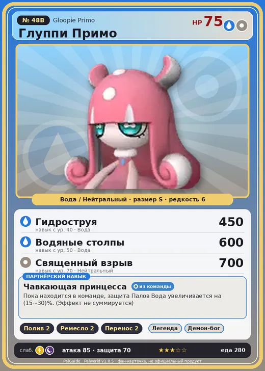

# Глуппи Примо

<canvas id="fx"></canvas>

№ 48B · Gloopie Primo

ВодаНейтральный

Слабость: МолнияТьма

💧 Полив <b>2</b>🖐️ Ручная работа <b>2</b>📦 Транспортировка <b>2</b>

<b>Чавкающая принцесса</b> 🎒 из команды

❤️ 75 · ⚔️ 85 · 🛡 70

| Поле | Значение |
|---|---|
| Стихия | Вода, Нейтральный |
| Слабость (кто бьёт сильнее) | Молния, Тьма |
| Редкость | 6 |
| Размер | S |
| HP / Атака / Защита (база вида) | 75 / 85 / 70 |
| Сколько ест | 280 |
| Цена продажи | 1612 |
| Множитель поимки | ×1 |
| Скорость рывка верхом | 500 |

=== "Обзор"

    #### Работа на базе
    - Полив — ур. 2
    - Ручная работа — ур. 2
    - Транспортировка — ур. 2

    #### Партнёрский навык: Чавкающая принцесса
    Пока находится в команде, защита Палов Вода увеличивается на 15–30%. (Эффект не суммируется). По звёздам: 0★ 15 · 1★ 17 · 2★ 20 · 3★ 24 · 4★ 30

    #### Чем хорош / чем плох
    - ✅
    - ❌ разводится только особой парой

    > Если берёте его с собой в постель, лучше заранее проверить расписание на завтра. Следы от его присосок похожи на поцелуи, так что если он случайно присосётся во сне — это может вызвать ненужную тревогу у окружающих.

    См. также: [Стихии](../../guide/06_stihii.md) · [Разведение](../../guide/07_razvedenie.md) · [Все палы](README.md)

=== "Атаки"

    #### Атаки по уровням
    - ур. 1: Акваджет (Вода, сила 40)
    - ур. 7: Силовой выстрел (Нейтральный, сила 80)
    - ур. 15: Дымовой рывок (Вода, сила 120)
    - ур. 22: Воздушные клинки (Нейтральный, сила 160)
    - ур. 30: Гидрорезак (Вода, сила 350)
    - ур. 40: Гидроструя (Вода, сила 450)
    - ур. 50: Водяные столпы (Вода, сила 600)
    - ур. 70: Священный взрыв (Нейтральный, сила 700)

=== "Где живёт"

    #### Где водится
    - В дикой природе: да; точек появления днём: 105, ночью: 105
    - Яйцо: Большое яйцо воды

=== "Дроп"

    #### Дроп
    - Жидкость водного Пала — 1–2 шт., 100%
    - Щупальце Глуппи — 1–2 шт., 100%

    **Дроп альфы:**
    - Деталь древней цивилизации — 2–3 шт., 100%
    - Ценные внутренности — 2–3 шт., 100%

=== "Разведение"

    #### Разведение
    - Ранг разведения (CombiRank): 1630
    - **Особая пара:** [Глуппи](../../4_spravochniki/paly/gloopie.md) + [Валентейл](../../4_spravochniki/paly/valentail.md)

=== "Пассивки"

    #### Лучшие пассивки по роли

    

⚔️ Боец

максимум урона и живучести в бою

<a class="psv r-4" data-psv="Легенда" href="../../../passivki/legend/">Легенда</a><a class="psv r-4" data-psv="Демон-бог" href="../../../passivki/demon_god/">Демон-бог</a><a class="psv r-3" data-psv="Владыка морей" href="../../../passivki/lord_of_the_sea/">Владыка морей</a><a class="psv r-3" data-psv="Хладнокровный" href="../../../passivki/serenity/">Хладнокровный</a>

    <small>Нажми на пассивку, чтобы узнать, что она даёт и где её взять.</small>

<a class="card-link" href="../gloopie/">← Глуппи</a><a class="card-link" href="../galeclaw/">Эрмург →</a>

