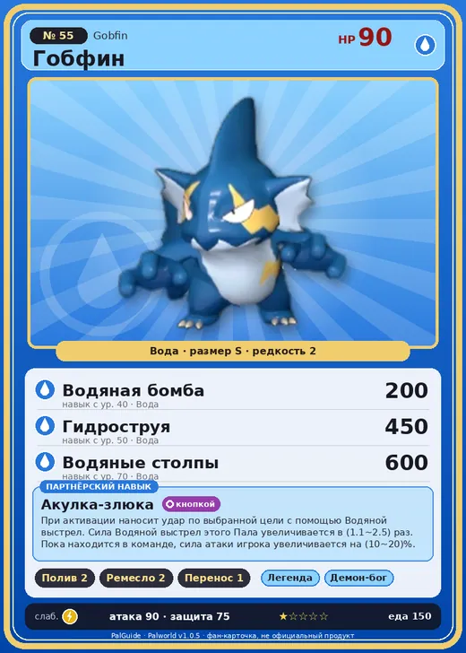

# Гобфин

<canvas id="fx"></canvas>

№ 55 · Gobfin

Вода

Слабость: Молния

💧 Полив <b>2</b>🖐️ Ручная работа <b>2</b>📦 Транспортировка <b>1</b>

<b>Акулка-злюка</b> 🎒 из команды 🐾 выпущен 🔘 кнопкой

❤️ 90 · ⚔️ 90 · 🛡 75

Основное

💎Редкость <button class="hlp" data-tip="Чем выше число, тем реже встречается пал. 1–4 — обычные, 5–7 — редкие, 8+ — легендарные.">?</button><b>2</b>

📏Размер<b>S</b>

💰Цена продажи <button class="hlp" data-tip="Сколько золота даст торговец за пала.">?</button><b>850</b>

Бой

🎯Множитель поимки <button class="hlp" data-tip="Насколько легче или труднее поймать: ×1 — обычно, меньше — сложнее.">?</button><b>×1</b>

🐎Скорость рывка верхом <button class="hlp" data-tip="Скорость, если сесть на пала и бежать рывком.">?</button><b>500</b>

Ферма и еда

🍖Сколько ест <button class="hlp" data-tip="Сколько сытости пал тратит — чем больше, тем больше еды нужно на базе.">?</button><b>150</b>

Разведение

🧬Сила разведения <button class="hlp" data-tip="Скрытое число игры: у детёныша оно примерно среднее от родителей. Чем меньше — тем «сильнее» пал.">?</button><b>2550</b>

=== "Обзор"

    #### Работа на базе
    - Полив — ур. 2
    - Ручная работа — ур. 2
    - Транспортировка — ур. 1

    #### Партнёрский навык: Акулка-злюка
    При активации наносит удар по выбранной цели с помощью Водяной выстрел. Сила Водяной выстрел этого Пала увеличивается в (1.1~2.5) раз. Пока находится в команде, сила атаки игрока увеличивается на 10–20%. По звёздам: 0★ 10 · 1★ 11 · 2★ 13 · 3★ 16 · 4★ 20

    #### Чем хорош / чем плох
    - ✅
    - ❌ явных минусов нет

    > В древности он был огромным и сильным водным Палом, но из-за нехватки пищи переселился на сушу. Передвижение по земле оказалось слишком энергозатратным, и со временем он уменьшился до нынешнего, жалкого состояния.

    См. также: [Стихии](../../guide/06_stihii.md) · [Разведение](../../guide/07_razvedenie.md) · [Все палы](README.md)

=== "Атаки"

    #### Атаки по уровням
    - ур. 1: Акваджет (Вода, сила 40)
    - ур. 7: Силовой выстрел (Нейтральный, сила 80)
    - ур. 15: Водяной выстрел (Вода, сила 50)
    - ур. 22: Пузырьковый выстрел (Вода, сила 80)
    - ур. 30: Ледяной резак (Лёд, сила 80)
    - ур. 40: Водяная бомба (Вода, сила 200)
    - ур. 50: Гидроструя (Вода, сила 450)
    - ур. 70: Водяные столпы (Вода, сила 600)

=== "Где живёт"

    #### Где водится
    - В дикой природе: да; точек появления днём: 67, ночью: 67; уровни в первых точках: 14–17
    - Подземелья: Пещера Горного Потока
    - Яйцо: Яйцо воды

=== "Дроп"

    #### Дроп
    - Жидкость водного Пала — 1 шт., 100%

    **Дроп альфы:**
    - Деталь древней цивилизации — 2–4 шт., 100%
    - Ценный коготь — 2–4 шт., 100%

=== "Разведение"

    #### Разведение
    - Ранг разведения (CombiRank): 2550
    - Участвует в особых парах: Руби → Гобфин Игнис

=== "Пассивки"

    #### Лучшие пассивки по роли

    

⚔️ Боец

максимум урона и живучести в бою

<a class="psv r-4" data-psv="Легенда" href="../../../passivki/legend/">Легенда</a><a class="psv r-4" data-psv="Демон-бог" href="../../../passivki/demon_god/">Демон-бог</a><a class="psv r-3" data-psv="Владыка морей" href="../../../passivki/lord_of_the_sea/">Владыка морей</a><a class="psv r-3" data-psv="Хладнокровный" href="../../../passivki/serenity/">Хладнокровный</a>

    <small>Нажми на пассивку, чтобы узнать, что она даёт и где её взять.</small>

<a class="card-link" href="../univolt_cryst/">← Юнивольт Крист</a><a class="card-link" href="../gobfin_ignis/">Гобфин Игнис →</a>

