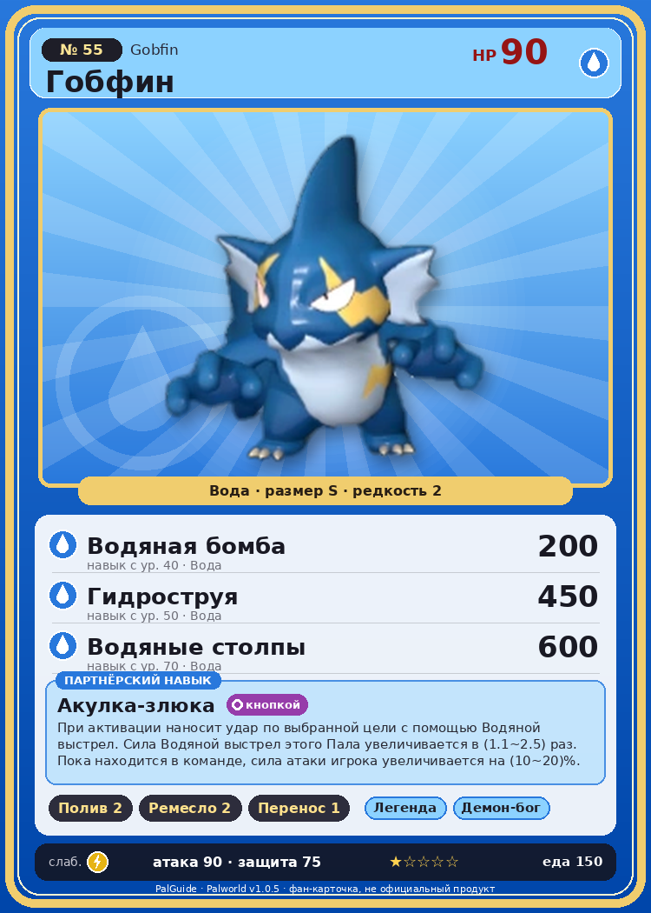

# #55 Гобфин (Gobfin)

{ width=360 }

| Поле | Значение |
|---|---|
| Стихия | Вода |
| Слабость (кто бьёт сильнее) | Молния |
| Редкость | 2 |
| Размер | S |
| HP / Атака / Защита (база вида) | 90 / 90 / 75 |
| Сколько ест | 150 |
| Цена продажи | 850 |
| Множитель поимки | ×1 |
| Скорость рывка верхом | 500 |

## Работа на базе
- Полив — ур. 2
- Ручная работа — ур. 2
- Транспортировка — ур. 1

## Партнёрский навык: Акулка-злюка
При активации наносит удар по выбранной цели с помощью Водяной выстрел . Сила Водяной выстрел этого Пала увеличивается в (1.1~2.5) раз . Пока находится в команде, сила атаки игрока увеличивается на (10~20)% . level value 1 TrainerATK_UP_PartnerSkill 10 MainValue 1.1 2 TrainerATK_UP_PartnerSkill 11 MainValue 1.3 3 TrainerATK_UP_PartnerSkill 13 MainValue 1.6 4 TrainerATK_UP_PartnerSkill 16 MainValue 2 5 TrainerATK_UP_PartnerSkill 20 MainValue 2.5

## Атаки по уровням
- ур. 1: Акваджет (Вода, сила 40)
- ур. 7: Силовой выстрел (Нейтральный, сила 80)
- ур. 15: Водяной выстрел (Вода, сила 50)
- ур. 22: Пузырьковый выстрел (Вода, сила 80)
- ур. 30: Ледяной резак (Лёд, сила 80)
- ур. 40: Водяная бомба (Вода, сила 200)
- ур. 50: Гидроструя (Вода, сила 450)
- ур. 70: Водяные столпы (Вода, сила 600)

## Где водится
- В дикой природе: да; точек появления днём: 67, ночью: 67; уровни в первых точках: 14–17
- Подземелья: Пещера Горного Потока
- Яйцо: Яйцо воды

## Дроп
- Жидкость водного Пала — 1 шт., 100%

**Дроп альфы:**
- Деталь древней цивилизации — 2–4 шт., 100%
- Ценный коготь — 2–4 шт., 100%

## Разведение
- Ранг разведения (CombiRank): 2550
- Участвует в особых парах: Руби → Гобфин Игнис

## Лучшие пассивки по роли
- боец: Легенда, Демон-бог, Хладнокровный, Бессмертие, Владыка морей (вместо Бессмертия, если нет мутации)
- ездовой: Божественная скорость, Легенда, Вечный двигатель, Небесное скольжение

## Чем хорош / чем плох
- ✅ можно оседлать
- ❌ явных минусов нет

> В древности он был огромным и сильным водным Палом, но из-за нехватки пищи переселился на сушу. Передвижение по земле оказалось слишком энергозатратным, и со временем он уменьшился до нынешнего, жалкого состояния.

См. также: [Стихии](../../2_mehaniki/stihii.md) · [Разведение](../../2_mehaniki/razvedenie.md) · [Все палы](README.md)
_Источник: paldb.cc v1.0.5_
