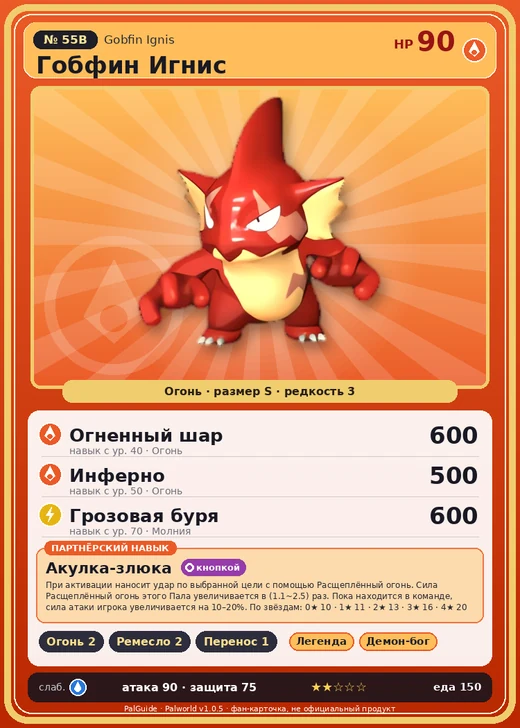

# Гобфин Игнис

<canvas id="fx"></canvas>

№ 55B

Огонь

Слабость: Вода <b class="mx">×1,5</b> <button class="hlp" data-tip="Множители перемножаются по обеим стихиям: ×1,5 за стихию, которую атака бьёт, ×0,65 за ту, что её держит.">?</button>

Устойчив: Трава <b class="mx">×0,65</b>Лёд <b class="mx">×0,65</b>

🔥 Разжигание огня <b>2</b>🖐️ Ручная работа <b>2</b>📦 Транспортировка <b>1</b>

<b>Акулка-злюка</b> 🎒 Работает из команды🐾 Когда пал выпущен🔘 Включается кнопкой

❤️ 90 · ⚔️ 90 · 🛡 75

Основное

💎Редкость <button class="hlp" data-tip="Чем выше число, тем реже встречается пал. 1–4 — обычные, 5–7 — редкие, 8+ — легендарные.">?</button><b>3</b>

📏Размер<b>S</b>

💰Цена продажи <button class="hlp" data-tip="Сколько золота даст торговец за пала.">?</button><b>850</b>

Бой

🎯Множитель поимки <button class="hlp" data-tip="Насколько легче или труднее поймать: ×1 — обычно, меньше — сложнее.">?</button><b>×1</b>

🐎Скорость рывка верхом <button class="hlp" data-tip="Скорость, если сесть на пала и бежать рывком.">?</button><b>500</b>

Ферма и еда

🍖Сколько ест <button class="hlp" data-tip="Сколько сытости пал тратит — чем больше, тем больше еды нужно на базе.">?</button><b>150</b>

Разведение

🧬Сила разведения <button class="hlp" data-tip="Скрытое число игры: у детёныша оно примерно среднее от родителей. Чем меньше — тем «сильнее» пал.">?</button><b>2430</b>

💞Особая пара <button class="hlp" data-tip="Этого пала можно вывести только от этой пары.">?</button><b>Гобфин + Руби</b>

=== "Обзор"

    #### Работа на базе

    
<a class="wbar" href="../../../2_mehaniki/rabota/?w=kindling&lv=2">🔥 Разжигание огня<i style="--v:20%"></i><b>2</b></a><a class="wbar" href="../../../2_mehaniki/rabota/?w=handiwork&lv=2">✋ Ручная работа<i style="--v:20%"></i><b>2</b></a><a class="wbar" href="../../../2_mehaniki/rabota/?w=transporting&lv=1">📦 Транспортировка<i style="--v:10%"></i><b>1</b></a><a class="wb-more" href="../../../2_mehaniki/rabota/">Что значат уровни работы →</a>

    #### Партнёрский навык: Акулка-злюка
    При активации наносит удар по выбранной цели с помощью Расщеплённый огонь. Сила Расщеплённый огонь этого Пала увеличивается в (1.1~2.5) раз. Пока находится в команде, сила атаки игрока увеличивается на 10–20%. По звёздам: 0★ 10 · 1★ 11 · 2★ 13 · 3★ 16 · 4★ 20

    #### Чем хорош / чем плох
    - ✅ хорошая атака (90)
    - ❌ разводится только особой парой

    > В древности он был огромным и сильным водным Палом, но из-за нехватки пищи вышел на сушу. Сжигая уйму калорий при ходьбе, он — как ни странно — пробудил в себе силу огня!

    См. также: [Стихии](../../guide/06_stihii.md) · [Разведение](../../guide/07_razvedenie.md) · [Все палы](README.md)

=== "Атаки"

    #### Атаки по уровням
    - ур. 1: Огненный выстрел (Огонь, сила 40)
    - ур. 7: Силовой выстрел (Нейтральный, сила 80)
    - ур. 15: Расщеплённый огонь (Огонь, сила 80)
    - ур. 22: Огненная стрела (Огонь, сила 120)
    - ур. 30: Грозовая линия (Молния, сила 160)
    - ур. 40: Огненный шар (Огонь, сила 600)
    - ур. 50: Инферно (Огонь, сила 500)
    - ур. 70: Грозовая буря (Молния, сила 600)

=== "Где живёт"

    #### Где водится

    

<button data-k="d" class="on">☀️ День</button><button data-k="n">🌙 Ночь</button>

ур. 34–55<a class="btn hm-full" href="../../../map/?pal=SharkKid_Fire">Показать на большой карте</a>

Обсидиановый вулканРазрушенный город-крепостьБолотный остров

🕳 Подземелье<b>Пещера Вулкана</b>

🥚 Яйцо<b>Раскалённое яйцо</b>

🛒 Торговец<b>Продаётся у торговца палами</b>

=== "Дроп"

    #### Дроп
    - Огненный орган — 1 шт., 100%

    **Дроп альфы:**

    - Деталь древней цивилизации — 2–4 шт., 100%
    - Ценный коготь — 2–4 шт., 100%

=== "Разведение"

    #### Разведение
    - Ранг разведения: 2430
    - **Особая пара:** [Гобфин](../../4_spravochniki/paly/gobfin.md) + [Руби](../../4_spravochniki/paly/rooby.md)
    - Участвует в особых парах: [Финсайдер](finsider.md) → [Финсайдер Игнис](finsider_ignis.md); [Скатласс](skutlass.md) → [Скатласс Игнис](skutlass_ignis.md)

=== "Пассивки"

    #### Лучшие пассивки по роли

    

⚔️ Боец

максимум урона и живучести в бою

<a class="psv r-4" data-psv="Легенда" href="../../../passivki/legend/">Легенда</a><a class="psv r-4" data-psv="Демон-бог" href="../../../passivki/demon_god/">Демон-бог</a><a class="psv r-3" data-psv="Император огня" href="../../../passivki/flame_emperor/">Император огня</a><a class="psv r-3" data-psv="Хладнокровный" href="../../../passivki/serenity/">Хладнокровный</a>

    <small>Нажми на пассивку, чтобы узнать, что она даёт и где её взять.</small>

<a class="card-link" href="../gobfin/">← Гобфин</a><a class="card-link" href="../loupmoon/">Лупмун →</a>

