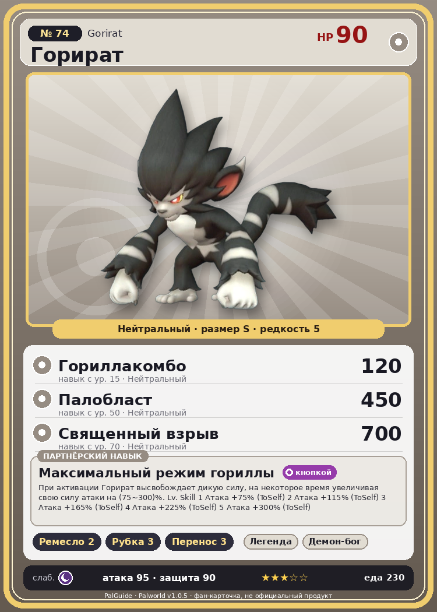

# #74 Горират (Gorirat)

{ width=360 }

| Поле | Значение |
|---|---|
| Стихия | Нейтральный |
| Слабость (кто бьёт сильнее) | Тьма |
| Редкость | 5 |
| Размер | S |
| HP / Атака / Защита (база вида) | 90 / 95 / 90 |
| Сколько ест | 230 |
| Цена продажи | 1214 |
| Множитель поимки | ×1 |
| Скорость рывка верхом | 720 |

## Работа на базе
- Ручная работа — ур. 2
- Рубка деревьев — ур. 3
- Транспортировка — ур. 3

## Партнёрский навык: Максимальный режим гориллы
При активации Горират высвобождает дикую силу, на некоторое время увеличивая свою силу атаки на (75~300)% . Lv. Skill 1 Атака +75% (ToSelf) 2 Атака +115% (ToSelf) 3 Атака +165% (ToSelf) 4 Атака +225% (ToSelf) 5 Атака +300% (ToSelf)

## Атаки по уровням
- ур. 1: Грязевой выстрел (Земля, сила 40)
- ур. 7: Силовой выстрел (Нейтральный, сила 80)
- ур. 15: Гориллакомбо (Нейтральный, сила 120)
- ур. 22: Каменный залп (Земля, сила 80)
- ур. 30: Семенной пулемёт (Трава, сила 80)
- ур. 40: Силовая бомба (Нейтральный, сила 120)
- ур. 50: Палобласт (Нейтральный, сила 450)
- ур. 70: Священный взрыв (Нейтральный, сила 700)

## Где водится
- В дикой природе: да; точек появления днём: 67, ночью: 67; уровни в первых точках: 30–34
- Подземелья: Пещера Горного Потока
- Яйцо: Большое обычное яйцо

## Дроп
- Кожа — 1–2 шт., 100%
- Кость — 1 шт., 100%

**Дроп альфы:**
- Деталь древней цивилизации — 2–4 шт., 100%
- Ценный коготь — 2–4 шт., 100%

## Разведение
- Ранг разведения (CombiRank): 2140
- Участвует в особых парах: Бронебол → Горират Терра

## Лучшие пассивки по роли
- боец: Легенда, Демон-бог, Хладнокровный, Бессмертие, Святое небо (вместо Бессмертия, если нет мутации)
- рабочий: Дьявольские руки, Виртуоз, Мастеровитый, Небожитель/Трудоголик
- ездовой: Божественная скорость, Легенда, Вечный двигатель, Небесное скольжение

## Чем хорош / чем плох
- ✅ можно оседлать
- ❌ явных минусов нет

> Общаются с сородичами, выстукивая ритмы по земле. У каждой стаи свои значения сигналов, поэтому их классификация до сих пор не завершена.

См. также: [Стихии](../../2_mehaniki/stihii.md) · [Разведение](../../2_mehaniki/razvedenie.md) · [Все палы](README.md)
_Источник: paldb.cc v1.0.5_
