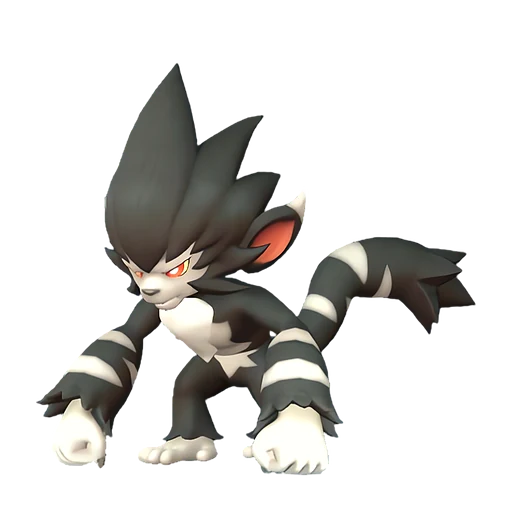

# Горират

<canvas id="fx"></canvas>

№ 74 · Gorirat

Нейтральный

Слабость: Тьма <b class="mx">×1,5</b> <button class="hlp" data-tip="Множители перемножаются по обеим стихиям пала: ×1,5 за каждую стихию, которую атака бьёт, ×0,65 за каждую, которая её держит. Если одна стихия слаба, а другая устойчива (×1,5 × 0,65 ≈ ×0,98), слабости нет.">?</button>

🖐️ Ручная работа <b>2</b>🪓 Рубка деревьев <b>3</b>📦 Транспортировка <b>3</b>

<b>Максимальный режим гориллы</b> 🔘 кнопкой

❤️ 90 · ⚔️ 95 · 🛡 90

Основное

💎Редкость <button class="hlp" data-tip="Чем выше число, тем реже встречается пал. 1–4 — обычные, 5–7 — редкие, 8+ — легендарные.">?</button><b>5</b>

📏Размер<b>S</b>

💰Цена продажи <button class="hlp" data-tip="Сколько золота даст торговец за пала.">?</button><b>1214</b>

Бой

🎯Множитель поимки <button class="hlp" data-tip="Насколько легче или труднее поймать: ×1 — обычно, меньше — сложнее.">?</button><b>×1</b>

🐎Скорость рывка верхом <button class="hlp" data-tip="Скорость, если сесть на пала и бежать рывком.">?</button><b>720</b>

Ферма и еда

🍖Сколько ест <button class="hlp" data-tip="Сколько сытости пал тратит — чем больше, тем больше еды нужно на базе.">?</button><b>230</b>

Разведение

🧬Сила разведения <button class="hlp" data-tip="Скрытое число игры: у детёныша оно примерно среднее от родителей. Чем меньше — тем «сильнее» пал.">?</button><b>2140</b>

=== "Обзор"

    #### Работа на базе
    - Ручная работа — ур. 2
    - Рубка деревьев — ур. 3
    - Транспортировка — ур. 3

    #### Партнёрский навык: Максимальный режим гориллы
    При активации Горират высвобождает дикую силу, на некоторое время увеличивая свою силу атаки на 75–300%.

    #### Чем хорош / чем плох
    - ✅
    - ❌ явных минусов нет

    > Общаются с сородичами, выстукивая ритмы по земле. У каждой стаи свои значения сигналов, поэтому их классификация до сих пор не завершена.

    См. также: [Стихии](../../guide/06_stihii.md) · [Разведение](../../guide/07_razvedenie.md) · [Все палы](README.md)

=== "Атаки"

    #### Атаки по уровням
    - ур. 1: Грязевой выстрел (Земля, сила 40)
    - ур. 7: Силовой выстрел (Нейтральный, сила 80)
    - ур. 15: Гориллакомбо (Нейтральный, сила 120)
    - ур. 22: Каменный залп (Земля, сила 80)
    - ур. 30: Семенной пулемёт (Трава, сила 80)
    - ур. 40: Силовая бомба (Нейтральный, сила 120)
    - ур. 50: Палобласт (Нейтральный, сила 450)
    - ур. 70: Священный взрыв (Нейтральный, сила 700)

=== "Где живёт"

    #### Где водится

    

<button data-k="d" class="on">☀️ День</button><button data-k="n">🌙 Ночь</button>

<button data-w=p class=on>Палпагос</button><button data-w=t>Мировое древо</button>

ур. 30–80<a class="btn hm-full" href="../../../map/?pal=Gorilla">Показать на большой карте</a>

Зелёный ручейИссохшие дюныЛедяная гораПодножие Астральных гор

🕳 Подземелье<b>Пещера Горного Потока</b>

🥚 Яйцо<b>Большое обычное яйцо</b>

=== "Дроп"

    #### Дроп
    - Кожа — 1–2 шт., 100%
    - Кость — 1 шт., 100%

    **Дроп альфы:**
    - Деталь древней цивилизации — 2–4 шт., 100%
    - Ценный коготь — 2–4 шт., 100%

=== "Разведение"

    #### Разведение
    - Ранг разведения (CombiRank): 2140
    - Участвует в особых парах: Бронебол → Горират Терра

=== "Пассивки"

    #### Лучшие пассивки по роли

    

⚔️ Боец

максимум урона и живучести в бою

<a class="psv r-4" data-psv="Легенда" href="../../../passivki/legend/">Легенда</a><a class="psv r-4" data-psv="Демон-бог" href="../../../passivki/demon_god/">Демон-бог</a><a class="psv r-3" data-psv="Святое небо" href="../../../passivki/celestial_emperor/">Святое небо</a><a class="psv r-3" data-psv="Хладнокровный" href="../../../passivki/serenity/">Хладнокровный</a>

🛠 Рабочий

работает быстрее и меньше устаёт на базе

<a class="psv r-5" data-psv="Дьявольские руки" href="../../../passivki/demons_hand/">Дьявольские руки</a><a class="psv r-4" data-psv="Виртуоз" href="../../../passivki/remarkable_craftsmanship/">Виртуоз</a><a class="psv r-3" data-psv="Мастеровитый" href="../../../passivki/artisan/">Мастеровитый</a><a class="psv r-3" data-psv="Трудоголик" href="../../../passivki/workaholic/">Трудоголик</a>

    <small>Нажми на пассивку, чтобы узнать, что она даёт и где её взять.</small>

<a class="card-link" href="../leezpunk_ignis/">← Лизпанк Игнис</a><a class="card-link" href="../gorirat_terra/">Горират Терра →</a>

