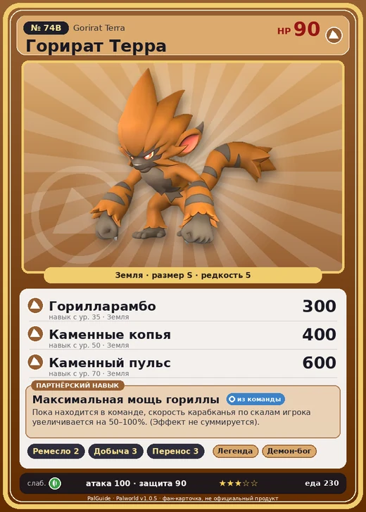

# #74B Горират Терра (Gorirat Terra)

№ 74B

Земля

Слабость: Трава

🖐️ Ручная работа <b>2</b>⛏️ Добыча <b>3</b>📦 Транспортировка <b>3</b>

<b>Максимальная мощь гориллы</b> 🎒 из команды

❤️ 90 · ⚔️ 100 · 🛡 90

| Поле | Значение |
|---|---|
| Стихия | Земля |
| Слабость (кто бьёт сильнее) | Трава |
| Редкость | 5 |
| Размер | S |
| HP / Атака / Защита (база вида) | 90 / 100 / 90 |
| Сколько ест | 230 |
| Цена продажи | 1284 |
| Множитель поимки | ×1 |
| Скорость рывка верхом | 720 |

=== "Обзор"

    #### Работа на базе
    - Ручная работа — ур. 2
    - Добыча — ур. 3
    - Транспортировка — ур. 3

    #### Партнёрский навык: Максимальная мощь гориллы
    Пока находится в команде, скорость карабканья по скалам игрока увеличивается на 50–100%. (Эффект не суммируется).

    #### Чем хорош / чем плох
    - ✅ хорошая атака (100)
    - ❌ разводится только особой парой

    > Общается с сородичами, выстукивая ритмы по земле. По силе он превосходит даже Горират . Говорят, если все Горират Терра одновременно ударят по земле — остров Палпагос уйдёт под воду за секунду.

    См. также: [Стихии](../../guide/06_stihii.md) · [Разведение](../../guide/07_razvedenie.md) · [Все палы](README.md)

=== "Атаки"

    #### Атаки по уровням
    - ур. 1: Силовой выстрел (Нейтральный, сила 80)
    - ур. 7: Грязевой выстрел (Земля, сила 40)
    - ур. 15: Каменный залп (Земля, сила 80)
    - ур. 22: Камнемёт (Земля, сила 120)
    - ур. 30: Гориллакомбо (Нейтральный, сила 120)
    - ур. 35: Горилларамбо (Земля, сила 300)
    - ур. 40: Камнепад (Земля, сила 300)
    - ур. 50: Каменные копья (Земля, сила 400)
    - ур. 70: Каменный пульс (Земля, сила 600)

=== "Где живёт"

    #### Где водится
    - В дикой природе: да; точек появления днём: 67, ночью: 67; уровни в первых точках: 35–39
    - Подземелья: Пещера Цветущей Сакуры
    - Может продаваться у торговца/рекрутера
    - Яйцо: Большое яйцо земли

=== "Дроп"

    #### Дроп
    - Металлическая руда — 2–3 шт., 100%
    - Кость — 1 шт., 100%

    **Дроп альфы:**
    - Деталь древней цивилизации — 2–3 шт., 100%
    - Ценный коготь — 2–3 шт., 100%

=== "Разведение"

    #### Разведение
    - Ранг разведения (CombiRank): 1880
    - **Особая пара:** [Горират](../../4_spravochniki/paly/gorirat.md) + [Бронебол](../../4_spravochniki/paly/kikit.md)

=== "Пассивки"

    #### Лучшие пассивки по роли

    

⚔️ Боец

максимум урона и живучести в бою

<a class="psv r-4" data-psv="Легенда" href="../../../passivki/legend/">Легенда</a><a class="psv r-4" data-psv="Демон-бог" href="../../../passivki/demon_god/">Демон-бог</a><a class="psv r-3" data-psv="Император земли" href="../../../passivki/earth_emperor/">Император земли</a><a class="psv r-3" data-psv="Хладнокровный" href="../../../passivki/serenity/">Хладнокровный</a>

🛠 Рабочий

работает быстрее и меньше устаёт на базе

<a class="psv r-5" data-psv="Дьявольские руки" href="../../../passivki/demons_hand/">Дьявольские руки</a><a class="psv r-4" data-psv="Виртуоз" href="../../../passivki/remarkable_craftsmanship/">Виртуоз</a><a class="psv r-3" data-psv="Мастеровитый" href="../../../passivki/artisan/">Мастеровитый</a><a class="psv r-3" data-psv="Трудоголик" href="../../../passivki/workaholic/">Трудоголик</a>

    <small>Нажми на пассивку, чтобы узнать, что она даёт и где её взять.</small>

<a class="card-link" href="../gorirat/">← Горират</a><a class="card-link" href="../surfent/">Серфент →</a>

