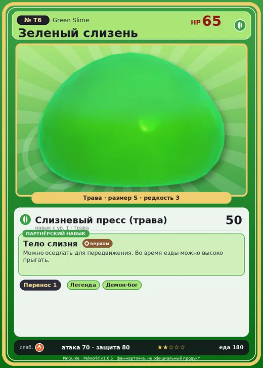

# Зеленый слизень

<canvas id="fx"></canvas>

№ T6 · Green Slime

Трава

Слабость: Огонь

📦 Транспортировка <b>1</b>

<b>Тело слизня</b> 🐎 верхом

❤️ 65 · ⚔️ 70 · 🛡 80

| Поле | Значение |
|---|---|
| Стихия | Трава |
| Слабость (кто бьёт сильнее) | Огонь |
| Редкость | 3 |
| Размер | S |
| HP / Атака / Защита (база вида) | 65 / 70 / 80 |
| Сколько ест | 180 |
| Цена продажи | 500 |
| Множитель поимки | ×1 |
| Скорость рывка верхом | 450 |
| Коллаборация | Terraria (остров Якусима) (нет в Палпедии) |

=== "Обзор"

    #### Работа на базе
    - Транспортировка — ур. 1

    #### Партнёрский навык: Тело слизня
    Можно оседлать для передвижения. Во время езды можно высоко прыгать.

    #### Чем хорош / чем плох
    - ✅ можно оседлать
    - ❌ слабая атака (70); мало здоровья (65)

    > [Коллаборация с Terraria] Монстр из другого мира. Похоже, здесь его можно приручить.

    См. также: [Стихии](../../guide/06_stihii.md) · [Разведение](../../guide/07_razvedenie.md) · [Все палы](README.md)

=== "Атаки"

    #### Атаки по уровням
    - ур. 1: Слизневый пресс (трава) (Трава, сила 50)

=== "Где живёт"

    #### Где водится
    - В дикой природе: да; точек появления днём: ?, ночью: ?
    - Яйцо: Яйцо свежей листвы

=== "Дроп"

    #### Дроп
    - Святой слиток — 1 шт., 100%

=== "Разведение"

    #### Разведение
    - Ранг разведения (CombiRank): 3100

=== "Пассивки"

    #### Лучшие пассивки по роли

    

⚔️ Боец

максимум урона и живучести в бою

<a class="psv r-4" data-psv="Легенда" href="../../../passivki/legend/">Легенда</a><a class="psv r-4" data-psv="Демон-бог" href="../../../passivki/demon_god/">Демон-бог</a><a class="psv r-3" data-psv="Король духов" href="../../../passivki/spirit_emperor/">Король духов</a><a class="psv r-3" data-psv="Хладнокровный" href="../../../passivki/serenity/">Хладнокровный</a>

🐎 Ездовой

быстрее бегает или летает с тобой верхом

<a class="psv r-4" data-psv="Божественная скорость" href="../../../passivki/swift/">Божественная скорость</a><a class="psv r-4" data-psv="Легенда" href="../../../passivki/legend/">Легенда</a><a class="psv r-4" data-psv="Вечный двигатель" href="../../../passivki/eternal_engine/">Вечный двигатель</a><a class="psv r-4" data-psv="Небесное скольжение" href="../../../passivki/sky_strider/">Небесное скольжение</a>

    <small>Нажми на пассивку, чтобы узнать, что она даёт и где её взять.</small>

<a class="card-link" href="../eye_of_cthulhu/">← Глаз Ктулху</a><a class="card-link" href="../illuminant_bat/">Светящаяся летучая мышь →</a>

