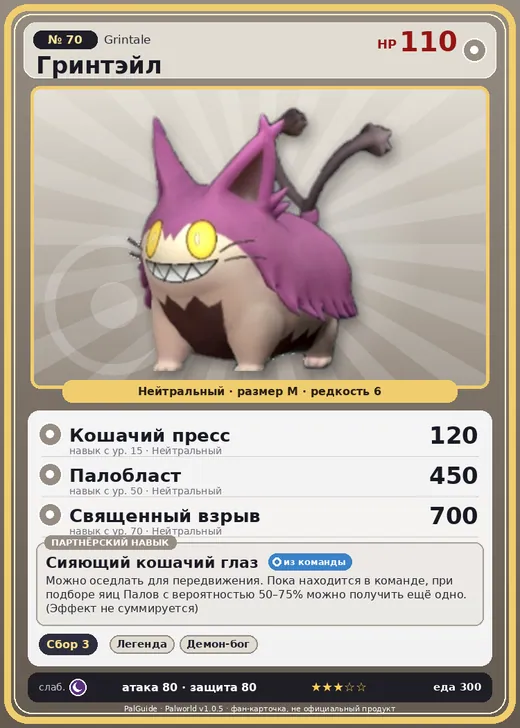

# #70 Гринтэйл (Grintale)

№ 70

Нейтральный

Слабость: Тьма

🌾 Сбор <b>3</b>

<b>Сияющий кошачий глаз</b> 🎒 из команды 🐎 верхом

❤️ 110 · ⚔️ 80 · 🛡 80

| Поле | Значение |
|---|---|
| Стихия | Нейтральный |
| Слабость (кто бьёт сильнее) | Тьма |
| Редкость | 6 |
| Размер | M |
| HP / Атака / Защита (база вида) | 110 / 80 / 80 |
| Сколько ест | 300 |
| Цена продажи | 1074 |
| Множитель поимки | ×1 |
| Скорость рывка верхом | 1000 |

## Работа на базе
- Сбор — ур. 3

## Партнёрский навык: Сияющий кошачий глаз
Можно оседлать для передвижения. Пока находится в команде, при подборе яиц Палов с вероятностью (50~75)% можно получить ещё одно. (Эффект не суммируется) Технологии 19 level value 1 EggObtainExtraEgg_PartnerSkill_NaughtyCat 50 2 EggObtainExtraEgg_PartnerSkill_NaughtyCat 55 3 EggObtainExtraEgg_PartnerSkill_NaughtyCat 60 4 EggObtainExtraEgg_PartnerSkill_NaughtyCat 65 5 EggObtainExtraEgg_PartnerSkill_NaughtyCat 75

## Атаки по уровням
- ур. 1: Грязевой выстрел (Земля, сила 40)
- ур. 7: Силовой выстрел (Нейтральный, сила 80)
- ур. 15: Кошачий пресс (Нейтральный, сила 120)
- ур. 22: Каменный залп (Земля, сила 80)
- ур. 30: Камнемёт (Земля, сила 120)
- ур. 40: Силовая бомба (Нейтральный, сила 120)
- ур. 50: Палобласт (Нейтральный, сила 450)
- ур. 70: Священный взрыв (Нейтральный, сила 700)

## Где водится
- В дикой природе: да; точек появления днём: 61, ночью: 621; уровни в первых точках: 25–28
- Подземелья: Пещера Горного Потока
- Яйцо: Большое обычное яйцо

## Дроп
- Качественное масло Пала — 1–3 шт., 100%

**Дроп альфы:**
- Деталь древней цивилизации — 3–4 шт., 100%
- Ценный мех — 3–4 шт., 100%

## Разведение
- Ранг разведения (CombiRank): 2120

## Лучшие пассивки по роли
- боец: Легенда, Демон-бог, Хладнокровный, Бессмертие, Святое небо (вместо Бессмертия, если нет мутации)
- рабочий: Дьявольские руки, Виртуоз, Мастеровитый, Небожитель/Трудоголик
- ездовой: Божественная скорость, Легенда, Вечный двигатель, Небесное скольжение

## Чем хорош / чем плох
- ✅ можно оседлать
- ❌ явных минусов нет

> Стоит только войти на территорию Гринтэйл , как за вами сразу начинают следить сверкающие глаза. И это не преувеличение — они действительно светятся.

См. также: [Стихии](../../guide/06_stihii.md) · [Разведение](../../guide/07_razvedenie.md) · [Все палы](README.md)
