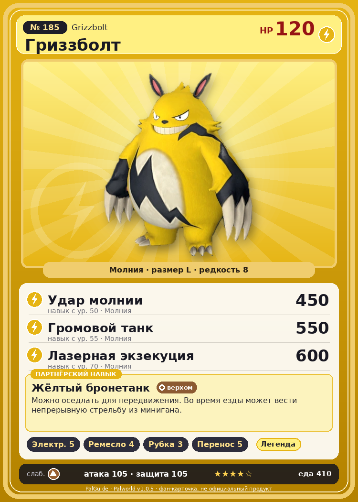

# #185 Гриззболт (Grizzbolt)

{ width=360 }

| Поле | Значение |
|---|---|
| Стихия | Молния |
| Слабость (кто бьёт сильнее) | Земля |
| Редкость | 8 |
| Размер | L |
| HP / Атака / Защита (база вида) | 120 / 105 / 105 |
| Сколько ест | 410 |
| Цена продажи | 3524 |
| Множитель поимки | ×1 |
| Скорость рывка верхом | 1000 |

## Работа на базе
- Генерация энергии — ур. 5
- Ручная работа — ур. 4
- Рубка деревьев — ур. 3
- Транспортировка — ур. 5

## Партнёрский навык: Жёлтый бронетанк
Можно оседлать для передвижения. Во время езды может вести непрерывную стрельбу из минигана. Технологии 40 level value 1 MainValue 6.5 Пробуждение : 2 MainValue 7 Пробуждение : (Увеличение урона: Небольшое ) 3 MainValue 7.5 Пробуждение : (Увеличение урона: Среднее ) 4 MainValue 8.5 Пробуждение : (Увеличение урона: Большое ) 5 MainValue 9.5 Пробуждение : (Увеличение урона: Очень большое )

## Атаки по уровням
- ур. 1: Искровой выстрел (Молния, сила 50)
- ур. 7: Шоковая волна (Молния, сила 80)
- ур. 15: Грозовые когти (Молния, сила 150)
- ур. 22: Грозовая линия (Молния, сила 160)
- ур. 30: Тройная молния (Молния, сила 200)
- ур. 40: Грозовой удар (Молния, сила 300)
- ур. 50: Удар молнии (Молния, сила 450)
- ур. 55: Громовой танк (Молния, сила 550)
- ур. 70: Лазерная экзекуция (Молния, сила 600)

## Где водится
- В дикой природе: да; точек появления днём: 1, ночью: 1
- Яйцо: Огромное яйцо молнии

## Дроп
- Электрический орган — 2–4 шт., 100%
- Кожа — 2–3 шт., 100%

**Дроп альфы:**
- Деталь древней цивилизации — 4–5 шт., 100%
- Ценный коготь — 4–5 шт., 100%

## Разведение
- Ранг разведения (CombiRank): 1020
- **Особая пара:** [Гриззболт](../../4_spravochniki/paly/grizzbolt.md) + [Гриззболт](../../4_spravochniki/paly/grizzbolt.md)
- Участвует в особых парах: Моссанда → Моссанда Лакс; Гриззболт → Гриззболт; Гриззболт → Гриззболт

## Лучшие пассивки по роли
- по обзору: Легенда, Демон-бог, Хладнокровный, Император молнии
- боец: Легенда, Демон-бог, Хладнокровный, Бессмертие, Император молнии (вместо Бессмертия, если нет мутации)
- рабочий: Дьявольские руки, Виртуоз, Мастеровитый, Небожитель/Трудоголик
- ездовой: Божественная скорость, Легенда, Вечный двигатель, Небесное скольжение

## Чем хорош / чем плох
- ✅ Молния + генерация 5, ранний сильный боец; хорошая атака (105); много здоровья (120); отличный рабочий (пригодность 5); можно оседлать
- ❌ Устаревает к эндгейму; разводится только особой парой

> С широкой улыбкой и внушительным телосложением он становится послушным тем, кого признаёт напарником. Но стоит вложить ему в руки миниган — и он меняется на глазах.

См. также: [Стихии](../../2_mehaniki/stihii.md) · [Разведение](../../2_mehaniki/razvedenie.md) · [Все палы](README.md)
_Источник: paldb.cc v1.0.5_
