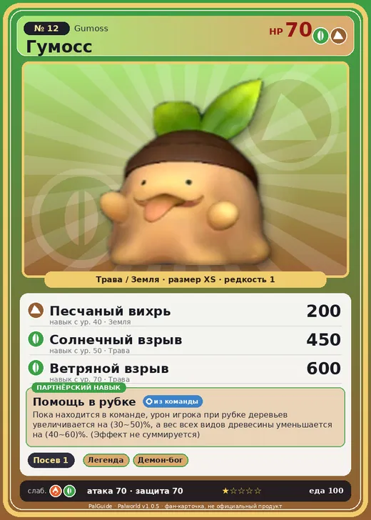

# Гумосс

<canvas id="fx"></canvas>

№ 12 · Gumoss

ТраваЗемля

Слабость: ОгоньТрава

🌱 Посев семян <b>1</b>

<b>Помощь в рубке</b> 🎒 из команды

❤️ 70 · ⚔️ 70 · 🛡 70

Основное

💎Редкость <button class="hlp" data-tip="Чем выше число, тем реже встречается пал. 1–4 — обычные, 5–7 — редкие, 8+ — легендарные.">?</button><b>1</b>

📏Размер<b>XS</b>

💰Цена продажи <button class="hlp" data-tip="Сколько золота даст торговец за пала.">?</button><b>394</b>

Бой

🎯Множитель поимки <button class="hlp" data-tip="Насколько легче или труднее поймать: ×1 — обычно, меньше — сложнее.">?</button><b>×1.3</b>

🐎Скорость рывка верхом <button class="hlp" data-tip="Скорость, если сесть на пала и бежать рывком.">?</button><b>400</b>

Ферма и еда

🍖Сколько ест <button class="hlp" data-tip="Сколько сытости пал тратит — чем больше, тем больше еды нужно на базе.">?</button><b>100</b>

Разведение

🧬Сила разведения <button class="hlp" data-tip="Скрытое число игры: у детёныша оно примерно среднее от родителей. Чем меньше — тем «сильнее» пал.">?</button><b>2950</b>

=== "Обзор"

    #### Работа на базе
    - Посев семян — ур. 1

    #### Партнёрский навык: Помощь в рубке
    Пока находится в команде, урон игрока при рубке деревьев увеличивается на 30–50%, а вес всех видов древесины уменьшается на 40–60%. (Эффект не суммируется). По звёздам: 0★ 30 · 1★ 35 · 2★ 40 · 3★ 45 · 4★ 50

    #### Чем хорош / чем плох
    - ✅
    - ❌ слабая атака (70)

    > Удивительный Пал с телом, похожим на древесный сок. Если он теряет свою шапочку, то начинает постепенно увядать — и в конце концов окончательно сгнивает.

    См. также: [Стихии](../../guide/06_stihii.md) · [Разведение](../../guide/07_razvedenie.md) · [Все палы](README.md)

=== "Атаки"

    #### Атаки по уровням
    - ур. 1: Грязевой выстрел (Земля, сила 40)
    - ур. 7: Ветряной клинок (Трава, сила 40)
    - ур. 15: Каменный залп (Земля, сила 80)
    - ур. 22: Семенной пулемёт (Трава, сила 80)
    - ур. 30: Семенная мина (Трава, сила 120)
    - ур. 40: Песчаный вихрь (Земля, сила 200)
    - ур. 50: Солнечный взрыв (Трава, сила 450)
    - ур. 70: Ветряной взрыв (Трава, сила 600)

=== "Где живёт"

    #### Где водится
    - В дикой природе: да; точек появления днём: 116, ночью: 116; уровни в первых точках: 2–4
    - Подземелья: Пещера Отдалённого Острова, Пещера Холмов
    - Яйцо: Яйцо свежей листвы

=== "Дроп"

    #### Дроп
    - Семена ягод — 1 шт., 100%
    - Лист Гумосса — 1 шт., 50%

    **Дроп альфы:**
    - Деталь древней цивилизации — 2–4 шт., 100%
    - Ценные внутренности — 2 шт., 100%

=== "Разведение"

    #### Разведение
    - Ранг разведения (CombiRank): 2950

=== "Пассивки"

    #### Лучшие пассивки по роли

    

⚔️ Боец

максимум урона и живучести в бою

<a class="psv r-4" data-psv="Легенда" href="../../../passivki/legend/">Легенда</a><a class="psv r-4" data-psv="Демон-бог" href="../../../passivki/demon_god/">Демон-бог</a><a class="psv r-3" data-psv="Король духов" href="../../../passivki/spirit_emperor/">Король духов</a><a class="psv r-3" data-psv="Хладнокровный" href="../../../passivki/serenity/">Хладнокровный</a>

    <small>Нажми на пассивку, чтобы узнать, что она даёт и где её взять.</small>

<a class="card-link" href="../teafant/">← Тифант</a><a class="card-link" href="../pupperai/">Паппирай →</a>

