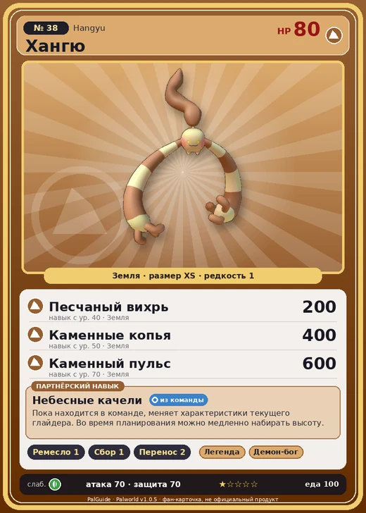

# Хангю

<canvas id="fx"></canvas>

№ 38 · Hangyu

Земля

Слабость: Трава

🖐️ Ручная работа <b>1</b>🌾 Сбор <b>1</b>📦 Транспортировка <b>2</b>

<b>Небесные качели</b> 🎒 из команды

❤️ 80 · ⚔️ 70 · 🛡 70

Основное

💎Редкость <button class="hlp" data-tip="Чем выше число, тем реже встречается пал. 1–4 — обычные, 5–7 — редкие, 8+ — легендарные.">?</button><b>1</b>

📏Размер<b>XS</b>

💰Цена продажи <button class="hlp" data-tip="Сколько золота даст торговец за пала.">?</button><b>541</b>

Бой

🎯Множитель поимки <button class="hlp" data-tip="Насколько легче или труднее поймать: ×1 — обычно, меньше — сложнее.">?</button><b>×1</b>

🐎Скорость рывка верхом <button class="hlp" data-tip="Скорость, если сесть на пала и бежать рывком.">?</button><b>550</b>

Ферма и еда

🍖Сколько ест <button class="hlp" data-tip="Сколько сытости пал тратит — чем больше, тем больше еды нужно на базе.">?</button><b>100</b>

Разведение

🧬Сила разведения <button class="hlp" data-tip="Скрытое число игры: у детёныша оно примерно среднее от родителей. Чем меньше — тем «сильнее» пал.">?</button><b>2780</b>

=== "Обзор"

    #### Работа на базе
    - Ручная работа — ур. 1
    - Сбор — ур. 1
    - Транспортировка — ур. 2

    #### Партнёрский навык: Небесные качели
    Пока находится в команде, меняет характеристики текущего глайдера. Во время планирования можно медленно набирать высоту.

    #### Чем хорош / чем плох
    - ✅
    - ❌ слабая атака (70)

    > Его огромные руки способны разорвать даже железо. Когда-то на городской площади проводили варварскую казнь: тяжких преступников приковывали к столбу и позволяли Хангю разрывать их плоть.

    См. также: [Стихии](../../guide/06_stihii.md) · [Разведение](../../guide/07_razvedenie.md) · [Все палы](README.md)

=== "Атаки"

    #### Атаки по уровням
    - ур. 1: Грязевой выстрел (Земля, сила 40)
    - ур. 7: Воздушная пушка (Нейтральный, сила 40)
    - ур. 15: Ветряной клинок (Трава, сила 40)
    - ур. 22: Силовой выстрел (Нейтральный, сила 80)
    - ур. 30: Силовая бомба (Нейтральный, сила 120)
    - ур. 40: Песчаный вихрь (Земля, сила 200)
    - ур. 50: Каменные копья (Земля, сила 400)
    - ур. 70: Каменный пульс (Земля, сила 600)

=== "Где живёт"

    #### Где водится
    - В дикой природе: да; точек появления днём: 144, ночью: 144; уровни в первых точках: 9–10
    - Подземелья: Пещера Песчаных Дюн, Пещера Ущелья
    - Яйцо: Яйцо земли

=== "Дроп"

    #### Дроп
    - Волокно — 5–10 шт., 100%
    - Семена пшеницы — 1 шт., 100%

    **Дроп альфы:**
    - Деталь древней цивилизации — 2–3 шт., 100%
    - Ценный мех — 2–3 шт., 100%

=== "Разведение"

    #### Разведение
    - Ранг разведения (CombiRank): 2780
    - Участвует в особых парах: Иктирдир → Иктирдир Тэрра; Сви → Хангю Крист

=== "Пассивки"

    #### Лучшие пассивки по роли

    

⚔️ Боец

максимум урона и живучести в бою

<a class="psv r-4" data-psv="Легенда" href="../../../passivki/legend/">Легенда</a><a class="psv r-4" data-psv="Демон-бог" href="../../../passivki/demon_god/">Демон-бог</a><a class="psv r-3" data-psv="Император земли" href="../../../passivki/earth_emperor/">Император земли</a><a class="psv r-3" data-psv="Хладнокровный" href="../../../passivki/serenity/">Хладнокровный</a>

    <small>Нажми на пассивку, чтобы узнать, что она даёт и где её взять.</small>

<a class="card-link" href="../turtacle_terra/">← Туртакл Терра</a><a class="card-link" href="../hangyu_cryst/">Хангю Крист →</a>

