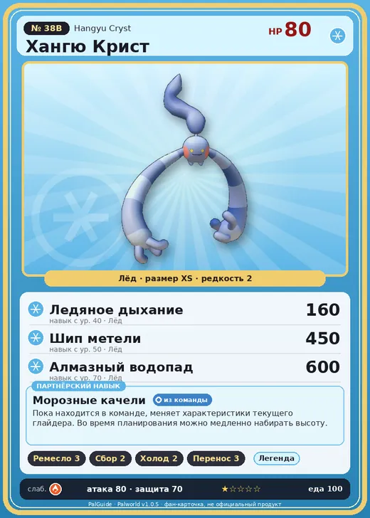

# Хангю Крист

<canvas id="fx"></canvas>

№ 38B · Hangyu Cryst

Лёд

Слабость: Огонь

🖐️ Ручная работа <b>3</b>🌾 Сбор <b>2</b>❄️ Охлаждение <b>2</b>📦 Транспортировка <b>3</b>

<b>Морозные качели</b> 🎒 из команды

❤️ 80 · ⚔️ 80 · 🛡 70

Основное

💎Редкость <button class="hlp" data-tip="Чем выше число, тем реже встречается пал. 1–4 — обычные, 5–7 — редкие, 8+ — легендарные.">?</button><b>2</b>

📏Размер<b>XS</b>

💰Цена продажи <button class="hlp" data-tip="Сколько золота даст торговец за пала.">?</button><b>728</b>

Бой

🎯Множитель поимки <button class="hlp" data-tip="Насколько легче или труднее поймать: ×1 — обычно, меньше — сложнее.">?</button><b>×1</b>

🐎Скорость рывка верхом <button class="hlp" data-tip="Скорость, если сесть на пала и бежать рывком.">?</button><b>550</b>

Ферма и еда

🍖Сколько ест <button class="hlp" data-tip="Сколько сытости пал тратит — чем больше, тем больше еды нужно на базе.">?</button><b>100</b>

Разведение

🧬Сила разведения <button class="hlp" data-tip="Скрытое число игры: у детёныша оно примерно среднее от родителей. Чем меньше — тем «сильнее» пал.">?</button><b>2510</b>

💞Особая пара <button class="hlp" data-tip="Этого пала можно вывести только от этой пары.">?</button><b>Хангю + Сви</b>

=== "Обзор"

    #### Работа на базе
    - Ручная работа — ур. 3
    - Сбор — ур. 2
    - Охлаждение — ур. 2
    - Транспортировка — ур. 3

    #### Партнёрский навык: Морозные качели
    Пока находится в команде, меняет характеристики текущего глайдера. Во время планирования можно медленно набирать высоту.

    #### Чем хорош / чем плох
    - ✅
    - ❌ разводится только особой парой

    > Его огромные руки способны разрывать даже ледяные глыбы. Когда-то в центре города устраивали жестокое публичное устрашение: тяжких преступников приковывали к столбу, и Хангю Крист вырывал им волосы, наводя ужас на толпу.

    См. также: [Стихии](../../guide/06_stihii.md) · [Разведение](../../guide/07_razvedenie.md) · [Все палы](README.md)

=== "Атаки"

    #### Атаки по уровням
    - ур. 1: Воздушная пушка (Нейтральный, сила 40)
    - ур. 7: Ледяная ракета (Лёд, сила 40)
    - ур. 15: Силовой выстрел (Нейтральный, сила 80)
    - ур. 22: Ледяной резак (Лёд, сила 80)
    - ур. 30: Айсберг (Лёд, сила 120)
    - ур. 40: Ледяное дыхание (Лёд, сила 160)
    - ур. 50: Шип метели (Лёд, сила 450)
    - ур. 70: Алмазный водопад (Лёд, сила 600)

=== "Где живёт"

    #### Где водится
    - В дикой природе: нет/особый способ; точек появления днём: 0, ночью: 335; уровни в первых точках: 32–36
    - Яйцо: Яйцо льда

=== "Дроп"

    #### Дроп
    - Волокно — 5–10 шт., 100%
    - Ледяной орган — 1 шт., 100%

    **Дроп альфы:**
    - Деталь древней цивилизации — 2–3 шт., 100%
    - Ценный мех — 2–3 шт., 100%

=== "Разведение"

    #### Разведение
    - Ранг разведения (CombiRank): 2510
    - **Особая пара:** [Хангю](../../4_spravochniki/paly/hangyu.md) + [Сви](../../4_spravochniki/paly/swee.md)

=== "Пассивки"

    #### Лучшие пассивки по роли

    

⚔️ Боец

максимум урона и живучести в бою

<a class="psv r-4" data-psv="Легенда" href="../../../passivki/legend/">Легенда</a><a class="psv r-4" data-psv="Демон-бог" href="../../../passivki/demon_god/">Демон-бог</a><a class="psv r-3" data-psv="Император льда" href="../../../passivki/ice_emperor/">Император льда</a><a class="psv r-3" data-psv="Хладнокровный" href="../../../passivki/serenity/">Хладнокровный</a>

🛠 Рабочий

работает быстрее и меньше устаёт на базе

<a class="psv r-5" data-psv="Дьявольские руки" href="../../../passivki/demons_hand/">Дьявольские руки</a><a class="psv r-4" data-psv="Виртуоз" href="../../../passivki/remarkable_craftsmanship/">Виртуоз</a><a class="psv r-3" data-psv="Мастеровитый" href="../../../passivki/artisan/">Мастеровитый</a><a class="psv r-3" data-psv="Трудоголик" href="../../../passivki/workaholic/">Трудоголик</a>

    <small>Нажми на пассивку, чтобы узнать, что она даёт и где её взять.</small>

<a class="card-link" href="../hangyu/">← Хангю</a><a class="card-link" href="../woolipop/">Вулипоп →</a>

