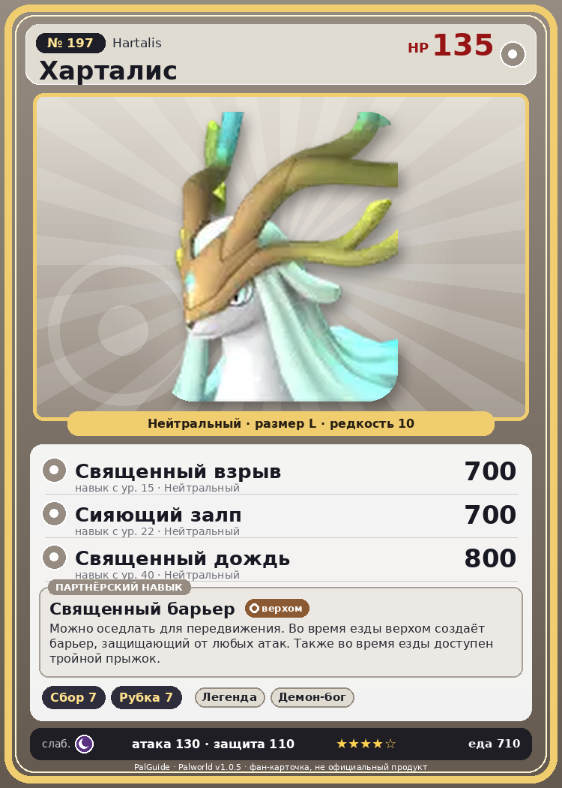

# #197 Харталис (Hartalis)

{ width=360 }

| Поле | Значение |
|---|---|
| Стихия | Нейтральный |
| Слабость (кто бьёт сильнее) | Тьма |
| Редкость | 10 |
| Размер | L |
| HP / Атака / Защита (база вида) | 135 / 130 / 110 |
| Сколько ест | 710 |
| Цена продажи | 4256 |
| Множитель поимки | ×1 |
| Скорость рывка верхом | 1900 |

## Работа на базе
- Сбор — ур. 7
- Рубка деревьев — ур. 7

## Партнёрский навык: Священный барьер
Можно оседлать для передвижения. Во время езды верхом создаёт барьер, защищающий от любых атак. Также во время езды доступен тройной прыжок . Технологии 70 level value 1 OverWriteCoolTime 150 Пробуждение : 2 OverWriteCoolTime 120 Пробуждение : (Сокращение перезарядки: Небольшое ) 3 OverWriteCoolTime 90 Пробуждение : (Сокращение перезарядки: Среднее ) 4 OverWriteCoolTime 60 Пробуждение : (Сокращение перезарядки: Большое ) 5 OverWriteCoolTime 30 Пробуждение : (Сокращение перезарядки: Очень большое )

## Атаки по уровням
- ур. 1: Силовой выстрел (Нейтральный, сила 80)
- ур. 7: Силовая бомба (Нейтральный, сила 120)
- ур. 15: Священный взрыв (Нейтральный, сила 700)
- ур. 22: Сияющий залп (Нейтральный, сила 700)
- ур. 30: Божественные крылья (Нейтральный, сила 700)
- ур. 40: Священный дождь (Нейтральный, сила 800)
- ур. 50: Свет очищения (Нейтральный, сила 250)
- ур. 70: Ветряной взрыв (Трава, сила 600)

## Где водится
- В дикой природе: нет/особый способ; точек появления днём: 0, ночью: 0
- Яйцо: Огромное обычное яйцо

## Дроп
- Рог — 2–3 шт., 100%
- Кожа — 2–3 шт., 100%
- Большая душа Пала — 1 шт., 30%

**Дроп альфы:**
- Деталь древней цивилизации — 4–6 шт., 100%
- Большая душа Пала — 1 шт., 30%
- Ценный мех — 6–8 шт., 100%

## Разведение
- Ранг разведения (CombiRank): 90
- **Особая пара:** [Харталис](../../4_spravochniki/paly/hartalis.md) + [Харталис](../../4_spravochniki/paly/hartalis.md)
- Участвует в особых парах: Харталис → Харталис; Харталис → Харталис

## Лучшие пассивки по роли
- по обзору: Легенда, Демон-бог, Хладнокровный, Святое небо
- боец: Легенда, Демон-бог, Хладнокровный, Бессмертие, Святое небо (вместо Бессмертия, если нет мутации)
- рабочий: Дьявольские руки, Виртуоз, Мастеровитый, Небожитель/Трудоголик
- ездовой: Божественная скорость, Легенда, Вечный двигатель, Небесное скольжение

## Чем хорош / чем плох
- ✅ Сбор/рубка 7; рейд-босс; очень высокая атака (130); много здоровья (135); отличный рабочий (пригодность 7); можно оседлать
- ❌ Рейд ур. 70; много ест (710); разводится только особой парой

> Пугающе тихо… и всё же удивительно спокойно. Больше никого нет. Все уже давно спасены. О Царь‑спаситель, прошу, унеси и меня в бесконечное безмолвие. — На этом древний текст обрывается.

См. также: [Стихии](../../2_mehaniki/stihii.md) · [Разведение](../../2_mehaniki/razvedenie.md) · [Все палы](README.md)
_Источник: paldb.cc v1.0.5_
