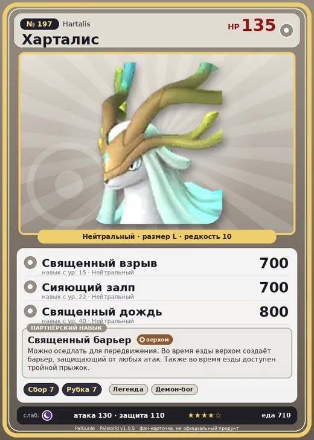

# Харталис

<canvas id="fx"></canvas>

№ 197

Нейтральный

Слабость: Тьма <b class="mx">×1,5</b> <button class="hlp" data-tip="Множители перемножаются по обеим стихиям: ×1,5 за стихию, которую атака бьёт, ×0,65 за ту, что её держит.">?</button>

🌾 Сбор <b>7</b>🪓 Рубка деревьев <b>7</b>

<b>Священный барьер</b> 🐎 Верхом

❤️ 135 · ⚔️ 130 · 🛡 110

Основное

💎Редкость <button class="hlp" data-tip="Чем выше число, тем реже встречается пал. 1–4 — обычные, 5–7 — редкие, 8+ — легендарные.">?</button><b>10</b>

📏Размер<b>L</b>

💰Цена продажи <button class="hlp" data-tip="Сколько золота даст торговец за пала.">?</button><b>4256</b>

Бой

🎯Множитель поимки <button class="hlp" data-tip="Насколько легче или труднее поймать: ×1 — обычно, меньше — сложнее.">?</button><b>×1</b>

🐎Скорость рывка верхом <button class="hlp" data-tip="Скорость, если сесть на пала и бежать рывком.">?</button><b>1900</b>

Ферма и еда

🍖Сколько ест <button class="hlp" data-tip="Сколько сытости пал тратит — чем больше, тем больше еды нужно на базе.">?</button><b>710</b>

Разведение

🧬Сила разведения <button class="hlp" data-tip="Скрытое число игры: у детёныша оно примерно среднее от родителей. Чем меньше — тем «сильнее» пал.">?</button><b>90</b>

💞Особая пара <button class="hlp" data-tip="Этого пала можно вывести только от этой пары.">?</button><b>Харталис + Харталис</b>

=== "Обзор"

    #### Работа на базе

    
<a class="wbar" href="../../../2_mehaniki/rabota/?w=gathering&lv=7">🧺 Сбор<i style="--v:70%"></i><b>7</b></a><a class="wbar" href="../../../2_mehaniki/rabota/?w=lumbering&lv=7">🪓 Рубка деревьев<i style="--v:70%"></i><b>7</b></a><a class="wb-more" href="../../../2_mehaniki/rabota/">Что значат уровни работы →</a>

    #### Партнёрский навык: Священный барьер
    Можно оседлать для передвижения. Во время езды верхом создаёт барьер, защищающий от любых атак. Также во время езды доступен тройной прыжок. Технологии 70.

    #### Чем хорош / чем плох
    - ✅ Сбор/рубка 7; рейд-босс; очень высокая атака (130); много здоровья (135); отличный рабочий (пригодность 7); можно оседлать
    - ❌ Рейд ур. 70; много ест (710); разводится только особой парой

    > Пугающе тихо… и всё же удивительно спокойно. Больше никого нет. Все уже давно спасены. О Царь‑спаситель, прошу, унеси и меня в бесконечное безмолвие. — На этом древний текст обрывается.

    См. также: [Стихии](../../guide/06_stihii.md) · [Разведение](../../guide/07_razvedenie.md) · [Все палы](README.md)

=== "Атаки"

    #### Атаки по уровням
    - ур. 1: Силовой выстрел (Нейтральный, сила 80)
    - ур. 7: Силовая бомба (Нейтральный, сила 120)
    - ур. 15: Священный взрыв (Нейтральный, сила 700)
    - ур. 22: Сияющий залп (Нейтральный, сила 700)
    - ур. 30: Божественные крылья (Нейтральный, сила 700)
    - ур. 40: Священный дождь (Нейтральный, сила 800)
    - ур. 50: Свет очищения (Нейтральный, сила 250)
    - ур. 70: Ветряной взрыв (Трава, сила 600)

=== "Где живёт"

    #### Где водится

    

<b>В дикой природе не встречается</b>Точек появления на открытой карте в данных игры нет — ищи в подземельях, яйцах или выводи разведением.

🥚 Яйцо<b>Огромное обычное яйцо</b>

=== "Дроп"

    #### Дроп
    - Рог — 2–3 шт., 100%
    - Кожа — 2–3 шт., 100%
    - Большая душа Пала — 1 шт., 30%

    **Дроп альфы:**

    - Деталь древней цивилизации — 4–6 шт., 100%
    - Большая душа Пала — 1 шт., 30%
    - Ценный мех — 6–8 шт., 100%

=== "Разведение"

    #### Разведение
    - Ранг разведения: 90
    - **Особая пара:** [Харталис](../../4_spravochniki/paly/hartalis.md) + [Харталис](../../4_spravochniki/paly/hartalis.md)
    - Участвует в особых парах: Харталис → Харталис; Харталис → Харталис

=== "Пассивки"

    #### Лучшие пассивки по роли

    

⚔️ Боец

максимум урона и живучести в бою

<a class="psv r-4" data-psv="Легенда" href="../../../passivki/legend/">Легенда</a><a class="psv r-4" data-psv="Демон-бог" href="../../../passivki/demon_god/">Демон-бог</a><a class="psv r-3" data-psv="Святое небо" href="../../../passivki/celestial_emperor/">Святое небо</a><a class="psv r-3" data-psv="Хладнокровный" href="../../../passivki/serenity/">Хладнокровный</a>

🛠 Рабочий

работает быстрее и меньше устаёт на базе

<a class="psv r-5" data-psv="Дьявольские руки" href="../../../passivki/demons_hand/">Дьявольские руки</a><a class="psv r-4" data-psv="Виртуоз" href="../../../passivki/remarkable_craftsmanship/">Виртуоз</a><a class="psv r-3" data-psv="Мастеровитый" href="../../../passivki/artisan/">Мастеровитый</a><a class="psv r-3" data-psv="Трудоголик" href="../../../passivki/workaholic/">Трудоголик</a>

🐎 Ездовой

быстрее бегает или летает с тобой верхом

<a class="psv r-4" data-psv="Божественная скорость" href="../../../passivki/swift/">Божественная скорость</a><a class="psv r-4" data-psv="Легенда" href="../../../passivki/legend/">Легенда</a><a class="psv r-4" data-psv="Вечный двигатель" href="../../../passivki/eternal_engine/">Вечный двигатель</a><a class="psv r-4" data-psv="Небесное скольжение" href="../../../passivki/sky_strider/">Небесное скольжение</a>

    <small>Нажми на пассивку, чтобы узнать, что она даёт и где её взять.</small>

<a class="card-link" href="../xenolord/">← Зенолорд</a><a class="card-link" href="../paladius/">Паладиус →</a>

