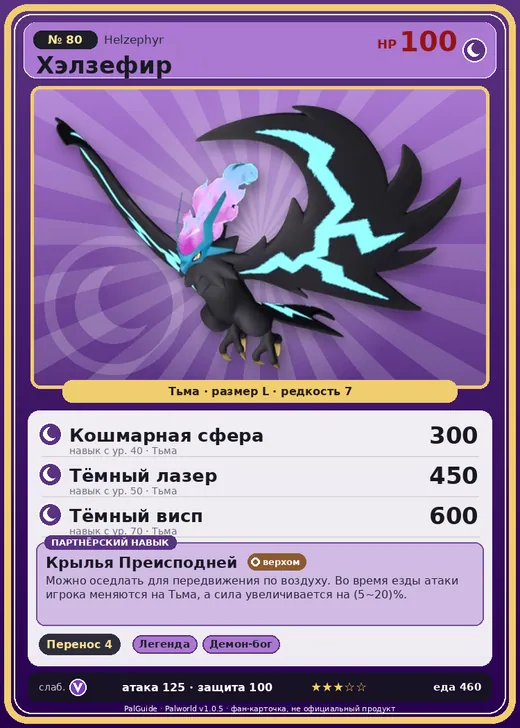

# #80 Хэлзефир (Helzephyr)

#80 · Helzephyr

Тьма

Слабость: Дракон

📦 Транспортировка <b>4</b>

<b>Крылья Преисподней</b> 🐎 верхом

❤️ 100 · ⚔️ 125 · 🛡 100

| Поле | Значение |
|---|---|
| Стихия | Тьма |
| Слабость (кто бьёт сильнее) | Дракон |
| Редкость | 7 |
| Размер | L |
| HP / Атака / Защита (база вида) | 100 / 125 / 100 |
| Сколько ест | 460 |
| Цена продажи | 2109 |
| Множитель поимки | ×1 |
| Скорость рывка верхом | 1100 |

## Работа на базе
- Транспортировка — ур. 4

## Партнёрский навык: Крылья Преисподней
Можно оседлать для передвижения по воздуху. Во время езды атаки игрока меняются на Тьма , а сила увеличивается на (5~20)% . Технологии 25 level value 1 GiveADark_Ride 1 GiveElement_TrainerATK_UP_PartnerSkill_Ride 5 2 GiveADark_Ride 1 GiveElement_TrainerATK_UP_PartnerSkill_Ride 7 3 GiveADark_Ride 1 GiveElement_TrainerATK_UP_PartnerSkill_Ride 10 4 GiveADark_Ride 1 GiveElement_TrainerATK_UP_PartnerSkill_Ride 14 5 GiveADark_Ride 1 GiveElement_TrainerATK_UP_PartnerSkill_Ride 20

## Атаки по уровням
- ур. 1: Расщеплённый огонь (Огонь, сила 80)
- ур. 7: Тёмный шар (Тьма, сила 50)
- ур. 15: Теневой взрыв (Тьма, сила 80)
- ур. 22: Огненный шторм (Огонь, сила 200)
- ур. 30: Духовное пламя (Тьма, сила 200)
- ур. 40: Кошмарная сфера (Тьма, сила 300)
- ур. 50: Тёмный лазер (Тьма, сила 450)
- ур. 70: Тёмный висп (Тьма, сила 600)

## Где водится
- В дикой природе: да; точек появления днём: 530, ночью: 1118; уровни в первых точках: 24–26
- Может продаваться у торговца/рекрутера
- Яйцо: Большое яйцо тьмы

## Дроп
- Ядовитая железа — 1–3 шт., 100%
- Средняя душа Пала — 1 шт., 3%

**Дроп альфы:**
- Деталь древней цивилизации — 4–6 шт., 100%
- Ценное перо — 4–6 шт., 100%

## Разведение
- Ранг разведения (CombiRank): 1130
- Участвует в особых парах: Райберд → Хэлзефир Лакс; Фросталлион → Фросталлион Нокт

## Лучшие пассивки по роли
- по обзору: Легенда, Божественная скорость, Король тьмы, Вечный двигатель
- боец: Легенда, Демон-бог, Хладнокровный, Бессмертие, Король тьмы (вместо Бессмертия, если нет мутации)
- рабочий: Дьявольские руки, Виртуоз, Мастеровитый, Небожитель/Трудоголик
- ездовой: Божественная скорость, Легенда, Вечный двигатель, Небесное скольжение

## Чем хорош / чем плох
- ✅ Тёмный летун; очень высокая атака (125); можно оседлать; летает (ездовой)
- ❌ явных минусов нет

> Призывает молнии из преисподней. Души тех, кого сожжёт молнией Хэлзефир , падают в ад.

См. также: [Стихии](../../2_mehaniki/stihii.md) · [Разведение](../../2_mehaniki/razvedenie.md) · [Все палы](README.md)
_Источник: paldb.cc v1.0.5_
