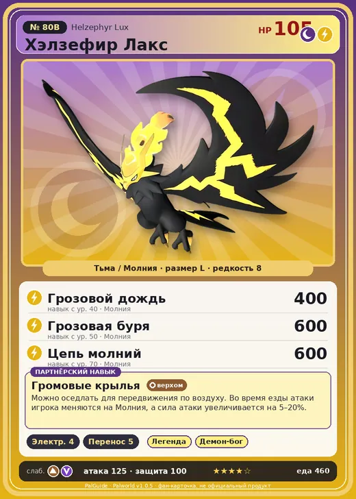

# #80B Хэлзефир Лакс (Helzephyr Lux)

№ 80B

ТьмаМолния

Слабость: ДраконЗемля

⚡ Генерация энергии <b>4</b>📦 Транспортировка <b>5</b>

<b>Громовые крылья</b> 🐎 верхом

❤️ 105 · ⚔️ 125 · 🛡 100

| Поле | Значение |
|---|---|
| Стихия | Тьма, Молния |
| Слабость (кто бьёт сильнее) | Дракон, Земля |
| Редкость | 8 |
| Размер | L |
| HP / Атака / Защита (база вида) | 105 / 125 / 100 |
| Сколько ест | 460 |
| Цена продажи | 2469 |
| Множитель поимки | ×1 |
| Скорость рывка верхом | 1100 |

=== "Обзор"

    #### Работа на базе
    - Генерация энергии — ур. 4
    - Транспортировка — ур. 5

    #### Партнёрский навык: Громовые крылья
    Можно оседлать для передвижения по воздуху. Во время езды атаки игрока меняются на Молния, а сила атаки увеличивается на 5–20%. Технологии 47.

    #### Чем хорош / чем плох
    - ✅ очень высокая атака (125); отличный рабочий (пригодность 5); можно оседлать; летает (ездовой)
    - ❌ разводится только особой парой

    > Призывает молнии из преисподней. Считается подвидом Хэлзефир , но есть версия, что Хэлзефир Лакс , получив удар молнии из преисподней, превратился в Хэлзефир .

    См. также: [Стихии](../../guide/06_stihii.md) · [Разведение](../../guide/07_razvedenie.md) · [Все палы](README.md)

=== "Атаки"

    #### Атаки по уровням
    - ур. 1: Искровой выстрел (Молния, сила 50)
    - ур. 7: Шоковая волна (Молния, сила 80)
    - ур. 15: Стрелы тьмы (Тьма, сила 120)
    - ур. 22: Кошмарная сфера (Тьма, сила 300)
    - ур. 30: Тройной разряд (Молния, сила 250)
    - ур. 40: Грозовой дождь (Молния, сила 400)
    - ур. 50: Грозовая буря (Молния, сила 600)
    - ур. 70: Цепь молний (Молния, сила 600)

=== "Где живёт"

    #### Где водится
    - В дикой природе: да; точек появления днём: 80, ночью: 80; уровни в первых точках: 47–48
    - Подземелья: Пещера Цветущей Сакуры
    - Яйцо: Огромное яйцо тьмы

=== "Дроп"

    #### Дроп
    - Электрический орган — 1–3 шт., 100%
    - Средняя душа Пала — 1 шт., 3%

    **Дроп альфы:**
    - Деталь древней цивилизации — 2–3 шт., 100%
    - Ценное перо — 2–3 шт., 100%

=== "Разведение"

    #### Разведение
    - Ранг разведения (CombiRank): 960
    - **Особая пара:** [Хэлзефир](../../4_spravochniki/paly/helzephyr.md) + [Райберд](../../4_spravochniki/paly/beakon.md)
    - Участвует в особых парах: Скорпио → Скорпио Лакс

=== "Пассивки"

    #### Лучшие пассивки по роли

    

⚔️ Боец

максимум урона и живучести в бою

<a class="psv r-4" data-psv="Легенда" href="../../../passivki/legend/">Легенда</a><a class="psv r-4" data-psv="Демон-бог" href="../../../passivki/demon_god/">Демон-бог</a><a class="psv r-3" data-psv="Король тьмы" href="../../../passivki/lord_of_the_underworld/">Король тьмы</a><a class="psv r-3" data-psv="Хладнокровный" href="../../../passivki/serenity/">Хладнокровный</a>

🛠 Рабочий

работает быстрее и меньше устаёт на базе

<a class="psv r-5" data-psv="Дьявольские руки" href="../../../passivki/demons_hand/">Дьявольские руки</a><a class="psv r-4" data-psv="Виртуоз" href="../../../passivki/remarkable_craftsmanship/">Виртуоз</a><a class="psv r-3" data-psv="Мастеровитый" href="../../../passivki/artisan/">Мастеровитый</a><a class="psv r-3" data-psv="Трудоголик" href="../../../passivki/workaholic/">Трудоголик</a>

🐎 Ездовой

быстрее бегает или летает с тобой верхом

<a class="psv r-4" data-psv="Божественная скорость" href="../../../passivki/swift/">Божественная скорость</a><a class="psv r-4" data-psv="Легенда" href="../../../passivki/legend/">Легенда</a><a class="psv r-4" data-psv="Вечный двигатель" href="../../../passivki/eternal_engine/">Вечный двигатель</a><a class="psv r-3" data-psv="Умелый бегун" href="../../../passivki/runner/">Умелый бегун</a>

    <small>Нажми на пассивку, чтобы узнать, что она даёт и где её взять.</small>

<a class="card-link" href="../helzephyr/">← Хэлзефир</a><a class="card-link" href="../elgrove/">Элгрув →</a>

