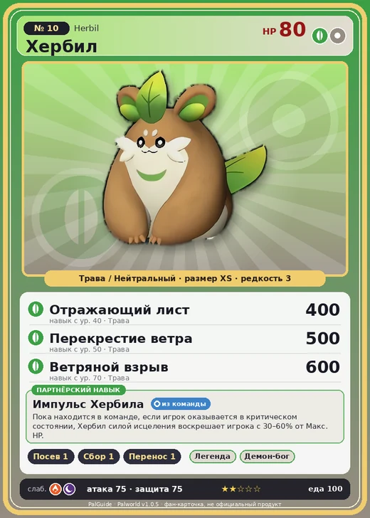

# #10 Хербил (Herbil)

#10 · Herbil

ТраваНейтральный

Слабость: ОгоньТьма

🌱 Посев семян <b>1</b>🌾 Сбор <b>1</b>📦 Транспортировка <b>1</b>

<b>Импульс Хербила</b> 🎒 из команды

❤️ 80 · ⚔️ 75 · 🛡 75

| Поле | Значение |
|---|---|
| Стихия | Трава, Нейтральный |
| Слабость (кто бьёт сильнее) | Огонь, Тьма |
| Редкость | 3 |
| Размер | XS |
| HP / Атака / Защита (база вида) | 80 / 75 / 75 |
| Сколько ест | 100 |
| Цена продажи | 541 |
| Множитель поимки | ×1 |
| Скорость рывка верхом | 600 |

## Работа на базе
- Посев семян — ур. 1
- Сбор — ур. 1
- Транспортировка — ур. 1

## Партнёрский навык: Импульс Хербила
Пока находится в команде, если игрок оказывается в критическом состоянии, Хербил силой исцеления воскрешает игрока с (30~60)% от Макс. HP. level value 1 MainValue 30 OverWriteCoolTime 700 Пробуждение : 2 MainValue 36 OverWriteCoolTime 660 Пробуждение : (Сокращение перезарядки: Небольшое ) 3 MainValue 42 OverWriteCoolTime 620 Пробуждение : (Сокращение перезарядки: Среднее ) 4 MainValue 48 OverWriteCoolTime 580 Пробуждение : (Сокращение перезарядки: Большое ) 5 MainValue 60 OverWriteCoolTime 520 Пробуждение : (Сокращение перезарядки: Очень большое )

## Атаки по уровням
- ур. 1: Ветряной клинок (Трава, сила 40)
- ур. 7: Семенной пулемёт (Трава, сила 80)
- ур. 15: Травяной торнадо (Трава, сила 200)
- ур. 22: Воздушные клинки (Нейтральный, сила 160)
- ур. 30: Перевёрнутый листок (Трава, сила 250)
- ур. 40: Отражающий лист (Трава, сила 400)
- ур. 50: Перекрестие ветра (Трава, сила 500)
- ур. 70: Ветряной взрыв (Трава, сила 600)

## Где водится
- В дикой природе: да; точек появления днём: 209, ночью: 209; уровни в первых точках: 1–10
- Подземелья: Пещера Горного Потока
- Может продаваться у торговца/рекрутера
- Яйцо: Яйцо свежей листвы

## Дроп
- Кожа — 1 шт., 100%
- Семена пшеницы — 1 шт., 100%

**Дроп альфы:**
- Деталь древней цивилизации — 2–3 шт., 100%
- Ценный мех — 2–3 шт., 100%

## Разведение
- Ранг разведения (CombiRank): 2630

## Лучшие пассивки по роли
- боец: Легенда, Демон-бог, Хладнокровный, Бессмертие, Король духов (вместо Бессмертия, если нет мутации)
- ездовой: Божественная скорость, Легенда, Вечный двигатель, Небесное скольжение

## Чем хорош / чем плох
- ✅ можно оседлать
- ❌ слабая атака (75)

> Он считает, что любую поломку можно исправить простым ударом. Сила Хербил идеально рассчитана для человека — одного удара достаточно, чтобы снова запустить остановившееся сердце.

См. также: [Стихии](../../2_mehaniki/stihii.md) · [Разведение](../../2_mehaniki/razvedenie.md) · [Все палы](README.md)
_Источник: paldb.cc v1.0.5_
