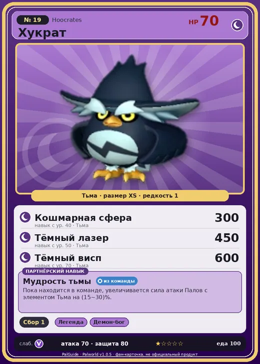

# #19 Хукрат (Hoocrates)

№ 19

Тьма

Слабость: Дракон

🌾 Сбор <b>1</b>

<b>Мудрость тьмы</b> 🎒 из команды

❤️ 70 · ⚔️ 70 · 🛡 80

| Поле | Значение |
|---|---|
| Стихия | Тьма |
| Слабость (кто бьёт сильнее) | Дракон |
| Редкость | 1 |
| Размер | XS |
| HP / Атака / Защита (база вида) | 70 / 70 / 80 |
| Сколько ест | 100 |
| Цена продажи | 443 |
| Множитель поимки | ×1 |
| Скорость рывка верхом | 550 |

## Работа на базе
- Сбор — ур. 1

## Партнёрский навык: Мудрость тьмы
Пока находится в команде, увеличивается сила атаки Палов с элементом Тьма на (15~30)% . level value 1 AttackUp_Dark_PartnerSkill 15 2 AttackUp_Dark_PartnerSkill 17 3 AttackUp_Dark_PartnerSkill 20 4 AttackUp_Dark_PartnerSkill 24 5 AttackUp_Dark_PartnerSkill 30

## Атаки по уровням
- ур. 1: Воздушная пушка (Нейтральный, сила 40)
- ур. 7: Тёмный шар (Тьма, сила 50)
- ур. 15: Теневой взрыв (Тьма, сила 80)
- ур. 22: Песчаный вихрь (Земля, сила 200)
- ур. 30: Духовное пламя (Тьма, сила 200)
- ур. 40: Кошмарная сфера (Тьма, сила 300)
- ур. 50: Тёмный лазер (Тьма, сила 450)
- ур. 70: Тёмный висп (Тьма, сила 600)

## Где водится
- В дикой природе: да; точек появления днём: 2, ночью: 266; уровни в первых точках: 4–7
- Подземелья: Пещера Отдалённого Острова, Пещера Холмов
- Яйцо: Яйцо тьмы

## Дроп
- Волокно — 5–10 шт., 100%
- Книга высоких технологий — 1 шт., 1%

**Дроп альфы:**
- Деталь древней цивилизации — 1–3 шт., 100%
- Книга высоких технологий — 1 шт., 1%
- Ценное перо — 1–3 шт., 100%

## Разведение
- Ранг разведения (CombiRank): 2940

## Лучшие пассивки по роли
- боец: Легенда, Демон-бог, Хладнокровный, Бессмертие, Король тьмы (вместо Бессмертия, если нет мутации)
- ездовой: Божественная скорость, Легенда, Вечный двигатель, Небесное скольжение

## Чем хорош / чем плох
- ✅ можно оседлать
- ❌ слабая атака (70)

> Часто предаётся раздумьям и не может уснуть от собственных мыслей. |Я мыслю, следовательно, я существую|.

См. также: [Стихии](../../guide/06_stihii.md) · [Разведение](../../guide/07_razvedenie.md) · [Все палы](README.md)
