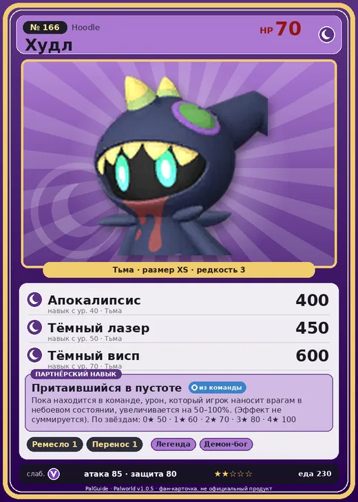

# #166 Худл (Hoodle)

#166 · Hoodle

Тьма

Слабость: Дракон

🖐️ Ручная работа <b>1</b>📦 Транспортировка <b>1</b>

<b>Притаившийся в пустоте</b> 🎒 из команды

❤️ 70 · ⚔️ 85 · 🛡 80

| Поле | Значение |
|---|---|
| Стихия | Тьма |
| Слабость (кто бьёт сильнее) | Дракон |
| Редкость | 3 |
| Размер | XS |
| HP / Атака / Защита (база вида) | 70 / 85 / 80 |
| Сколько ест | 230 |
| Цена продажи | 1656 |
| Множитель поимки | ×1 |
| Скорость рывка верхом | 550 |

## Работа на базе
- Ручная работа — ур. 1
- Транспортировка — ур. 1

## Партнёрский навык: Притаившийся в пустоте
Пока находится в команде, урон, который игрок наносит врагам в небоевом состоянии, увеличивается на (50~100)% . (Эффект не суммируется) level value 1 HoodGhost_PartnerSkill 50 2 HoodGhost_PartnerSkill 60 3 HoodGhost_PartnerSkill 70 4 HoodGhost_PartnerSkill 80 5 HoodGhost_PartnerSkill 100

## Атаки по уровням
- ур. 1: Тёмный шар (Тьма, сила 50)
- ур. 7: Тёмная пушка (Тьма, сила 70)
- ур. 15: Теневой взрыв (Тьма, сила 80)
- ур. 22: Духовное пламя (Тьма, сила 200)
- ур. 30: Кошмарная сфера (Тьма, сила 300)
- ур. 40: Апокалипсис (Тьма, сила 400)
- ур. 50: Тёмный лазер (Тьма, сила 450)
- ур. 70: Тёмный висп (Тьма, сила 600)

## Где водится
- В дикой природе: да; точек появления днём: 37, ночью: 115
- Яйцо: Яйцо тьмы

## Дроп
- Маленькая душа Пала — 1–2 шт., 100%
- Рог — 1–2 шт., 100%

**Дроп альфы:**
- Деталь древней цивилизации — 1–2 шт., 100%
- Ценные внутренности — 2–3 шт., 100%

## Разведение
- Ранг разведения (CombiRank): 1770

## Лучшие пассивки по роли
- боец: Легенда, Демон-бог, Хладнокровный, Бессмертие, Король тьмы (вместо Бессмертия, если нет мутации)
- ездовой: Божественная скорость, Легенда, Вечный двигатель, Небесное скольжение

## Чем хорош / чем плох
- ✅ можно оседлать
- ❌ явных минусов нет

> Сжимается во сне. Во сне его нет. Поскольку во сне Худл не существует, Худл не спит.

См. также: [Стихии](../../guide/06_stihii.md) · [Разведение](../../guide/07_razvedenie.md) · [Все палы](README.md)
