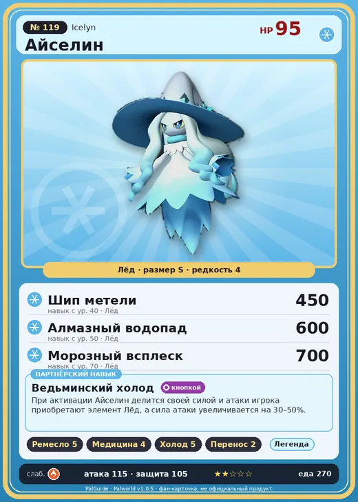

# #119 Айселин (Icelyn)

№ 119

Лёд

Слабость: Огонь

🖐️ Ручная работа <b>5</b>💊 Фармацевтика <b>4</b>❄️ Охлаждение <b>5</b>📦 Транспортировка <b>2</b>

<b>Ведьминский холод</b> 🔘 кнопкой

❤️ 95 · ⚔️ 115 · 🛡 105

| Поле | Значение |
|---|---|
| Стихия | Лёд |
| Слабость (кто бьёт сильнее) | Огонь |
| Редкость | 4 |
| Размер | S |
| HP / Атака / Защита (база вида) | 95 / 115 / 105 |
| Сколько ест | 270 |
| Цена продажи | 2277 |
| Множитель поимки | ×1 |
| Скорость рывка верхом | 600 |

## Работа на базе
- Ручная работа — ур. 5
- Фармацевтика — ур. 4
- Охлаждение — ур. 5
- Транспортировка — ур. 2

## Партнёрский навык: Ведьминский холод
При активации Айселин делится своей силой и атаки игрока приобретают элемент Лёд , а сила атаки увеличивается на (30~50)% .

## Атаки по уровням
- ур. 1: Ледяная ракета (Лёд, сила 40)
- ур. 7: Ледяной резак (Лёд, сила 80)
- ур. 15: Айсберг (Лёд, сила 120)
- ур. 22: Ледяное дыхание (Лёд, сила 160)
- ур. 30: Ледяная стена (Лёд, сила 200)
- ур. 40: Шип метели (Лёд, сила 450)
- ур. 50: Алмазный водопад (Лёд, сила 600)
- ур. 70: Морозный всплеск (Лёд, сила 700)

## Где водится
- В дикой природе: да; точек появления днём: 38, ночью: 38
- Яйцо: Яйцо льда

## Дроп
- Ледяной орган — 1–2 шт., 100%

**Дроп альфы:**
- Деталь древней цивилизации — 2–3 шт., 100%
- Ценное перо — 2–3 шт., 100%

## Разведение
- Ранг разведения (CombiRank): 1260

## Лучшие пассивки по роли
- боец: Легенда, Демон-бог, Хладнокровный, Бессмертие, Император льда (вместо Бессмертия, если нет мутации)
- рабочий: Дьявольские руки, Виртуоз, Мастеровитый, Небожитель/Трудоголик
- ездовой: Божественная скорость, Легенда, Вечный двигатель, Небесное скольжение

## Чем хорош / чем плох
- ✅ хорошая атака (115); отличный рабочий (пригодность 5); можно оседлать
- ❌ явных минусов нет

> Когда жарко, его тело начинает таять, но он ничего не может с собой поделать — слишком уж любит солнечные ванны. От тепла он тоже начинает плавиться, но страсть к горячим источникам сильнее. По его мнению, если уж умирать — то лучше растаять в открытом горячем источнике под ясным небом.

См. также: [Стихии](../../guide/06_stihii.md) · [Разведение](../../guide/07_razvedenie.md) · [Все палы](README.md)
