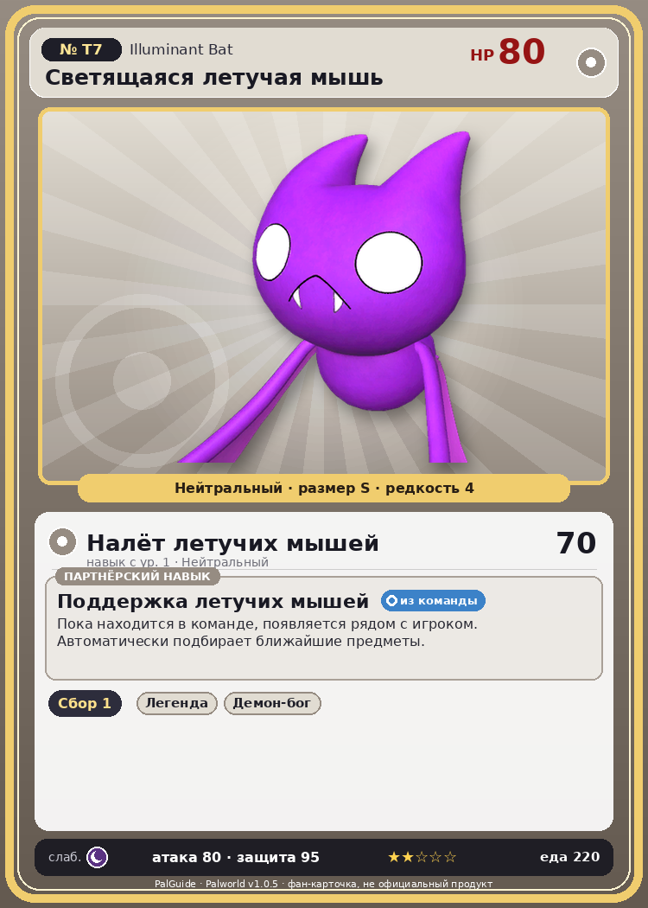

# #T7 Светящаяся летучая мышь (Illuminant Bat)

{ width=360 }

| Поле | Значение |
|---|---|
| Стихия | Нейтральный |
| Слабость (кто бьёт сильнее) | Тьма |
| Редкость | 4 |
| Размер | S |
| HP / Атака / Защита (база вида) | 80 / 80 / 95 |
| Сколько ест | 220 |
| Цена продажи | 1250 |
| Множитель поимки | ×1 |
| Скорость рывка верхом | 450 |
| Коллаборация | Terraria (остров Якусима) (нет в Палпедии) |

## Работа на базе
- Сбор — ур. 1

## Партнёрский навык: Поддержка летучих мышей
Пока находится в команде, появляется рядом с игроком. Автоматически подбирает ближайшие предметы.

## Атаки по уровням
- ур. 1: Налёт летучих мышей (Нейтральный, сила 70)

## Где водится
- В дикой природе: да; точек появления днём: ?, ночью: ?
- Яйцо: Обычное яйцо

## Дроп
- Святой слиток — 2–4 шт., 100%

## Разведение
- Ранг разведения (CombiRank): 3100

## Лучшие пассивки по роли
- боец: Легенда, Демон-бог, Хладнокровный, Бессмертие, Святое небо (вместо Бессмертия, если нет мутации)
- ездовой: Божественная скорость, Легенда, Вечный двигатель, Небесное скольжение

## Чем хорош / чем плох
- ✅ можно оседлать
- ❌ явных минусов нет

> [Коллаборация с Terraria] Монстр из другого мира. Похоже, здесь его можно приручить.

См. также: [Стихии](../../2_mehaniki/stihii.md) · [Разведение](../../2_mehaniki/razvedenie.md) · [Все палы](README.md)
_Источник: paldb.cc v1.0.5_
