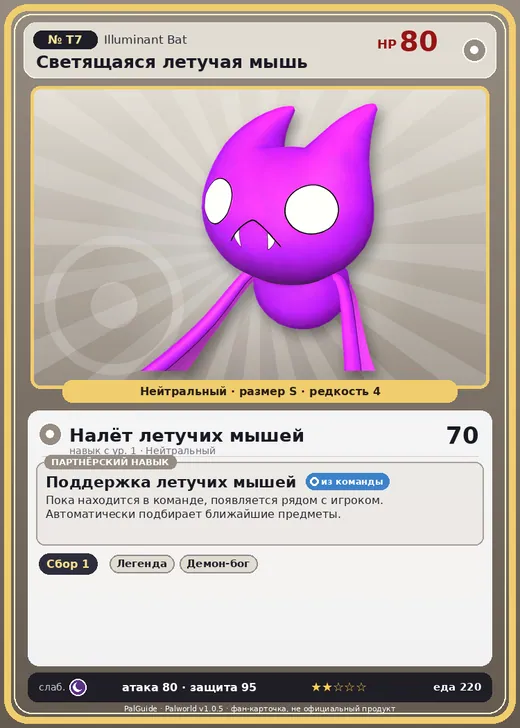

# #T7 Светящаяся летучая мышь (Illuminant Bat)

№ T7

Нейтральный

Слабость: Тьма

🌾 Сбор <b>1</b>

<b>Поддержка летучих мышей</b> 🎒 из команды

❤️ 80 · ⚔️ 80 · 🛡 95

| Поле | Значение |
|---|---|
| Стихия | Нейтральный |
| Слабость (кто бьёт сильнее) | Тьма |
| Редкость | 4 |
| Размер | S |
| HP / Атака / Защита (база вида) | 80 / 80 / 95 |
| Сколько ест | 220 |
| Цена продажи | 1250 |
| Множитель поимки | ×1 |
| Скорость рывка верхом | 450 |
| Коллаборация | Terraria (остров Якусима) (нет в Палпедии) |

=== "Обзор"

    #### Работа на базе
    - Сбор — ур. 1

    #### Партнёрский навык: Поддержка летучих мышей
    Пока находится в команде, появляется рядом с игроком. Автоматически подбирает ближайшие предметы.

    #### Чем хорош / чем плох
    - ✅
    - ❌ явных минусов нет

    > [Коллаборация с Terraria] Монстр из другого мира. Похоже, здесь его можно приручить.

    См. также: [Стихии](../../guide/06_stihii.md) · [Разведение](../../guide/07_razvedenie.md) · [Все палы](README.md)

=== "Атаки"

    #### Атаки по уровням
    - ур. 1: Налёт летучих мышей (Нейтральный, сила 70)

=== "Где живёт"

    #### Где водится
    - В дикой природе: да; точек появления днём: ?, ночью: ?
    - Яйцо: Обычное яйцо

=== "Дроп"

    #### Дроп
    - Святой слиток — 2–4 шт., 100%

=== "Разведение"

    #### Разведение
    - Ранг разведения (CombiRank): 3100

=== "Пассивки"

    #### Лучшие пассивки по роли

    

⚔️ Боец

максимум урона и живучести в бою

<a class="psv r-4" data-psv="Легенда" href="../../../passivki/legend/">Легенда</a><a class="psv r-4" data-psv="Демон-бог" href="../../../passivki/demon_god/">Демон-бог</a><a class="psv r-3" data-psv="Святое небо" href="../../../passivki/celestial_emperor/">Святое небо</a><a class="psv r-3" data-psv="Хладнокровный" href="../../../passivki/serenity/">Хладнокровный</a>

    <small>Нажми на пассивку, чтобы узнать, что она даёт и где её взять.</small>

<a class="card-link" href="../green_slime/">← Зеленый слизень</a><a class="card-link" href="../illuminant_slime/">Светящийся слизень →</a>

