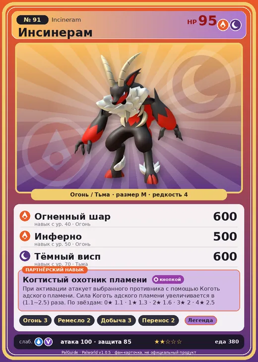

# Инсинерам

<canvas id="fx"></canvas>

№ 91 · Incineram

ОгоньТьма

Слабость: ВодаДракон

🔥 Разжигание огня <b>3</b>🖐️ Ручная работа <b>2</b>⛏️ Добыча <b>3</b>📦 Транспортировка <b>2</b>

<b>Когтистый охотник пламени</b> 🔘 кнопкой

❤️ 95 · ⚔️ 100 · 🛡 85

| Поле | Значение |
|---|---|
| Стихия | Огонь, Тьма |
| Слабость (кто бьёт сильнее) | Вода, Дракон |
| Редкость | 4 |
| Размер | M |
| HP / Атака / Защита (база вида) | 95 / 100 / 85 |
| Сколько ест | 380 |
| Цена продажи | 1325 |
| Множитель поимки | ×1 |
| Скорость рывка верхом | 960 |

=== "Обзор"

    #### Работа на базе
    - Разжигание огня — ур. 3
    - Ручная работа — ур. 2
    - Добыча — ур. 3
    - Транспортировка — ур. 2

    #### Партнёрский навык: Когтистый охотник пламени
    При активации атакует выбранного противника с помощью Коготь адского пламени. Сила Коготь адского пламени увеличивается в (1.1~2.5) раза. По звёздам: 0★ 1.1 · 1★ 1.3 · 2★ 1.6 · 3★ 2 · 4★ 2.5

    #### Чем хорош / чем плох
    - ✅ хорошая атака (100)
    - ❌ явных минусов нет

    > По ночам он хватает добычу и тащит её в своё логово. Нетрудно представить, через что придётся пройти попавшимся Палам.

    См. также: [Стихии](../../guide/06_stihii.md) · [Разведение](../../guide/07_razvedenie.md) · [Все палы](README.md)

=== "Атаки"

    #### Атаки по уровням
    - ур. 1: Огненный выстрел (Огонь, сила 40)
    - ур. 7: Расщеплённый огонь (Огонь, сила 80)
    - ур. 15: Огненная стрела (Огонь, сила 120)
    - ур. 22: Коготь адского пламени (Огонь, сила 200)
    - ур. 30: Теневой взрыв (Тьма, сила 80)
    - ур. 40: Огненный шар (Огонь, сила 600)
    - ур. 50: Инферно (Огонь, сила 500)
    - ур. 70: Тёмный висп (Тьма, сила 600)

=== "Где живёт"

    #### Где водится
    - В дикой природе: да; точек появления днём: 107, ночью: 107; уровни в первых точках: 30–34
    - Подземелья: Пещера Вулкана
    - Может продаваться у торговца/рекрутера
    - Яйцо: Раскалённое яйцо

=== "Дроп"

    #### Дроп
    - Рог — 1 шт., 100%
    - Кожа — 1 шт., 100%

    **Дроп альфы:**
    - Деталь древней цивилизации — 2–3 шт., 100%
    - Ценный коготь — 2–3 шт., 100%

=== "Разведение"

    #### Разведение
    - Ранг разведения (CombiRank): 1470
    - Участвует в особых парах: Мараит → Инсинерам Нокт

=== "Пассивки"

    #### Лучшие пассивки по роли

    

⚔️ Боец

максимум урона и живучести в бою

<a class="psv r-4" data-psv="Легенда" href="../../../passivki/legend/">Легенда</a><a class="psv r-4" data-psv="Демон-бог" href="../../../passivki/demon_god/">Демон-бог</a><a class="psv r-3" data-psv="Император огня" href="../../../passivki/flame_emperor/">Император огня</a><a class="psv r-3" data-psv="Хладнокровный" href="../../../passivki/serenity/">Хладнокровный</a>

🛠 Рабочий

работает быстрее и меньше устаёт на базе

<a class="psv r-5" data-psv="Дьявольские руки" href="../../../passivki/demons_hand/">Дьявольские руки</a><a class="psv r-4" data-psv="Виртуоз" href="../../../passivki/remarkable_craftsmanship/">Виртуоз</a><a class="psv r-3" data-psv="Мастеровитый" href="../../../passivki/artisan/">Мастеровитый</a><a class="psv r-3" data-psv="Трудоголик" href="../../../passivki/workaholic/">Трудоголик</a>

    <small>Нажми на пассивку, чтобы узнать, что она даёт и где её взять.</small>

<a class="card-link" href="../leafan/">← Лифан</a><a class="card-link" href="../incineram_noct/">Инсинерам Нокт →</a>

