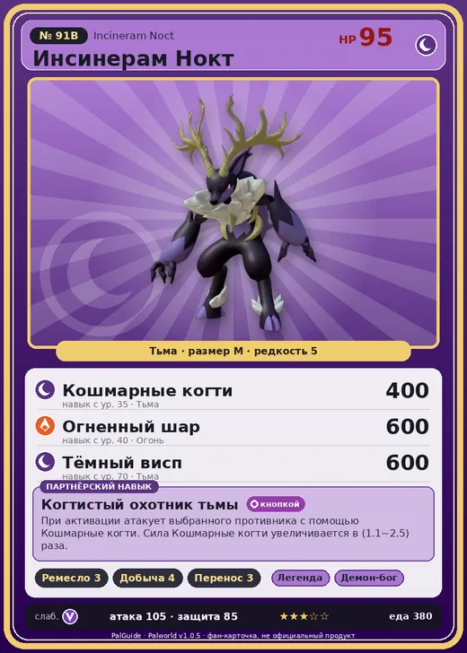

# #91B Инсинерам Нокт (Incineram Noct)

#91B · Incineram Noct

Тьма

Слабость: Дракон

🖐️ Ручная работа <b>3</b>⛏️ Добыча <b>4</b>📦 Транспортировка <b>3</b>

<b>Когтистый охотник тьмы</b> 🔘 кнопкой

❤️ 95 · ⚔️ 105 · 🛡 85

| Поле | Значение |
|---|---|
| Стихия | Тьма |
| Слабость (кто бьёт сильнее) | Дракон |
| Редкость | 5 |
| Размер | M |
| HP / Атака / Защита (база вида) | 95 / 105 / 85 |
| Сколько ест | 380 |
| Цена продажи | 2036 |
| Множитель поимки | ×1 |
| Скорость рывка верхом | 960 |

## Работа на базе
- Ручная работа — ур. 3
- Добыча — ур. 4
- Транспортировка — ур. 3

## Партнёрский навык: Когтистый охотник тьмы
При активации атакует выбранного противника с помощью Кошмарные когти . Сила Кошмарные когти увеличивается в (1.1~2.5) раза . level value 1 MainValue 1.1 2 MainValue 1.3 3 MainValue 1.6 4 MainValue 2 5 MainValue 2.5

## Атаки по уровням
- ур. 1: Огненный выстрел (Огонь, сила 40)
- ур. 7: Расщеплённый огонь (Огонь, сила 80)
- ур. 15: Огненная стрела (Огонь, сила 120)
- ур. 22: Коготь адского пламени (Огонь, сила 200)
- ур. 30: Теневой взрыв (Тьма, сила 80)
- ур. 35: Кошмарные когти (Тьма, сила 400)
- ур. 40: Огненный шар (Огонь, сила 600)
- ур. 50: Инферно (Огонь, сила 500)
- ур. 70: Тёмный висп (Тьма, сила 600)

## Где водится
- В дикой природе: да; точек появления днём: 16, ночью: 16
- Яйцо: Большое яйцо тьмы

## Дроп
- Рог — 1 шт., 100%
- Кожа — 1 шт., 100%

**Дроп альфы:**
- Деталь древней цивилизации — 2–3 шт., 100%
- Ценный коготь — 2–3 шт., 100%

## Разведение
- Ранг разведения (CombiRank): 1310
- **Особая пара:** [Инсинерам](../../4_spravochniki/paly/incineram.md) + [Мараит](../../4_spravochniki/paly/maraith.md)

## Лучшие пассивки по роли
- боец: Легенда, Демон-бог, Хладнокровный, Бессмертие, Король тьмы (вместо Бессмертия, если нет мутации)
- рабочий: Дьявольские руки, Виртуоз, Мастеровитый, Небожитель/Трудоголик
- ездовой: Божественная скорость, Легенда, Вечный двигатель, Небесное скольжение

## Чем хорош / чем плох
- ✅ хорошая атака (105); можно оседлать
- ❌ разводится только особой парой

> Целенаправленно охотится на детёнышей Палов, утаскивая их в своё логово. Нетрудно представить, в какое отчаяние впадают их родители.

См. также: [Стихии](../../2_mehaniki/stihii.md) · [Разведение](../../2_mehaniki/razvedenie.md) · [Все палы](README.md)
_Источник: paldb.cc v1.0.5_
